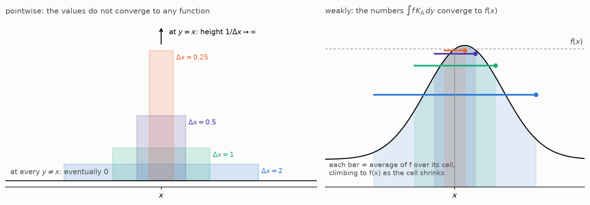

*A guest post by Ivan Petrov, edited together for the quantum road — the
first of, we hope, many.*

[Last time](/posts/states-are-vectors/#when-the-menu-is-infinite) the
quantum road reached the continuous menu. A particle on a line has a
position, every real number is a possible reading, and the state had
to be written as an integral over position kets:

$$
|\psi\rangle = \int \psi(x)\, |x\rangle\, dx.
$$

That line was written on credit twice over. What exactly is the ket
$|x\rangle$ — and what is $\langle x | y \rangle$, the inner product of
two of them? For a discrete orthonormal basis the answer was the
Kronecker delta, $\langle E_i | E_j \rangle = \delta_{ij}$. For the
continuous basis it *cannot* be, and finding out what replaces it is
this post's whole job. The answer is an old friend of this blog: the
**Dirac delta**, which the Fourier road's
[Part 1](/posts/fourier-series-to-spectrogram-part-1/#an-honest-model-of-a-discrete-signal)
built as the limit of a shrinking averaging window. Today it will
arrive by a completely different road — as the limit of an
orthonormal grid — and the two roads will meet at the same object.

The Dirac delta is usually handed to you as-is: a "function" that is
zero everywhere except at a single point, where it is infinitely
tall, and which somehow integrates to one. What actually defines it is
the **sifting property**,

$$
\int_{-\infty}^{\infty} f(y)\, \delta(x - y)\, dy = f(x),
$$

which says that integrating any function against $\delta(x - y)$
plucks out its value at $y = x$. Very useful — but where does such a
thing come from? We will derive it from the Kronecker delta, by
discretizing the continuous inner product and refusing to cheat at any
step.

## The Kronecker delta

In finite dimensions an orthonormal basis $\{ |E_i\rangle \}$ satisfies

$$
\langle E_i | E_j \rangle = \delta_{ij} = \begin{cases} 1 & i = j \\ 0 & i \neq j \end{cases}
$$

— the Kronecker delta of the last post. Expand two vectors,
$|\psi\rangle = \sum_i a_i |E_i\rangle$ and
$|\varphi\rangle = \sum_j b_j |E_j\rangle$, and the inner product
collapses:

$$
\langle \psi | \varphi \rangle = \sum_i \sum_j a_i^* \, b_j \, \langle E_i | E_j \rangle = \sum_i \sum_j a_i^* \, b_j \, \delta_{ij} = \sum_i a_i^* \, b_i.
$$

The $\delta_{ij}$ acts as a **diagonal selector**: it removes every
term of the double sum except those on the diagonal $i = j$.

Now move to the continuous setting — a particle on the real line, where
the "basis" is indexed by a continuous label $x \in \mathbb R$ rather
than an integer $i$. We would like an analogue of the Kronecker delta:
some object $\langle x | y \rangle$ that selects the diagonal $x = y$
inside an *integral* instead of a sum. The rest of the post shows that
this object is forced to be the Dirac delta $\delta(x - y)$, and says
precisely in what sense.

## The inner product of two continuous superpositions

Start where the last post left off: with honest vectors. A state
with $n$ possible outcomes was a vector with $n$ coordinates,

$$
|\psi\rangle = \sum_{i=1}^{n} a_i\, |E_i\rangle, \qquad a_i = \langle E_i | \psi \rangle,
$$

and the list $(a_1, \dots, a_n)$ is all there is to know about it. Look
at that list as a *function*: it assigns a number to each index, so a
vector in $\mathbb C^n$ is a function $\{1, \dots, n\} \to \mathbb C$,
and the expansion above just says "coordinates times unit vectors".
Now let the menu grow. More outcomes — a longer list, still one
coordinate per index. A continuum of outcomes — one index per real
number $x$ — and the list of coordinates *is* a function on the line.
That is the whole insight: **a vector with a continuum of coordinates
is a function**, and the function is what the last post called the
wavefunction, $a(x) = \langle x | \psi \rangle$.

With that in mind, take two states written the way the last post
wrote them,

$$
|\psi\rangle = \int a(x)\, |x\rangle\, dx, \qquad |\varphi\rangle = \int b(y)\, |y\rangle\, dy
$$

(we write $a$ and $b$ rather than $\psi$ and $\varphi$ to keep the two
states apart). Each formula is the same statement as the finite one,
"coordinates times unit vectors", with the sum over indices turned
into an integral; the state and its wavefunction are one object.

### What the coordinate objects must do

In the finite case the coordinates come out of the basis by a one-line
computation, which the
[last post](/posts/states-are-vectors/#coordinates-and-a-formula-for-the-identity-operator)
did: hit the expansion with a basis bra, and orthonormality collapses
the sum,

$$
\langle E_k | \psi \rangle = \sum_i a_i\, \langle E_k | E_i \rangle = \sum_i a_i\, \delta_{ki} = a_k.
$$

"Coordinates are inner products", and the Kronecker delta is what
makes it work. The continuum version of this is the one property we
ask of the position kets: that they return the coordinates of every
state the same way,

$$
\langle x | \psi \rangle = a(x) \qquad \text{for every state } |\psi\rangle.
$$

Expand $|\psi\rangle$ inside the bracket, and the requirement becomes a
statement about the unknown $\langle x | y \rangle$:

$$
a(x) = \int \langle x | y \rangle\, a(y)\, dy.
$$

Read it as the continuous twin of the Kronecker line above:
$\langle x | y \rangle$, as a function of $y$, must do inside an
integral what $\delta_{ki}$ does inside a sum — kill every contribution
except the one at $y = x$ and return the coordinate there. The sifting
property from the opening of the post is therefore not a definition
handed down from above; it is the *requirement* that the position kets
be a basis in the sense of the last post. We will call a ket with this
property a **coordinate object** for the point $x$.

### The inner product, assuming the coordinate objects exist

Suppose for a moment that such objects exist. Then the inner product
of our two states follows in one line. Expand only the bra, pull the
integral out of the first slot — anti-linearity, which conjugates $a$
— and apply the requirement to what remains:

$$
\langle \psi | \varphi \rangle = \Big\langle \int a(x)\, |x\rangle\, dx \;\Big|\; \varphi \Big\rangle = \int a(x)^*\, \langle x | \varphi \rangle\, dx = \int a(x)^*\, b(x)\, dx.
$$

The right-hand side is the inner product of the
[space of square-integrable wavefunctions](/posts/states-are-vectors/#when-the-menu-is-infinite),
$L^2(\mathbb R)$, which the last post wrote down as
$\langle f | g \rangle = \int f^* g\, dx$.

The formula $\int a^* b\, dx$ is a definition that stands on its own: it makes sense for any two
square-integrable functions, needs no kets and no deltas, and
satisfies the axioms of an inner product from the last post — linear
in $b$, conjugate-linear in $a$, and $\int |a|^2\, dx \gt 0$ unless $a$
is zero. What the line above adds is a *consistency* statement: if
the position kets meet the requirement, the inner product computed
through the kets coincides with the inner product of $L^2$. So there
is one honest inner product in play, that of $L^2$, and the kets are
to be built to match it.

A word on the functions themselves. A state must be
**square-integrable**, $\int |a(x)|^2\, dx \lt \infty$ (for a state the
length is in fact $1$: total probability one). Square-integrability
guarantees that $\int a^* b\, dx$ converges (by the
[Cauchy–Schwarz inequality](https://en.wikipedia.org/wiki/Cauchy%E2%80%93Schwarz_inequality))
and that every sum below is finite. We assume $a$ and $b$ continuous
as well, which is what the Riemann sums need.

One step of the derivation was taken on trust. The last post allowed
a finite sum to come out of a bracket; here we let an *integral* of
kets come out. Nothing so far says that this is legitimate. The
construction below will make it so: it only ever takes integrals over
kets as limits of finite sums, and the finite sums come out of a
bracket by the last post's rule.

### Why the coordinate objects cannot be functions

What *is* exotic in all this is the unit vectors. Try to
write the ket $|x_0\rangle$ as a function of the index, the way we
just wrote states: "a $1$ at $x_0$ and $0$ everywhere else". That
function exists, but it is useless — its squared length
$\int |f|^2\, dx$ is zero, so in $L^2$ it is the zero vector, orthogonal
to everything, and no unit vector.

Nor does a repaired candidate help — a narrow bump of unit norm, say.
Any attempt of this kind fails for the same reason, and the reason is
general: no function whatsoever can satisfy the requirement. Recall
what it asks of $\langle x | y \rangle$:

$$
a(x) = \int \langle x | y \rangle\, a(y)\, dy \qquad \text{for every state } a.
$$

Suppose $\langle x | y \rangle$ were an ordinary function of two
variables, $K(x, y)$. The requirement would then read

$$
a(x) = \int K(x, y)\, a(y)\, dy \qquad \text{for every continuous } a,
$$

and this is impossible. Fix $x$ and take two continuous functions
$a_1$ and $a_2$ that are equal everywhere except on a tiny interval
of width $\varepsilon$ around $y = x$, where $a_2$ rises above $a_1$
by a narrow bump of height $1$.

The left-hand sides differ by
$a_2(x) - a_1(x) = 1$. The right-hand sides differ by

$$
\int K(x, y)\, \big(a_2(y) - a_1(y)\big)\, dy,
$$

an integral over an interval of width $\varepsilon$ of a function
bounded by $\max |K|$ — at most $\varepsilon \cdot \max |K|$, which
goes to zero as the bump narrows. One side of the equation differs by $1$, the other by as little as we
like — and all we used about $K$ was that, being a function, it
assigns one finite value to every point of its domain, $y = x$
included, so it is bounded there. No function $K$ can satisfy the
requirement: returning $a(x)$ would take being "infinite with unit
area" at that single point, which a function by definition cannot be.

The object that actually does a
coordinate object's job is not a function at all, as the rest of the
post will show. Readers of the Fourier road
have met this exact predicament: in
[Part 1](/posts/fourier-series-to-spectrogram-part-1/#an-honest-model-of-a-discrete-signal)
the "perfect instrument" that reads off a signal's value at one
instant could not be a function either, and the Dirac delta had to
be built as a limit of averaging windows. Here the same object will
arrive from the opposite side.

### Building the coordinate objects from the finite-dimensional side

That opposite side is the finite-dimensional linear algebra of the
last post, where everything is a sum and nothing is exotic. The plan:
replace both integrals by Riemann sums, so that
$\langle \psi | \varphi \rangle$ becomes a finite computation and the
unknown becomes a finite table of numbers $\langle x_i | y_j \rangle$;
find which table satisfies the requirement in the limit; and read the
Dirac delta off that table's limit. Lay down a **grid** on the line: sample points
$x_1, x_2, \dots$ a fixed spacing $\Delta x$ apart — and keep only the
kets $|x_i\rangle$ at the grid points. On any bounded stretch of the
line these are finitely many, and we *declare* them to be the axes.
Replacing the integral by its Riemann sum over this grid gives the
**discretized states**

$$
|\psi_\Delta\rangle = \sum_i a(x_i)\, |x_i\rangle\, \Delta x, \qquad |\varphi_\Delta\rangle = \sum_j b(y_j)\, |y_j\rangle\, \Delta y
$$

We use the same grid for both states — the points $y_j$ are the
points $x_j$ and $\Delta y = \Delta x$; the second letter only keeps
the two sums apart. These are finite linear combinations of kets, so
everything we do with them is the finite-dimensional linear algebra of
the last post.

Compute the inner product of the two finite sums. By linearity in the
second slot and anti-linearity in the first — the two properties from
the last post — the sums come out of the bracket and the scalars come
out of the slots, the first-slot ones conjugated:

$$
\begin{aligned}
\langle \psi_\Delta | \varphi_\Delta \rangle &= \Big\langle \sum_i a(x_i)\, |x_i\rangle\, \Delta x \;\Big|\; \sum_j b(y_j)\, |y_j\rangle\, \Delta y \Big\rangle \\
&= \sum_i \sum_j a(x_i)^* \, b(y_j)\, \langle x_i | y_j \rangle\, \Delta x\, \Delta y.
\end{aligned}
$$

The kets $|x_i\rangle$ and $|y_j\rangle$ have fused into a single
scalar, $\langle x_i | y_j \rangle$. Call it the **kernel** of the
double sum,

$$
K_\Delta(x_i, y_j) := \langle x_i | y_j \rangle,
$$

and the main question of the post is: what is the kernel?

## A dead end: the naive Kronecker guess

It is tempting to say the kernel is just the Kronecker delta,
$\langle x_i | y_j \rangle \overset{?}{=} \delta_{ij}$ — the grid
kets are orthonormal, as any decent basis should be. Nothing forbids
the guess: we showed above that no *function* $K(x, y)$ on the line
can be the kernel, but on the grid the kernel is a finite table of
numbers, and any table is a legitimate candidate. The test is what its
limit does.

Test the guess against the requirement: hit the discretized state
with a grid bra. The $\delta_{ij}$ keeps one term of the sum,

$$
\langle x_i | \psi_\Delta \rangle = \sum_j a(y_j)\, \delta_{ij}\, \Delta y = a(x_i)\, \Delta x \;\xrightarrow{\;\Delta x \to 0\;}\; 0,
$$

and the kets return coordinates that vanish as the grid is refined,
instead of $a(x_i)$. The inner product fares the same way: in the
double sum the $\delta_{ij}$ collapses the $j$-sum, and what remains is

$$
\langle \psi_\Delta | \varphi_\Delta \rangle = \left( \sum_i a(x_i)^* \, b(x_i)\, \Delta x \right) \cdot \Delta x \;\xrightarrow{\;\Delta x \to 0\;}\; 0
$$

— a Riemann sum, which tends to the finite number $\int a^* b\, dx$,
times a leftover $\Delta x$, which tends to zero. With
$\langle x_i | y_j \rangle = \delta_{ij}$, *every* pair of states has
inner product zero in the limit — including a state with itself, so
every state has length zero.

This is the unit-vector problem from the previous section, seen from
the grid. Read the table $\delta_{ij}$ as a function of $y$ for fixed
$x_i$: it is $1$ on the one cell containing $x_i$ and $0$ elsewhere,
and as the grid is refined it settles into exactly the function "$1$
at $y = x$, $0$ everywhere else" — the zero vector of $L^2$ from the
figure above. The guess failed because its limit is a function, and
we already knew that a function cannot do the job. Here is the same
dead end numerically, next to the fix we are about to find:

## The right basis: cell states

The dead end is not a failure of the limit machinery. The limit
worked flawlessly and reported, correctly, what the table
$\langle x_i | y_j \rangle = \delta_{ij}$ implies: coordinates that
drain away. The table was the guess, and the table was wrong. We
cannot know the inner products of the grid kets in advance — they are
the very thing under construction — so instead of guessing them we
build the grid states from a basis we *define* to be orthonormal,
made of honest elements of $L^2$, and let linear algebra fix the
coefficients. Introduce a new symbol: let
$|\hat x_i\rangle$ be the **cell state** "the particle is somewhere in
cell $i$" — a cell of width $\Delta x$ around $x_i$,

$$
C_i = \left[\, x_i - \tfrac{\Delta x}{2},\; x_i + \tfrac{\Delta x}{2} \,\right],
$$

with $\mathbf 1_{C_i}$ for its **indicator function** — $1$ on the
cell, $0$ elsewhere. As a wavefunction the cell state is this flat
bump, scaled to unit norm:

$$
\hat x_i(x) = \frac{\mathbf 1_{C_i}(x)}{\sqrt{\Delta x}}.
$$

Let us check that the cell states are orthonormal. The product of two
indicators is the indicator of the intersection, so the inner product
of $L^2$ measures the overlap of two cells:

$$
\begin{aligned}
\langle \hat x_i | \hat x_j \rangle &= \frac{1}{\Delta x} \int \mathbf 1_{C_i}(x)\, \mathbf 1_{C_j}(x)\, dx \\
&= \frac{\text{length of } C_i \cap C_j}{\Delta x} = \delta_{ij},
\end{aligned}
$$

because distinct cells are disjoint and a cell has length
$\Delta x$. The Kronecker delta is back, but its indices now label
*intervals*, and the $1$ on the diagonal is a cell measured against
itself.
(This way of building a continuous basis from a lattice of cells is
how Shankar's *Principles of Quantum Mechanics* introduces
infinite-dimensional state spaces, §1.10; see the references.)

Note that, unlike $|x\rangle$, the
cell states are honest elements of $L^2$ — a cell state is the
indicator function of its cell, normalized. This corrects a picture
the word "grid" may have suggested: the grid kets we are about to
build are not the kets $|x\rangle$ of the continuum picked out at the
grid points and declared orthonormal — that was the dead end, and
the function "$1$ at a point" behind it is the zero vector of $L^2$ —
but states spread over a whole cell of width $\Delta x$, which stand
in for the points only as $\Delta x \to 0$.

Write the discretized state in the cell states,

$$
|\psi_\Delta\rangle = \sum_i c_i\, |\hat x_i\rangle,
$$

where the coefficients $c_i$ are, as always in an orthonormal basis,
inner products — the inner product of $L^2$, the one that needs no
kets:

$$
\begin{aligned}
c_i = \langle \hat x_i | \psi \rangle &= \int \hat x_i(y)^*\, a(y)\, dy \\
&= \frac{1}{\sqrt{\Delta x}} \int_{\text{cell } i} a(y)\, dy \\
&= a(\xi_i)\, \sqrt{\Delta x},
\end{aligned}
$$

the last step by the
[mean value theorem for integrals](https://en.wikipedia.org/wiki/Mean_value_theorem#Mean_value_theorems_for_definite_integrals):
for continuous $a$ the integral over the cell equals $a(\xi_i)\, \Delta x$
for some point $\xi_i$ of the cell. So the coordinate of a state along
a cell state is a sample of $a$ in the cell times $\sqrt{\Delta x}$.

This fixes the grid ket $|x_i\rangle$ of the original Riemann sum,
$|\psi_\Delta\rangle = \sum_i a(x_i)\, |x_i\rangle\, \Delta x$, whose
normalization was left open. Sample that sum at the points $\xi_i$
instead of $x_i$ — a Riemann sum may sample each cell anywhere — and
compare it with the expansion in cell states,
$|\psi_\Delta\rangle = \sum_i c_i\, |\hat x_i\rangle$ with
$c_i = a(\xi_i)\sqrt{\Delta x}$. Both describe the same state, so the
terms must agree cell by cell:

$$
\underbrace{a(\xi_i)\, \Delta x}_{\text{Riemann sum}}\; |x_i\rangle = \underbrace{a(\xi_i)\, \sqrt{\Delta x}}_{c_i}\; |\hat x_i\rangle \quad \Longrightarrow \quad |x_i\rangle = \frac{1}{\sqrt{\Delta x}}\, |\hat x_i\rangle.
$$

So the kernel is

$$
\langle x_i | y_j \rangle = \frac{1}{\Delta x}\, \langle \hat x_i | \hat x_j \rangle = \frac{\delta_{ij}}{\Delta x},
$$

with a factor $1/\Delta x$ that cancels the leftover $\Delta x$ of
the dead end. As a function of a point $y$ on the line, rather than
of a cell index, the kernel is the wavefunction of $|x_i\rangle$:

$$
K_\Delta(x_i, y) = \frac{\hat x_i(y)}{\sqrt{\Delta x}} = \frac{\mathbf 1_{C_i}(y)}{\Delta x},
$$

a step of height $1/\Delta x$ over the whole cell $C_i$, which on the
grid points reduces to the table $K_\Delta(x_i, y_j) = \delta_{ij}/\Delta x$.
This is the correctly normalized kernel:

$$
\boxed{\; \langle x_i | y_j \rangle = \frac{\delta_{ij}}{\Delta x} \;}
$$

Check it against the requirement. Hit the discretized state, sampled
at the $\xi_j$, with a grid bra:

$$
\langle x_i | \psi_\Delta \rangle = \sum_j a(\xi_j)\, \frac{\delta_{ij}}{\Delta x}\, \Delta y = a(\xi_i).
$$

On every grid the ket returns the sample of $a$ in its cell, with no
stray factor of $\Delta x$ to drain it away. What remains is to refine
the grid and see what this table of numbers, and the states built
from it, converge to — which is the next section.

## Taking the limit

The requirement first. Fix a target point $x$ — the only thing held
fixed from here on — let $i$ be the index of the cell containing it, and refine the grid.
The index $i$, the grid point $x_i$ and the sample $\xi_i$ all change
with the grid, but $x_i$ and $\xi_i$ lie in the cell around $x$, so
$|\xi_i - x| \leq \Delta x \to 0$, and by continuity of $a$

$$
\lim_{\Delta x \to 0} \langle x_i | \psi_\Delta \rangle = \lim_{\Delta x \to 0} a(\xi_i) = a(x).
$$

That is the requirement, $\langle x | \psi \rangle = a(x)$.

Next the inner product. The consistency statement at the start of
the post says that kets meeting the requirement reproduce the inner
product of $L^2$, $\langle \psi | \varphi \rangle = \int a(x)^* b(x)\, dx$;
the grid kets now meet it, so watch them do so. Substitute the
normalized kernel into the double sum and do the $j$-sum with
$\delta_{ij}$ first:

$$
\begin{aligned}
\langle \psi_\Delta | \varphi_\Delta \rangle &= \sum_i \sum_j a(x_i)^* \, b(y_j)\, \frac{\delta_{ij}}{\Delta x}\, \Delta x\, \Delta y \\
&= \sum_i a(x_i)^* \, b(x_i)\, \Delta x \;\xrightarrow{\;\Delta x \to 0\;}\; \int a(x)^* \, b(x)\, dx.
\end{aligned}
$$

The $1/\Delta x$ cancelled exactly one of the two spacings, leaving a
single honest Riemann sum, and the inner-product formula is
reproduced by the kets.

That settles the inner product, but not the kernel itself. We would
like to say what $K_\Delta = \delta_{ij} / \Delta x$ *converges to*,
and call that $\langle x | y \rangle$. Fix a point $x$ on the line, let $C_i$ be the cell containing it,
and look at $K_\Delta(x_i, y) = \mathbf 1_{C_i}(y) / \Delta x$ as a
function of $y$: a single spike of **width** $\Delta x$ and **height**
$1/\Delta x$ around $x$, hence of **area**

$$
\text{width} \times \text{height} = \Delta x \cdot \frac{1}{\Delta x} = 1.
$$

As $\Delta x \to 0$ the width shrinks to zero, the height diverges,
and the area stays pinned at one. This is exactly the picture people
draw for the Dirac delta.

So it is tempting to take the limit of $K_\Delta$ pointwise and call
the result $K(x, y)$. But that limit would be "$0$ everywhere except
at the single point $y = x$, infinite there" — and the section on the
coordinate objects showed that no function can play this part: a
function has one finite value at $y = x$, and a single point has no
width to contribute an area. The object we are reaching for is not a
function, so we cannot define $K(x, y)$ by its values. We fall back on
the definition from the introduction instead: the Dirac delta is
defined not by its values but by **what it does inside an integral** —
the sifting property. To identify $K$ with $\delta$ we will not take a
pointwise limit at all; we will show that $K$ *sifts*.

## The kernel is the Dirac delta

Recall from the opening of the post what defines the Dirac delta: the
**sifting property**, $\int f(y)\, \delta(x - y)\, dy = f(x)$ for
every continuous $f$ — integrating against it plucks out the value at
$y = x$. We have in fact already proved it. The limit computed at the
start of *Taking the limit*,

$$
\lim_{\Delta x \to 0} \; \sum_j a(\xi_j)\, K_\Delta(x_i, y_j)\, \Delta y = a(x),
$$

used nothing about $a$ except that it is continuous — not that it is
square-integrable, not that it is the wavefunction of a state. So the
same computation goes through, line for line, for an arbitrary
continuous function $f$ in place of $a$:

$$
\lim_{\Delta x \to 0} \; \sum_j f(\xi_j)\, K_\Delta(x_i, y_j)\, \Delta y = f(x) \qquad \text{for every continuous } f.
$$

This is the sifting property, with the integral on the left spelled
out as the limit of sums it stands for. We therefore *define* the
notation $\int f(y)\, K(x, y)\, dy$ to mean this limit, and with that
reading

$$
\int f(y)\, K(x, y)\, dy = f(x) \qquad \text{for every continuous } f.
$$

An object satisfying the sifting property for all continuous $f$ is,
by definition, the Dirac delta:

$$
\boxed{\; K(x, y) = \delta(x - y) \;}
$$

The two features of the spikes survive in this reading. The spike
was zero outside one cell; the delta has no values, but the sifting
property says that $\int f\, \delta(x - y)\, dy$ depends on $f$ only
through $f(x)$, which is the same thing said through integrals. The
spike had area one; with $f \equiv 1$ the sifting property gives
$\int \delta(x - y)\, dy = 1$.

Sifting in the $y$ variable collapses a double integral into a
single one,

$$
\iint a(x)^* \, b(y)\, \delta(x - y)\, dx\, dy = \int a(x)^* \, b(x)\, dx,
$$

selecting the diagonal of a double integral as $\delta_{ij}$ selects
the diagonal of a double sum. Since $K$ was defined as the limit of
$\langle x_i | y_j \rangle$, this also answers the second question of
the opening: for the position kets,

$$
\langle x | y \rangle = \delta(x - y),
$$

the continuous version of $\langle E_i | E_j \rangle = \delta_{ij}$.
Finally, the kets are the coordinate objects of the section on the
inner product: with the integral read as the limit above,
$\langle x | \psi \rangle = \int \langle x | y \rangle\, \psi(y)\, dy = \psi(x)$
for every state, which is the requirement.

(One detail of the test is worth a second look: the step of the grid
and the width of the spike went to zero *together*. Why that is
allowed, and why we chose to do it that way, is discussed in
[Appendix B](#appendix-b-why-one-grid-and-the-straight-road-not-taken).)

Note what we did **not** do: we never claimed the spikes converge as
functions. We tested against $f$, produced a limit of numbers, and
identified $K$ by its action. That is the only sense in which the
identification holds, and it has a name.

## Weak convergence

It is tempting to write

$$
\frac{\delta_{ij}}{\Delta x} \longrightarrow \delta(x - y),
$$

but read as an ordinary limit of functions this is wrong: the
pointwise limit of the spikes does not exist, and $\delta(x - y)$ is
not a function anyway. It is a **distribution** — an object defined
only by its action inside integrals. The correct statement is called
**weak convergence**: not the spikes themselves but their *integrals
against every continuous function* converge — for every continuous
$f$,

$$
\int f(y)\, K_\Delta(x_i, y)\, dy \;\xrightarrow{\;\Delta x \to 0\;}\; f(x),
$$

which is what the previous section proved, with the integral on the
left written as the sum $\sum_j f(\xi_j)\, K_\Delta(x_i, y_j)\, \Delta y$. The arrow above is universally
used as shorthand for this statement, and now we know what it
abbreviates.

 It also has a classical name: in Gelfand and Shilov's
*Generalized Functions*, vol. 1, a sequence of functions $f_\nu$ is
called **delta-like** if its integrals over any interval stay bounded
and $\int_a^b f_\nu \to 1$ when $a \lt 0 \lt b$ and $\to 0$ otherwise —
and every delta-like sequence converges weakly to $\delta$ (chapter I,
§2.5). Our spikes, read as step functions of width $\Delta x$ and
height $1/\Delta x$ centered at $x$, satisfy both conditions on sight,
so the identification above is a special case of that theorem.

## Summary

The Kronecker delta $\delta_{ij}$ and the Dirac delta $\delta(x - y)$
are one idea in two settings. The first selects the diagonal of a
double sum,

$$
\sum_i \sum_j a_i^* \, b_j\, \delta_{ij} = \sum_i a_i^* \, b_i;
$$

the second selects the diagonal of a double integral,

$$
\iint a(x)^* \, b(y)\, \delta(x - y)\, dx\, dy = \int a(x)^* \, b(x)\, dx.
$$

To get from the first to the second, the discrete kernel must be
rescaled by $1/\Delta x$, because that is the normalization a
continuous basis forces — the coordinate of a state along a unit cell
state is an inner product over the cell, $a(x_i)\sqrt{\Delta x}$, so
the amplitude of a cell carries a square root of the width;
physically, the probability of a cell is a density times a width — and the resulting spikes converge to $\delta(x - y)$ only in
the weak sense: not point by point, but through what they do to every
function they are integrated against. In short: the Dirac delta is
what the Kronecker delta becomes when a sum becomes an integral.

The opening asked two questions, and here are the answers.

*What is $\langle x | y \rangle$?* The Dirac delta, $\delta(x - y)$ —
the continuous version of $\langle E_i | E_j \rangle = \delta_{ij}$,
and the diagonal selector in a double integral.

*What is the ket $|x_0\rangle$?* Three answers, at three levels.

- **By what it does.** It is the object whose bra returns the
  coordinate at $x_0$: $\langle x_0 | \psi \rangle = \psi(x_0)$ for
  every state. This is the definition; everything else follows from
  it.
- **By how it is built.** It is the limit of the cell states rescaled
  by $1/\sqrt{\Delta x}$ — a limit in the weak sense only, through what
  the kets do to states. Their norm $1/\sqrt{\Delta x}$ diverges, so the
  limit is not an element of $L^2$ and not a state: a *generalized
  vector*. Physically, "the particle is exactly at $x_0$" is an
  idealization that honest states approach and never reach.
- **By its coordinates.** In the position basis its coordinates are
  $\langle y | x_0 \rangle = \delta(y - x_0)$. Since the position
  representation identifies every ket with its wavefunction, in that
  representation $|x_0\rangle$ *is* the delta concentrated at $x_0$,
  and the opening line $|\psi\rangle = \int \psi(x)\, |x\rangle\, dx$
  becomes

  $$\psi(y) = \int \psi(x)\, \delta(y - x)\, dx,$$

  the sifting property read from right to left: a function as a
  superposition of deltas. On the grid the same line is literal — the
  discretized state $\sum_i a(x_i)\, |x_i\rangle\, \Delta x$ has
  wavefunction $\sum_i a(x_i)\, \mathbf 1_{C_i}(y)$, the step function
  that approximates $a$.

The third answer depends on a choice the first two do not make. A ket
equals a function only after a basis is chosen, exactly as a vector
equals a column of numbers only after a basis is chosen; the delta is
the face of $|x_0\rangle$ in the position basis, and in another basis
the same ket has other coordinates.
[Appendix A](#appendix-a-the-price-the-position-kets-are-not-states)
shows two of them.

The logic of the post hangs on the first of these properties: that
the position kets return coordinates, exactly as an orthonormal basis
does through $\delta_{ki}$. The $L^2$ inner product followed from that
requirement in one line; the grid construction then built kets that
satisfy it in the limit, and the price of satisfying it — the
$1/\Delta x$ — is what turned the Kronecker delta into the Dirac
delta.

## Onward

Both debts of the last post are paid: $|x\rangle$ is the limit of the
normalized cell states, and $\langle x | y \rangle = \delta(x - y)$.
The road can now use the position basis with a clear conscience. Next
stop: measurable quantities finally get objects of their own —
observables as operators, eigenvalues as the menu of outcomes — and
the Born rule, taken on credit twice by now, is earned rather than
postulated.

## Appendix A. The price: the position kets are not states

*Optional reading; the rest of the road will refer back to it.*

One consequence of the construction deserves to be said out loud,
because the rest of the road will keep meeting it. The norm of a grid
ket is
$\lVert\, |x_i\rangle \,\rVert = 1 / \sqrt{\Delta x}$, and it
**diverges** as $\Delta x \to 0$. Whatever the limiting objects
$|x\rangle$ are, they are not unit vectors, not normalizable vectors,
not elements of the Hilbert space at all. That is why "basis" has been
in scare quotes since the first paragraph.

Does this contradict the last post, where the space of states was
declared a Hilbert space? No — and the distinction is worth stating
carefully, because it will recur. The space of states is still the
Hilbert space $L^2$ of square-integrable wavefunctions: every physical
state $|\psi\rangle$, every honest superposition, lives there. But
$|x\rangle$ is **not a state** — and, in particular, no state
$|\psi\rangle$ can be equal to a single $|x_0\rangle$. Suppose it
were: its wavefunction would be $\psi(x) = \langle x | x_0 \rangle = \delta(x - x_0)$,
and $\langle \psi | \psi \rangle = \int |\delta(x - x_0)|^2\, dx$ is
not even a divergent integral, it is an undefined expression — the
delta cannot be squared. What *can* be prepared is a state
concentrated *near* $x_0$: a narrow bump of width $\sigma$, say a
Gaussian, which is an honest element of $L^2$ for every $\sigma \gt 0$.
But as $\sigma \to 0$ these states converge to nothing in $L^2$ — the
normalized bumps have no limit in the norm — so "exactly at $x_0$" is
not a rare state but a nonexistent one, approachable to any precision
and never reached.

This is a genuine difference from the discrete
menus of the first two posts, where every outcome had a state of its
own ($|u\rangle$, $|d\rangle$): for a continuous menu, a definite
outcome has no state, only approximations. Mathematically, then,
$|x\rangle$ is a *generalized vector*, an object of the same kind as the delta itself:
it exists only through what it does to honest states. The bra
$\langle x |$ is the functional "evaluate the wavefunction at $x$",
$\langle x | \psi \rangle = \psi(x)$, and this functional is *not* the
inner product with any element of $L^2$ — the last post's Riesz
theorem does not apply to it, because evaluation at a point is not a
bounded functional on $L^2$. So the "continuous basis" is a basis in a
generalized sense: every honest state has an expansion
$\int \psi(x)\, |x\rangle\, dx$ along it, while the "basis vectors"
themselves stand just outside the space. The rigorous home for this
arrangement is a *rigged Hilbert space* — a triple
$\Phi \subset \mathcal H \subset \Phi^*$ of nice test states, the
Hilbert space, and the generalized vectors, with $|x\rangle \in \Phi^*$
— which we name and do not build. The construction, and the theorem
that every honest state expands along generalized eigenvectors, are
due to Gelfand and Vilenkin (*Generalized Functions*, vol. 4); the
gentlest entry is de la Madrid's article on the role of the rigged
Hilbert space in quantum mechanics, which works it all out on one
solvable example — both are in the references.

One more thing the construction did not fix: the road to the limit.
The cell states are one sequence of honest states converging weakly
to $|x_0\rangle$; any delta-like sequence does the same — Gaussians of
shrinking width, or the oscillating kernels
$\sin(K(y - x_0)) / \pi(y - x_0)$ that come from cutting off the
plane-wave integral $\frac{1}{2\pi} \int e^{ik(y - x_0)}\, dk$, the
Fourier road's formula for the delta. They all converge to the same
object, because the object is defined by what it does to states, not
by how it is approached. The grid itself is likewise one choice of
discretization among several: physicists more often put the particle
in a very large box, which leaves position continuous and discretizes
*momentum* instead — plane waves $e^{i k_n x}$ with $k_n = 2\pi n / L$
— and the same $1/\sqrt{\text{spacing}}$ rescaling appears there. The
road returns to that construction when momentum gets its own basis.

**The same ket in other bases.** In finite dimensions a basis vector
$|E_k\rangle$ has coordinates $\delta_{ik}$ in its own basis and
coordinates $\langle F_j | E_k \rangle$ in any other basis
$\{|F_j\rangle\}$ — a column of numbers that is nothing like a single
$1$ among zeros. The position ket behaves the same way. In the
position basis its coordinates are $\delta(y - x_0)$. In the
*momentum* basis — the plane waves that the dynamics post will
introduce as the eigenvectors of momentum — its coordinates are

$$
\langle k | x_0 \rangle = \frac{e^{-ikx_0}}{\sqrt{2\pi}},
$$

a complex exponential of constant modulus: the Fourier road's "flat
spectrum of a delta", now as a change of basis (we quote the formula
here and derive it there). And in the *energy* basis of a particle in
a box of length $L$, with eigenfunctions
$\varphi_n(x) = \sqrt{2/L}\, \sin(n\pi x / L)$, the coordinates of
$|x_0\rangle$ are an ordinary discrete list of numbers,
$\langle E_n | x_0 \rangle = \varphi_n(x_0)$ — the values of the
eigenfunctions at the point. The infinite norm shows up there too:
$\sum_n |\varphi_n(x_0)|^2$ diverges, because the terms
$\frac{2}{L} \sin^2(n\pi x_0 / L)$ do not go to zero. Three bases,
three faces — a delta, a plane wave, a divergent column — one
generalized vector.

This is also the first appearance of a theme the road will return to:
position is a measurable quantity whose menu of outcomes is a
continuum, and such quantities have "eigenvectors" that live just
outside the space of states. (The functional-analysis name for a menu
of this kind is a *continuous spectrum*; the box, the tunnel and the
hydrogen atom will show all three kinds — discrete, continuous, and
mixed.)

## Appendix B. Why one grid, and the straight road not taken

*Optional reading; it explains a choice made in this post.*

In the test of the kernel the spacing $\Delta x$ played two roles at
once: the width of the spike $K_\Delta(x_i, y) = \mathbf 1_{C_i}(y) / \Delta x$,
and the step of the grid on which "integrating $f$ against $K$" was
replaced by a sum. We sent both to zero together, along the diagonal
$\Delta y = \Delta x$ — two limits at once, which in general one may not
do without checking that the result does not depend on how the two
are tied.

**The straight road.** Keep the two apart. For fixed $\Delta x$ the
spike is an ordinary function of $y$, so integrating $f$ against it is
an ordinary integral — the average of $f$ over the cell:

$$
\int f(y)\, K_\Delta(x_i, y)\, dy = \frac{1}{\Delta x} \int_{C_i} f(y)\, dy.
$$

Riemann sums with step $\Delta y \to 0$ converge to this integral while
$\Delta x$ stays put. Then let $\Delta x \to 0$: the cell shrinks onto
$x$, and the average tends to $f(x)$ by continuity. In this form there
is no grid at all — only a shrinking window and an integral, and it
is shorter than what this post did. It is also exactly the
construction of
[Part 1](/posts/fourier-series-to-spectrogram-part-1/#an-honest-model-of-a-discrete-signal)
of the Fourier road, which met the delta as the limit of a shrinking
averaging window: a rectangle $\frac{1}{\tau} r_\tau(t)$ of width
$\tau$ and height $1/\tau$, area one, tested against a continuous
signal, with the sifting property proved by a mean-value argument as
$\tau \to 0$. Compare with today's spike: width $\Delta x$, height
$1/\Delta x$, area one, tested against a continuous $f$. The two are
the same construction with different motivation — one came from
*measuring* a signal through an instrument of finite resolution, the
other from *building* a basis of finite resolution — and the same
fine print applies to both: the delta is not a function, and the
limits are weak. Analysis calls such families
[approximate identities](https://en.wikipedia.org/wiki/Mollifier),
Gelfand and Shilov call them delta-like sequences, and the systematic
theory of objects like $\delta$ is
[distribution theory](https://en.wikipedia.org/wiki/Distribution_(mathematics)),
which we name and do not rebuild.

**Why the post did not take it.** On the straight road the Kronecker
delta disappears at the first step: the spike becomes a step function
on the line, the sum becomes an integral, and what remains is the
standard delta-sequence argument. The point of this post was the
other thing — to keep everything on one grid, where the state is a
finite sum, the inner product a double sum, the kernel a table
$\delta_{ij} / \Delta x$, and the test of the kernel collapses to a
single term *because* $\delta_{ij}$ kills the sum and $1/\Delta x$ eats
the $\Delta y$. That collapse is the discrete sifting property, and
watching it turn into the continuous one as $\Delta x \to 0$ is the
intuition the post was after: the Dirac delta is what the Kronecker
delta becomes when a sum becomes an integral, with $1/\Delta x$ as the
exchange rate.

**Why it is allowed.** The diagonal limit agrees with the straight
road, and the reason is continuity of $f$: with $\Delta y = \Delta x$
the cell holds a single sample point, the sum collapses to
$f(\xi_i)$, and $f(\xi_i)$ differs from the cell average by at most the
oscillation of $f$ over a cell of width $\Delta x$, which goes to
zero. Without continuity the two limits could disagree. The coupling
also has a direction: the grid must be no coarser than the spike,
$\Delta y \leq \Delta x$, since with $\Delta y \gt \Delta x$ a cell may
contain no sample point at all, the sum returns $0$, and the test
misses the spike entirely. A kernel of width $\Delta x$ is only visible
to a sum of resolution $\Delta x$ or better — which is why, on one
grid, the discrete delta and the sums that test it cannot be
separated.

## References

- G. Stefanucci, R. van Leeuwen. *Nonequilibrium Many-Body Theory of
  Quantum Systems*. Cambridge University Press, 2013 — chapter 1 makes
  the same passage from a discrete to a continuous basis, with the
  $1/\sqrt{\Delta x}$ normalization; and a
  [Physics Forums discussion](https://www.physicsforums.com/threads/going-from-kronecker-deltas-to-dirac-deltas.1064459/)
  of exactly that passage.
- N. Wheeler, [*Simplified production of Dirac delta function
  identities*](https://www.reed.edu/physics/faculty/wheeler/documents/Miscellaneous%20Math/Delta%20Functions/Simplified%20Dirac%20Delta.pdf)
  — the delta calculus, done by a physicist who minds the fine print.
- [*What exactly is Dirac's delta function?*](https://www.physicsforums.com/insights/what-exactly-is-diracs-delta-function/),
  a Physics Forums Insights article on the distributional definition.
- The same $1/\sqrt{\Delta x}$ trick in the wild, in four unrelated
  corners of physics:
  [Heisenberg–Langevin formalism for open circuit-QED systems](https://arxiv.org/abs/1711.05699)
  (appendix A.2),
  [exact asymptotic solutions to nonlinear Hawkes processes](https://arxiv.org/abs/2110.01523)
  (appendix A),
  [derivation of the four-wave kinetic equation in action-angle variables](https://arxiv.org/abs/1911.13057),
  and [discretized light-cone quantization](https://arxiv.org/abs/hep-ph/9910203).
- I. M. Gelfand, G. E. Shilov. *Generalized Functions, vol. 1:
  Properties and Operations*. Academic Press, 1964 (Russian original:
  И. М. Гельфанд, Г. Е. Шилов, *Обобщённые функции и действия над
  ними*, Физматгиз, 1959) — chapter I, §1.8 (weak convergence of
  generalized functions) and §2.5 (delta-like sequences).
- I. M. Gelfand, N. Ya. Vilenkin. *Generalized Functions, vol. 4:
  Applications of Harmonic Analysis*. Academic Press, 1964 (Russian
  original: И. М. Гельфанд, Н. Я. Виленкин, *Обобщённые функции, вып. 4:
  Некоторые применения гармонического анализа. Оснащённые гильбертовы
  пространства*, Физматгиз, 1961) — chapter I, §4 (pp. 133–161):
  generalized eigenvectors (§4.1), rigged Hilbert spaces (§4.2), and
  Theorem 5′ (§4.5, p. 161): a self-adjoint operator in a rigged
  Hilbert space has a complete system of generalized eigenvectors —
  the theorem behind $\int \psi(x)\, |x\rangle\, dx$.
- R. de la Madrid. [The role of the rigged Hilbert space in quantum
  mechanics](https://arxiv.org/abs/quant-ph/0502053). *European Journal
  of Physics* 26 (2005), 287–312 — a pedestrian introduction on one
  exactly solvable example; the place to see why $|x\rangle$ lives
  outside the Hilbert space and how Dirac's formalism is made rigorous.
- R. Shankar. *Principles of Quantum Mechanics*, 2nd ed. Plenum, 1994 —
  §1.10, "Generalization to infinite dimensions": a continuous basis
  built from a lattice of cells, with the Dirac delta emerging in the
  limit.
- This blog's own first meeting with the delta:
  [Part 1 of the Fourier road](/posts/fourier-series-to-spectrogram-part-1/#an-honest-model-of-a-discrete-signal).
