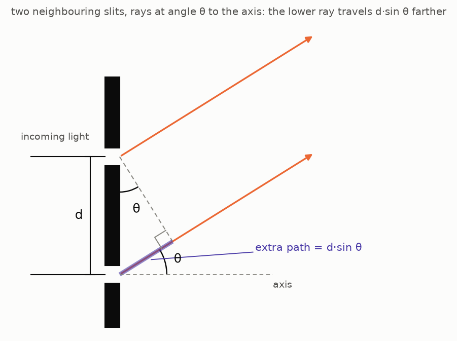
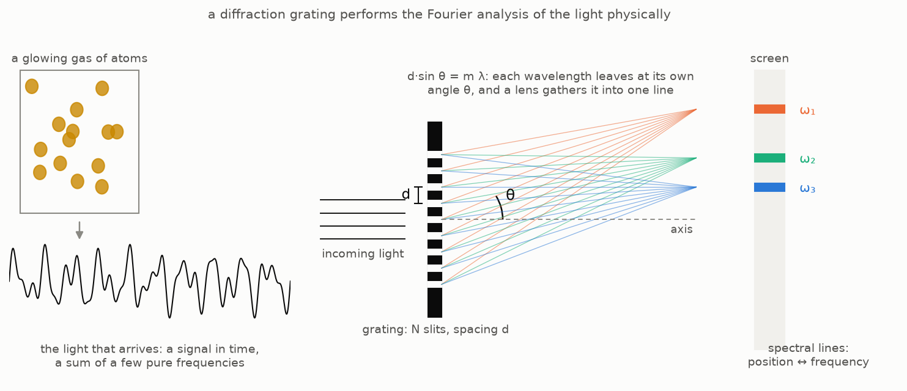
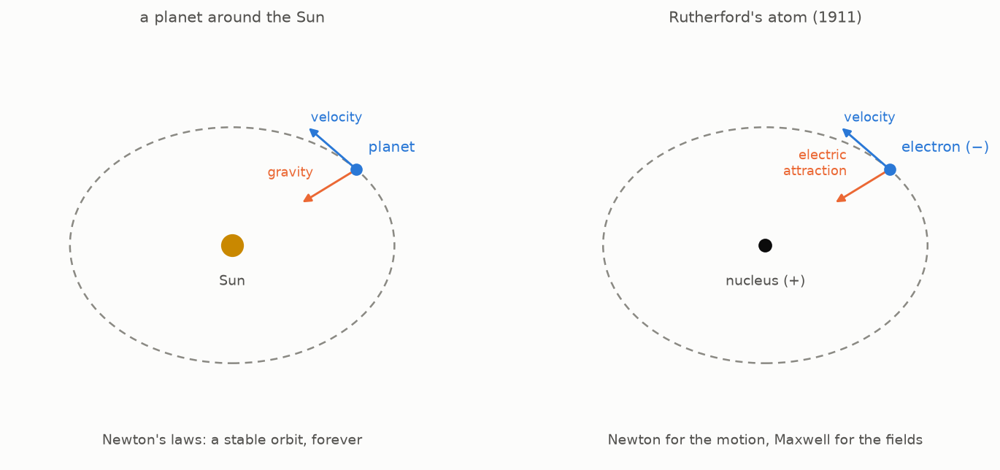
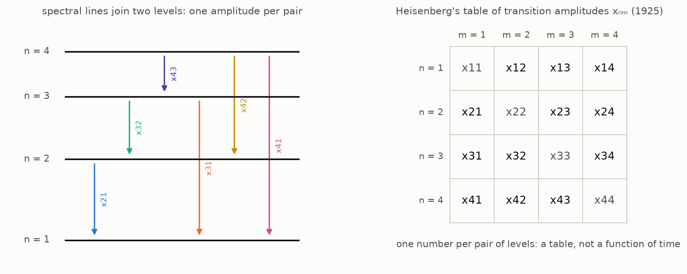
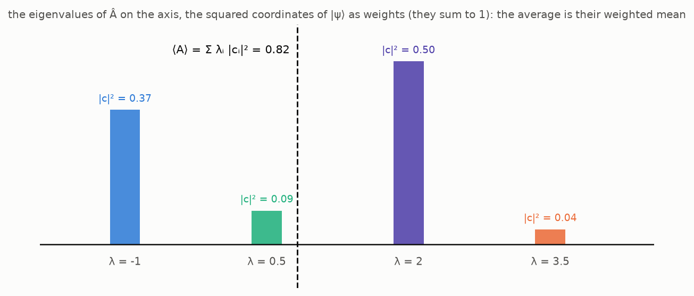
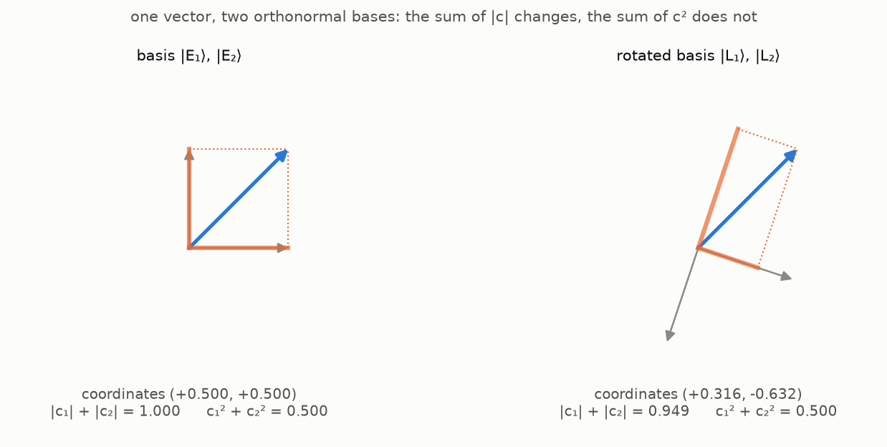
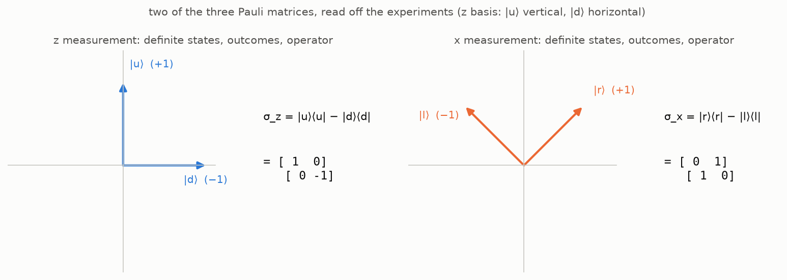
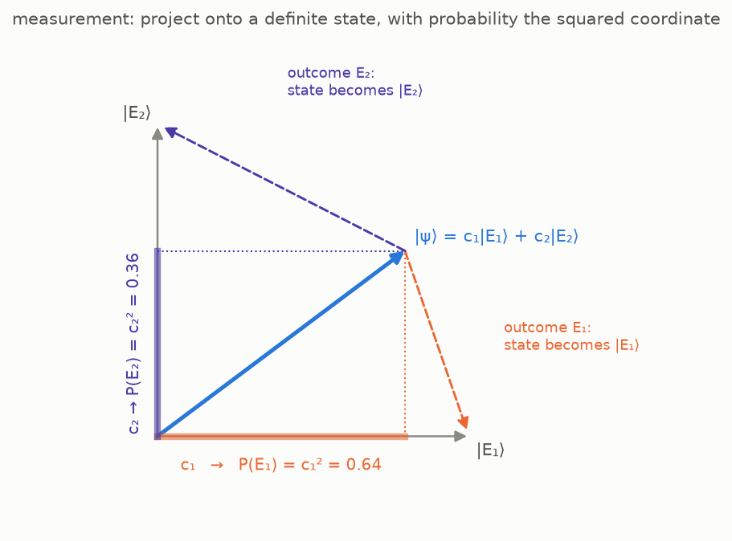

The [first post](/posts/the-apparatus-and-the-arrow/#the-wishlist) of
the quantum road ended with a wishlist. Items 1 and 2 — a state
object, and a way to blend outcomes into states — were paid in the
[second post](/posts/states-are-vectors/): states are unit vectors in
a Hilbert space, blends are superpositions. Item 3 is still open:
*measurable quantities as actors, not numbers*. The first post found
that the electron does not carry a value of "spin along $\hat n$"
the way it carries a mass; what it carries is two possible readings
of the apparatus pointed along $\hat n$, $+1$ and $-1$, each with a
probability. So the quantity itself
needs a mathematical object, separate from the states, and the
wishlist asked for one per quantity. Item 4, *measurement as an
operation on states*, is also still open.

There is also a debt. The second post took the
[Born rule](/posts/states-are-vectors/#what-the-geometry-means-physically)
on credit — "the probability of an outcome is the squared magnitude of
its amplitude" — and promised a derivation. The
[last post](/posts/from-kronecker-to-dirac/) borrowed it again in
passing.

This post settles both. Most textbooks open this chapter with a
postulate — "observables are Hermitian operators" — and derive the
rest from it. Here the postulate is the last line, not the first: the
post starts from what an apparatus actually gives us and follows that
as far as it goes. That is the road of chapter II of Dirac's
*Principles*, and of §3 of Landau and Lifshitz read in the other
direction (see the references); Heisenberg took its first steps in
1925 without knowing where they led. As in the second post, the
spin of the first post serves as the running example, and its
operators are constructed from the experiments as in lecture 3 of
Susskind and Friedman.

## Where we stand

Three facts from the earlier posts are used throughout.

- A measurement along an axis has two outcomes, $+1$ and $-1$, and
  two **definite states** — the states that the measurement prepares
  and then confirms on every repetition. For the $z$ axis they are
  $|u\rangle$ and $|d\rangle$; for the $x$ axis, $|r\rangle$ and
  $|l\rangle$, which the
  [second post built](/posts/states-are-vectors/#the-machinery-earns-its-keep-right-and-left)
  from the experiments:

  $$
  |r\rangle = \tfrac{1}{\sqrt 2}\,|u\rangle + \tfrac{1}{\sqrt 2}\,|d\rangle, \qquad |l\rangle = \tfrac{1}{\sqrt 2}\,|u\rangle - \tfrac{1}{\sqrt 2}\,|d\rangle.
  $$

- Each axis donates an **orthonormal basis**: its two definite states
  are perfectly distinguishable by the apparatus, hence orthogonal,
  and normalized to length one. Any state expands in any of these
  bases, with coordinates that are inner products,
  $c_i = \langle E_i | \psi \rangle$.
- The outer product $|E_i\rangle\langle E_i|$ is a
  [projector](/posts/states-are-vectors/#coordinates-and-a-formula-for-the-identity-operator)
  onto the $i$-th basis direction, and the projectors of a basis add
  up to the identity: $\sum_i |E_i\rangle\langle E_i| = \hat I$.

What is missing is an object for the *quantity itself*. The two
answers of the $z$ measurement have objects, the states $|u\rangle$
and $|d\rangle$; "spin along $z$", the thing that is being measured,
has none yet.

## From averages to operators

### What the apparatus gives us: averages

Go back to the [first post's third
experiment](/posts/the-apparatus-and-the-arrow/#experiment-three-turning-the-arrow).
A single reading of the window is random: $+1$ or $-1$, and no
preparation makes the next reading of a tilted apparatus predictable.
What *is* predictable is the average over many rounds —
$\langle \sigma \rangle = \cos\theta$, the one formula of that post.
This is true of every measurable quantity, not only of the spin: for
a system prepared in a given state, the numbers an experiment can
actually reproduce are averages over many repetitions.

So whatever mathematical object we assign to a measurable quantity,
it must first of all do this: given a state, return the average of
the outcomes. The rest of the post is what that requirement forces
the object to be.

### Heisenberg's table

The object was found before anyone knew what it was. The account
below follows Heisenberg's paper of July 1925 as reconstructed by
Aitchison, MacManus and Snyder (see the references), who quote him
throughout.

The problem Bohr faced in 1913 was the one the first post started
from: atoms emit light at a discrete set of frequencies, and they are
stable. The set of frequencies is called the atom's **spectrum**, and
the word means what it meant on the Fourier road. The light arriving
from a gas of atoms is a signal in time; a prism or a diffraction
grating performs its Fourier analysis physically, spreading the power
over frequency, and a **spectral line** is a frequency at which that
power is concentrated — a sharp peak in the same kind of plot as
[Part 2's reading of $|X[k]|^2$](/posts/fourier-series-to-spectrogram-part-2/#what-does-xk-measure).
Hydrogen's spectrum is a handful of such peaks, not a continuous
band.

Why a grating sorts frequencies

A diffraction grating is a row of $N$ equally spaced slits, a
distance $d$ apart. Light of wavelength $\lambda$ passes through all
of them, and in the direction at angle $\theta$ to the axis the waves
from neighbouring slits travel different distances. Drop a
perpendicular from the upper slit onto the lower ray: it cuts off a
right triangle whose hypotenuse is the slit spacing $d$ and whose
angle at the upper slit is $\theta$, so the lower ray's extra path is
the opposite side, $d \sin\theta$.

The two waves add up in phase only if that difference is a whole number of
wavelengths, $d \sin\theta = m\lambda$ — so each wavelength leaves the
grating at its own angle, as a bundle of parallel rays, and a mixture
of wavelengths is spread into a fan. The grating itself does not
bring the bundle to a point — parallel rays stay parallel; a lens
behind it (or the eye's own lens, when one looks through a grating)
does that, sending every direction to one point of its focal plane. The lines are sharp because the contributions of the $N$ slits
form a finite geometric series, $\sum_{n} e^{\,i n \cdot 2\pi d \sin\theta / \lambda}$,
the same series that made the DFT of Part 2 peak at the right bin; its
peak has width about $\lambda / N d$, and gratings have thousands of
slits. A prism does the same job by a different mechanism — the glass
bends each frequency by a slightly different angle — with poorer
resolution.

The classical model of the atom — Rutherford's, from 1911 — is a
small planetary system: a heavy positive nucleus, and a light,
negatively charged electron moving around it on an orbit under the
electric attraction, exactly as a planet moves around the Sun under
gravity, with Newton's laws for the motion and Maxwell's laws for
the electric and magnetic fields.

Such an electron can produce neither sharp peaks nor a stable atom.
Maxwell's
electrodynamics says that an electric charge
[emits electromagnetic waves whenever its velocity changes](https://www.feynmanlectures.caltech.edu/I_28.html).
An electron
on a circular orbit changes its velocity at every moment, since the
direction of its motion keeps turning, so it would radiate without
pause. The energy carried away by the waves has to come from
somewhere, and the only source is the electron's own energy of
motion: as it loses energy, its orbit shrinks, and it spirals into
the nucleus — within a fraction of a nanosecond, if one does the
arithmetic. And as the
orbit shrank, the frequency of the emitted light would sweep through
a continuous range rather than sit at a few sharp values. (The first
video of the Quantum Sense series,
[*Why we need quantum mechanics*](https://youtu.be/3nvbBEzfmE8),
opens with this failure.)

Bohr's answer, in 1913, was to keep the planetary picture but to
allow only some of its orbits. His theory still pictured the
electron as a classical particle on an orbit, with a position $x(t)$
and a period, and it added one extra condition on which orbits are
possible — a condition that Newton's mechanics knows nothing about
and that nothing in the theory justified; it was postulated because
it gave the right spectrum. Mechanics allows a circular orbit of any radius; Bohr kept only those on which
the electron's [angular momentum](https://en.wikipedia.org/wiki/Angular_momentum)
— mass times speed times radius — is
a whole multiple of Planck's constant divided by $2\pi$,
$m v r = n\hbar$ with $n = 1, 2, 3, \dots$ The rule produced a
discrete set of radii and of energies $W(n)$ for hydrogen. A second
postulate connected them to the light: the electron does not radiate
while on an allowed orbit, only when it *jumps* from one to another,
and the frequency of the emitted light is set not by the orbital
motion but by the energy difference,

$$
\omega = \frac{W(n) - W(m)}{\hbar}
$$

(here $\omega$ is the angular frequency of the light, $2\pi$ times the
frequency in hertz, and $\hbar = h / 2\pi$). With these two rules the
levels reproduced the hydrogen spectrum line by line. Nothing in the
theory explained either rule, and for atoms beyond hydrogen the
scheme failed.

Heisenberg's opening move was to
"discard all hope of observing hitherto unobservable quantities, such
as the position and period of the electron", and to build "a
theoretical quantum mechanics, analogous to classical mechanics, but
in which only relations between observable quantities occur". What
*is* observable about an atom is its light: the frequencies and
intensities of its spectral lines. To see what that programme does
to the description of the electron, start with what the classical
picture says the light should be, then compare with what is measured.

**The classical picture.** In Bohr's picture the electron on the
orbit with label $n$ moves as a classical particle, periodically,
with a period $T(n)$ that depends on the orbit and an orbital
frequency $\omega(n) = 2\pi / T(n)$. Any periodic motion is a sum of
harmonics of its fundamental frequency — a
[Fourier series](/posts/fourier-series-to-spectrogram-part-1/#the-fourier-series),
as on the Fourier road:

$$
x(n, t) = \sum_\alpha X_\alpha(n)\, e^{i\omega(n)\alpha t},
$$

one amplitude $X_\alpha(n)$ per harmonic. By Maxwell such an electron
radiates at exactly these harmonic frequencies, $\omega(n)\alpha$, with
the intensity of the $\alpha$-th line proportional to
$|X_\alpha(n)|^2$: the spectrum of an orbit is an evenly spaced
ladder of overtones above one fundamental, as for a vibrating string.
One more consequence of the classical picture will be needed later:
the Fourier series of the square of the position. Multiply the series
for $x(n, t)$ by itself and collect the terms with the same frequency:

$$
\begin{aligned}
x^2(n, t) &= \sum_\alpha \sum_\gamma X_\alpha(n) X_\gamma(n)\, e^{i\omega(n)(\alpha + \gamma) t} \\
&= \sum_\beta \Big( \sum_\alpha X_\alpha(n)\, X_{\beta - \alpha}(n) \Big) e^{i\omega(n)\beta t} ,
\end{aligned}
$$

with $\beta = \alpha + \gamma$. The square is again a series in the
same harmonics, because the frequencies of two harmonics *add*,
$\omega(n)\alpha + \omega(n)\gamma = \omega(n)(\alpha + \gamma)$; its
coefficients are $Y_\beta(n) = \sum_\alpha X_\alpha(n)\, X_{\beta - \alpha}(n)$.

**The measured spectrum.** The classical picture thus makes a
definite prediction about the light: for each orbit, a fundamental
frequency and its multiples. The prediction is wrong. Hydrogen's lines
are not the multiples of a fundamental — no choice of orbits arranges
them into ladders of overtones. What they do form had been noticed in the 1890s
by Rydberg and Ritz, by inspecting the tables of lines, before there was any
theory: every observed frequency of an atom is the *difference* of two
numbers from a single list — the
[Rydberg–Ritz combination principle](https://en.wikipedia.org/wiki/Rydberg%E2%80%93Ritz_combination_principle).
This is exactly the pattern Bohr's second postulate produces: the
numbers in the list are the energies of the stationary states, and a
line is a jump between *two* of them,

$$
\omega(n, n - \alpha) = \frac{W(n) - W(n - \alpha)}{\hbar} .
$$

Two consequences. Every
observable quantity of the atom carries *two* indices, the two levels
a line joins, where the classical motion carried one. And the frequencies combine in a new way. Classically, two harmonics
of the *same* orbit add to a third harmonic of that orbit:
$\omega(n)\alpha + \omega(n)\gamma = \omega(n)(\alpha + \gamma)$. For
transition frequencies, two lines add up to a third only if they form
a *chain* — the second jump starts at the level where the first one
ended — and then the shared energy cancels:

$$
\begin{aligned}
&\omega(n, n - \alpha) + \omega(n - \alpha, n - \beta) \\
&\qquad = \frac{W(n) - W(n - \alpha)}{\hbar} + \frac{W(n - \alpha) - W(n - \beta)}{\hbar} \\
&\qquad = \frac{W(n) - W(n - \beta)}{\hbar} = \omega(n, n - \beta) .
\end{aligned}
$$

So where the classical rule pairs two harmonics of one orbit, the
quantum rule pairs two jumps through an intermediate level, and the
second factor depends on where the first jump landed. For large $n$,
when neighbouring levels are nearly equally spaced and
$\omega(n, n - \alpha) \approx \alpha\, \omega(n)$, the chain reduces to
the classical rule; at small $n$ it does not. Bohr had made this a
requirement, separate from the two postulates of his model: for large
quantum numbers the quantum rules must turn into the classical ones.
He called it the
[correspondence principle](https://en.wikipedia.org/wiki/Correspondence_principle),
and it was the main tool in the search for the new mechanics,
Heisenberg's included.

**Heisenberg's reinterpretation.** Keep the classical formulas, but
replace in them every classical quantity by the measured one. The
harmonic $\omega(n)\alpha$ becomes the transition frequency
$\omega(n, n - \alpha)$, and the amplitude $X_\alpha(n)$ becomes a
**transition amplitude** $X(n, n - \alpha)$ whose squared magnitude
gives the intensity of the line from $n$ to $n - \alpha$. Heisenberg's
step — the first of what Aitchison and his coauthors call his
"magical jumps" — was to let the whole set of quantities
$X(n, n - \alpha)\, e^{i\omega(n, n - \alpha) t}$ *stand for* the
position $x(t)$: not a function of time any more, but a table of
numbers indexed by pairs of states.

In this reinterpretation every classical quantity has a measured
counterpart, and the correspondence is one to one:

| | classical orbit | Heisenberg's reinterpretation |
|---|---|---|
| what labels a quantity | one orbit, $n$ | a pair of levels, $(n, n - \alpha)$ |
| frequency | harmonic $\omega(n)\,\alpha$ | transition $\omega(n, n - \alpha) = \dfrac{W(n) - W(n - \alpha)}{\hbar}$ |
| amplitude | $X_\alpha(n)$ | $X(n, n - \alpha)$ |
| intensity of the line | $\propto \lvert X_\alpha(n) \rvert^2$ | $\propto \lvert X(n, n - \alpha) \rvert^2$ |
| the position | $x(n, t) = \sum_\alpha X_\alpha(n)\, e^{i\omega(n)\alpha t}$ | the set of all $X(n, n - \alpha)\, e^{i\omega(n, n - \alpha) t}$ |

A table of numbers is not yet a mechanics. The classical equation of
motion of a one-dimensional system is Newton's $\ddot x + f(x) = 0$,
with a force $f(x)$ that is in general a nonlinear function of the
position. Heisenberg tested his scheme on the simplest such systems,
oscillators with $f(x) = \omega_0^2 x + \lambda x^2$ or
$f(x) = \omega_0^2 x + \lambda x^3$, whose classical motion is periodic
and so has a Fourier description. To translate such an equation into
the language of tables one has to know what the table of $x^2$ or
$x^3$ is, given the table of $x$: positions have to be *multiplied*.
So Heisenberg needed a multiplication rule.

Classically the coefficients of $x^2$ came out as
$Y_\beta = \sum_\alpha X_\alpha X_{\beta - \alpha}$ — the computation
[under *The classical picture*](#the-classical-picture) above — a sum
over pairs of harmonics of one orbit. Heisenberg arrived at the quantum
rule not from a physical picture of what multiplication means, but
from three formal requirements that the rule had to satisfy.

1. **$x^2$ is a measurable quantity too.** So its representative must
   be a set of the same kind as that of $x$:
   $Y(n, n - \beta)\, e^{i\omega(n, n - \beta) t}$, one entry per pair of
   levels, with transition frequencies obeying the Ritz rule.
2. **It should be built the way the classical one was.** Squaring a
   Fourier series meant multiplying every term by every term, so each
   coefficient of $x^2$ became a sum of products of two coefficients
   of $x$; the quantum $Y$ should likewise be a sum of products of two
   $X$'s.
3. **The frequencies must come out right.** A product
   $X(n, n - \alpha)\, e^{i\omega(n, n - \alpha) t} \cdot X(k, k - \gamma)\, e^{i\omega(k, k - \gamma) t}$
   oscillates at the sum of the two frequencies, and that sum is a
   transition frequency only when the second jump starts where the
   first ended, $k = n - \alpha$; every other pairing produces a
   frequency the atom does not emit.

So the only products allowed into $Y(n, n - \beta)$ are the chains
through an intermediate level $n - \alpha$, and it is, in
Heisenberg's words, "almost necessary" to sum over that level:

$$
Y(n, n - \beta) = \sum_\alpha X(n, n - \alpha)\, X(n - \alpha, n - \beta) .
$$

He noted at once that with this rule the product of two different
quantities need not commute, $xy \neq yx$ — in the chain from $n$
to $n - \beta$ it matters which quantity supplies the first jump and
which the second, since $x(n, n - \alpha)\, y(n - \alpha, n - \beta)$ and
$y(n, n - \alpha)\, x(n - \alpha, n - \beta)$ are different numbers —
and found the point disturbing. He did not recognize the rule: it is the multiplication of
matrices, "something unknown to Heisenberg in July 1925". Max Born
did recognize it within weeks; he and Jordan then wrote down the
commutation relation $\hat x \hat p - \hat p \hat x = i\hbar$ between
position and momentum — the relation behind the uncertainty
principle, which the road will take up when momentum gets its
operator — Dirac in Cambridge built the same structure as an algebra of non-commuting
"q-numbers", and the "three-man paper" of Born, Heisenberg and Jordan
completed matrix mechanics before the year was out. The reading of
the sum as "all ways of getting from $n$ to $n - \beta$ through an
intermediate state" came later, with the matrix formulation and then
with Dirac; in July 1925 it was the only combination that had the
right frequencies and the right classical limit.

What survives from that summer, for this post, is the shape of the
object: **a measurable quantity is a table of numbers indexed by
pairs of states.**

### A table for a question

The same shape appears in the laboratory of the first post, in
Feynman's treatment of it (volume III, chapter 5). Feynman's apparatus is
the real one behind the [first post's black box](/posts/the-apparatus-and-the-arrow/#the-apparatus),
a Stern–Gerlach magnet, used as a *filter*: it lets through only the
atoms in one definite state and blocks the rest.

Put any device $A$ between two such filters. It is described
completely by the amplitudes $\langle j | A | i \rangle$ that an atom
entering the device in the base state $i$ leaves it in the base state
$j$. For Feynman's spin-one atom, with three base states, that is
nine numbers, "usually written as a square matrix, called the matrix
$A$". Two devices in series are described by the product of their
matrices, and the order matters. Feynman's $A$ is a
device that acts on states, not yet a measurable quantity. What we
take from his setup is only the form of the description — one number
for every ordered pair of basis states — and apply it to a question.
Fix the $z$ basis $\{|u\rangle, |d\rangle\}$. A
question $A$ asked of the spin is to be described by four numbers —
one for each ordered pair of basis states:

$$
A_{ij} = \langle E_i |\, A\, | E_j \rangle, \qquad E_i, E_j \in \{u, d\},
$$

a two-by-two table. The notation already says how the table acts: the
second post showed that an $n \times n$ table of numbers, written
with respect to an orthonormal basis, *is* a linear operator — a
machine $\hat A : V \to V$ that sends vectors to vectors and respects
sums and scalar multiples,
$\hat A(\alpha|\psi\rangle + \beta|\varphi\rangle) = \alpha\hat A|\psi\rangle + \beta\hat A|\varphi\rangle$.
Here is the correspondence in detail. The entry
$A_{ij} = \langle E_i | A | E_j \rangle$ is, by the second post's
"coordinates are inner products", the $i$-th coordinate of the
vector that the machine returns when fed the basis vector
$|E_j\rangle$; so the $j$-th column of the table lists the
coordinates of $\hat A |E_j\rangle$:

$$
\hat A\, |E_j\rangle = \sum_i A_{ij}\, |E_i\rangle .
$$

That fixes the machine on the basis vectors, and linearity fixes it
everywhere else. Feed it a state $|\psi\rangle = \sum_j c_j |E_j\rangle$
with $c_j = \langle E_j | \psi \rangle$:

$$
\begin{aligned}
\hat A\, |\psi\rangle &= \hat A \sum_j c_j\, |E_j\rangle = \sum_j c_j\, \hat A |E_j\rangle \\
&= \sum_j c_j \sum_i A_{ij}\, |E_i\rangle = \sum_i \Big( \sum_j A_{ij}\, c_j \Big) |E_i\rangle .
\end{aligned}
$$

The $i$-th coordinate of the output is $\sum_j A_{ij} c_j$ — the
$i$-th row of the table times the column of the input — which is
the matrix times the column. For the spin:

$$
\hat A \begin{pmatrix} c_u \\ c_d \end{pmatrix} = \begin{pmatrix} A_{uu} & A_{ud} \\ A_{du} & A_{dd} \end{pmatrix} \begin{pmatrix} c_u \\ c_d \end{pmatrix} = \begin{pmatrix} A_{uu} c_u + A_{ud} c_d \\ A_{du} c_u + A_{dd} c_d \end{pmatrix} .
$$

A table with two indices and a linear operator are one object in two
notations, as a column of coordinates and a vector are. So
the wishlist's "object per question" is a linear operator on the
space of states, written with a hat: $\hat E$ for
energy, $\sigma_z$ for the spin along $z$ (the spin operators are
written without a hat, by convention). Nothing has been said yet about
which operator belongs to which question, or about eigenvectors. That
is what the averages will decide.

### The average is a quadratic form

We now have a table for a question and a column for a state. The
job set at the start of this section was that the object assigned to
a question must return, for every state, the average of the
outcomes. So the next step is to say how the table and the column
combine into that one number: given $|\psi\rangle = \sum_j c_j |E_j\rangle$
and the operator $\hat A$, what expression in the coordinates $c_j$
and the entries $A_{ij}$ is the average?

The second post made one thing a principle: the state is the vector,
and nothing about it depends on the basis used to write it. An
average that is a law about the state must then be an expression in
the coordinates whose *form* is the same in every orthonormal basis.
The simplest such expressions are the quadratic ones,
$\sum_{i,j} c_i^* M_{ij} c_j$ — in vector language, a number built
from the state and one matrix, $\langle \psi | \hat M | \psi \rangle$
— and Landau and Lifshitz take it as the starting point of their §3
that probabilities and averages are of this form, bilinear in
$\psi$ and $\psi^*$. We take it too, and name the matrix after the
question:

> **The average.** In the state $|\psi\rangle$, the average of the
> outcomes of the question with operator $\hat A$ is
> $$\langle A \rangle = \langle \psi | \hat A | \psi \rangle = \sum_{i,j} c_i^*\, A_{ij}\, c_j .$$

(A theorem of Gleason, in the references, shows that for state
spaces of dimension three and more *every* consistent assignment of
probabilities is of this quadratic form, so the assumption costs
nothing; in two dimensions it is an assumption, and the
section on the Born rule gives an independent reason for it.)

This is the bracket of the first post, $\langle \sigma \rangle$,
with its meaning finally spelled out: the operator of the question
between the bra and the ket of the state. One check is immediate.
Different questions must have different tables, since two questions
with the same average in every state are not distinguishable by any
experiment — and a quadratic form determines its matrix, so the
table of a question is fixed by its averages.

## What the table must be

### Real averages force a Hermitian table

Averages of real readings are real numbers. So the quadratic form
$\langle \psi | \hat A | \psi \rangle$ must be real for *every* state
$|\psi\rangle$. This condition on the table has a name.

First the notion it needs. Write $|\hat M \psi\rangle$ for the vector
$\hat M$ returns when fed $|\psi\rangle$, so that
$\langle \varphi | \hat M | \psi \rangle = \langle \varphi | \hat M \psi \rangle$.
The [**adjoint**](https://en.wikipedia.org/wiki/Hermitian_adjoint)
$\hat M^\dagger$ of $\hat M$ is the operator that lets the operator
act on the bra instead:

$$
\langle \varphi | \hat M \psi \rangle = \langle \hat M^\dagger \varphi | \psi \rangle \qquad \text{for all } |\varphi\rangle, |\psi\rangle .
$$

It exists and is unique by the second post's Riesz theorem (for fixed
$|\varphi\rangle$ the left side is a linear functional of
$|\psi\rangle$, hence an inner product with a unique vector, which we
name $\hat M^\dagger|\varphi\rangle$). In a matrix with respect to an
orthonormal basis the adjoint is the **conjugate transpose**,
$(M^\dagger)_{ij} = M_{ji}^*$ (Panov's lectures, §4.1); three rules
follow from the definition: $(\hat A^\dagger)^\dagger = \hat A$,
$(\hat A + \hat B)^\dagger = \hat A^\dagger + \hat B^\dagger$,
$(\hat A\hat B)^\dagger = \hat B^\dagger \hat A^\dagger$. The adjoint
of a ket is its bra, $(|v\rangle)^\dagger = \langle v|$ — the second
post's bra–ket correspondence in this notation.

An operator equal to its own adjoint, $\hat A^\dagger = \hat A$, is
called **Hermitian** (or self-adjoint); its matrix equals its own
conjugate transpose. And:

> **Real averages mean Hermitian operators.** The quadratic form
> $\langle \psi | \hat A | \psi \rangle$ is real for every
> $|\psi\rangle$ if and only if $\hat A$ is Hermitian.

One direction is a line. If $\hat A^\dagger = \hat A$, then
$\langle \psi | \hat A \psi \rangle = \langle \hat A \psi | \psi \rangle = \langle \psi | \hat A \psi \rangle^*$
by the Hermitian symmetry of the inner product, so the number equals
its own conjugate. The other direction says that a quadratic form
determines its matrix; the proof is under the cut.

A quadratic form determines its operator (polarization)

Let $\hat B = \hat A - \hat A^\dagger$. If $\langle \psi | \hat A \psi \rangle$
is real for all $\psi$, then
$\langle \psi | \hat B \psi \rangle = \langle \psi | \hat A \psi \rangle - \langle \hat A \psi | \psi \rangle = \langle \psi | \hat A \psi \rangle - \langle \psi | \hat A \psi \rangle^* = 0$
for all $\psi$. The claim is that an operator whose quadratic form
vanishes identically is the zero operator. Expand the form on
$|\varphi\rangle + |\psi\rangle$ and on $|\varphi\rangle + i|\psi\rangle$:

$$
0 = \langle \varphi + \psi \,|\, \hat B(\varphi + \psi) \rangle = \langle \varphi | \hat B \psi \rangle + \langle \psi | \hat B \varphi \rangle ,
$$

$$
0 = \langle \varphi + i\psi \,|\, \hat B(\varphi + i\psi) \rangle = i\,\langle \varphi | \hat B \psi \rangle - i\,\langle \psi | \hat B \varphi \rangle .
$$

Multiply the second line by $-i$ and add it to the first:
$2\,\langle \varphi | \hat B \psi \rangle = 0$ for all $\varphi, \psi$.
Choosing $|\varphi\rangle = \hat B|\psi\rangle$ gives
$\lVert \hat B \psi \rVert^2 = 0$, so $\hat B = 0$ and
$\hat A = \hat A^\dagger$. The complex scalar $i$ was essential: over
the real numbers a quadratic form does not determine the
antisymmetric part of its matrix.

So the first consequence of "averages are real" is that **the
table of every measurable quantity is Hermitian** — and this was
obtained before any eigenvector was mentioned.

### Diagonalize: an average of eigenvalues

A Hermitian table can be simplified by a change of basis, and the
simplified form is where outcomes and probabilities come from.
Recall the definitions. A nonzero vector $|v\rangle$ is an
[**eigenvector**](https://en.wikipedia.org/wiki/Eigenvalues_and_eigenvectors)
of $\hat A$ if the operator merely rescales it,
$\hat A|v\rangle = \lambda|v\rangle$, and $\lambda$ is the
corresponding **eigenvalue**; the set of eigenvalues is the
**spectrum** of $\hat A$.

> **Spectral theorem** (finite dimensions). A Hermitian operator has
> real eigenvalues and an orthonormal basis of eigenvectors.

Two of its three claims are one line each, with the operator moved
across the bracket; the third is cited.

*Real eigenvalues.* If $\hat A|\varphi\rangle = \lambda|\varphi\rangle$
with $|\varphi\rangle \neq 0$, then

$$
\lambda\, \langle \varphi | \varphi \rangle = \langle \varphi | \hat A \varphi \rangle = \langle \hat A \varphi | \varphi \rangle = \lambda^*\, \langle \varphi | \varphi \rangle ,
$$

and $\langle \varphi | \varphi \rangle \gt 0$ gives $\lambda = \lambda^*$.

*Orthogonal eigenvectors.* If $\hat A|\varphi_1\rangle = \lambda_1|\varphi_1\rangle$,
$\hat A|\varphi_2\rangle = \lambda_2|\varphi_2\rangle$ and
$\lambda_1 \neq \lambda_2$, then

$$
\lambda_2\, \langle \varphi_1 | \varphi_2 \rangle = \langle \varphi_1 | \hat A \varphi_2 \rangle = \langle \hat A \varphi_1 | \varphi_2 \rangle = \lambda_1\, \langle \varphi_1 | \varphi_2 \rangle ,
$$

so $(\lambda_2 - \lambda_1)\langle \varphi_1 | \varphi_2 \rangle = 0$
and the inner product vanishes.

*The eigenvectors fill the space.* That there are enough of them to
form a basis is the part that needs the finite dimension and a page
of algebra: Panov, §4.2, Theorem 4.2.3 (its Lemmas 4.2.4 and 4.2.5
are the two facts just proved). Within a repeated eigenvalue the
eigenvectors are not orthogonal automatically, and Gram–Schmidt makes
them so.

Now diagonalize. Call the orthonormal eigenbasis of $\hat A$
$\{|a_i\rangle\}$, with $\hat A|a_i\rangle = \lambda_i |a_i\rangle$,
and write the state in it, $|\psi\rangle = \sum_i c_i |a_i\rangle$.
The table of $\hat A$ in its own eigenbasis is diagonal —
$\langle a_i | \hat A | a_j \rangle = \lambda_j \langle a_i | a_j \rangle = \lambda_i \delta_{ij}$
— and the quadratic form collapses:

$$
\langle A \rangle = \langle \psi | \hat A | \psi \rangle = \sum_{i,j} c_i^*\, \lambda_i \delta_{ij}\, c_j = \sum_i \lambda_i\, |c_i|^2 .
$$

The numbers $|c_i|^2$ are nonnegative and
add up to $\sum_i |c_i|^2 = \langle \psi | \psi \rangle = 1$. So the
average of the question, in any state, is a **weighted average of the
eigenvalues** $\lambda_i$, with weights $|c_i|^2$ that form a
probability distribution. An average of a random quantity is the sum
of its possible values times their probabilities. Read the formula
that way:

> the **eigenvalues** of $\hat A$ are the possible outcomes of the
> question, and $|c_i|^2$ is the probability of the outcome
> $\lambda_i$ in the state $|\psi\rangle$.

This is where the eigenbasis comes from: it is the basis in which
the average of the question takes the form of an ordinary average. Rewriting the diagonal table without coordinates gives
the operator as a sum over its own definite directions,

$$
\boxed{\; \hat A = \sum_i \lambda_i\, |a_i\rangle\langle a_i| \;}
$$

— the **spectral decomposition**: each outcome times the projector
onto its eigenvector. (Apply both sides to $|\psi\rangle$ and use
$\langle a_i | \psi \rangle = c_i$ to see that it is the same
operator.) Set every $\lambda_i$ to $1$ and it collapses to the
resolution of identity of the second post.

Two refinements. An eigenvalue may belong to more than one
independent eigenvector; it is then called **degenerate**, and the
outcome does not determine the state, only the subspace it lands in
— the hydrogen atom will make this concrete, with several orbitals
sharing one energy. And in infinite dimensions the spectrum need not
be a list of eigenvalues with eigenvectors inside the space: the
position operator of the last post is the first example, its
"eigenvectors" $|x\rangle$ living just outside $L^2$ and its spectrum
being the whole real line — a **continuous spectrum**, with
$\hat x = \int x\, |x\rangle\langle x|\, dx$ as its spectral
decomposition. The problems ahead show all three kinds: the particle
in a box has a purely discrete spectrum, the tunneling problem a
purely continuous one, and hydrogen both at once. For general
self-adjoint operators the spectral theorem survives in this
integral form, which the last post's Appendix A pointed at.

## The Born rule, two ways

The weights $|c_i|^2$ came out of the diagonalized average. Two
independent arguments show that they, and nothing else, are the
probabilities.

### From averages

Among the questions one can ask is the yes/no question "did the
outcome equal $\lambda_i$?" Its answers are $1$ and $0$, its average is
by definition the probability of the outcome $\lambda_i$, and its
operator is the projector $\hat P_i = |a_i\rangle\langle a_i|$ — a
Hermitian table whose eigenvalues are $1$ (on $|a_i\rangle$) and $0$
(on everything orthogonal to it), the two answers. The average rule
applied to this question gives

$$
P(\lambda_i) = \langle \psi | \hat P_i | \psi \rangle = \langle \psi | a_i \rangle \langle a_i | \psi \rangle = |c_i|^2 .
$$

This is Dirac's route (*Principles*, chapter II, §12): once the
average of every observable is a quadratic form, the probability of
every outcome is the average of the corresponding projector, and the
squared amplitude follows.

### From basis independence

The derivation above uses the assumption that the average is a
quadratic form. The following argument for the squared magnitude
uses no such assumption — only that probabilities must not depend on the basis the
state happens to be written in. It follows video 8 of the Quantum
Sense series.

Suppose the probability of the outcome $\lambda_i$ is some function
of the coordinate, $P_i = f(c_i)$ — the same function for every
outcome and every observable, since nothing in the formalism singles
one out. Take real coefficients first, in two dimensions, and try the
simplest guess: the probability is the magnitude, $P_i = |c_i|$, so
that $|c_1| + |c_2| = 1$. For the fifty-fifty state this gives
$c_1 = c_2 = \frac12$. Now write the *same* state in another
orthonormal basis — one obtained by rotating the first, which is what
a different measurement axis does. In the rotated basis the
coordinates of the vector $(\frac12, \frac12)$ are, say,
$(\frac{1}{\sqrt{10}}, -\frac{2}{\sqrt{10}})$, and the sum of
magnitudes is no longer one:

$$
\tfrac{1}{\sqrt{10}} + \tfrac{2}{\sqrt{10}} = \tfrac{3}{\sqrt{10}} \approx 0.95 .
$$

The coefficients in the new basis no longer add up to a probability
distribution, and the vector would have to be rescaled by hand every
time the basis changes. But the state is the same physical state
whichever apparatus we point at it; a rule that needs a rescaling
depending on the basis cannot be a law about the state.

What *is* the same in every orthonormal basis is the length of the
vector: for a unit state, $\sum_i c_i^2 = 1$ in every one of them
(real case). So $f$ must produce a probability distribution on every
unit vector, in every orthonormal basis, from the coordinates alone.
Write down what that requires, for real coefficients.

1. **Normalization.** $\sum_i f(c_i) = 1$ whenever $\sum_i c_i^2 = 1$.
2. **A single function.** The same $f$ serves every coordinate, every
   basis, every observable.
3. **Sign does not matter.** $f(-c) = f(c)$: the state $-|\psi\rangle$
   is the same physical state as $|\psi\rangle$ (the second post: a
   unit scalar factor changes no measurement), so flipping the sign of
   one coordinate cannot change a probability.

Condition 1 ties $n$ numbers by one equation. Solve the tie for the
last coordinate, $c_n = \sqrt{1 - \sum_{i \lt n} c_i^2}$ (condition 3
lets us take the positive root), and condition 1 becomes an identity
in the $n - 1$ *independent* variables $c_1, \dots, c_{n-1}$:

$$
\sum_{i=1}^{n-1} f(c_i) + f\!\left(\sqrt{1 - \textstyle\sum_{i=1}^{n-1} c_i^2}\right) = 1 .
$$

An identity in independent variables can be differentiated with
respect to any of them. Differentiate with respect to $c_1$ (assume
$f$ differentiable; this is the argument's technical assumption):

$$
f'(c_1) - f'(c_n)\, \frac{c_1}{c_n} = 0 \qquad\Longrightarrow\qquad \frac{f'(c_1)}{c_1} = \frac{f'(c_n)}{c_n} .
$$

Differentiating with respect to $c_2$ instead gives the same
right-hand side, so

$$
\frac{f'(c_1)}{c_1} = \frac{f'(c_2)}{c_2}
$$

for all admissible values of two independent variables. A function of
$c_1$ alone that equals a function of $c_2$ alone is a constant:

$$
\frac{f'(c)}{c} = \lambda \qquad\Longrightarrow\qquad f(c) = \frac{\lambda}{2}\, c^2 + \mu .
$$

Two physical boundary conditions fix the constants. A state with
$c_i = 0$ has no component along $|a_i\rangle$ — it is orthogonal to
it, hence perfectly distinguishable from it — so the outcome
$\lambda_i$ never occurs: $f(0) = 0$, and $\mu = 0$. A state with
$c_i = 1$ *is* $|a_i\rangle$, and then $\lambda_i$ is certain:
$f(1) = 1$, so $\lambda = 2$. Therefore $f(c) = c^2$.

The coefficients are complex in general. One observation extends the
result. The eigenvector $|a_i\rangle$ is fixed by the physics only up
to a unit factor: $e^{i\theta}|a_i\rangle$ is the same physical
state, still an eigenvector with the same eigenvalue, still of length
one. So $\{e^{i\theta_i}|a_i\rangle\}$ is also an orthonormal eigenbasis
of the same observable, and in it the coordinates of $|\psi\rangle$
are $e^{-i\theta_i} c_i$. The probabilities cannot know which of these
bases was used; hence $f$ depends on $c_i$ only through $|c_i|$.
Apply the real result to the nonnegative numbers $|c_i|$, which
satisfy $\sum_i |c_i|^2 = 1$:

> **The Born rule.** If $|\psi\rangle = \sum_i c_i |a_i\rangle$ in the
> orthonormal eigenbasis of an observable, the probability that a
> measurement of it returns $\lambda_i$ is
> $$P(\lambda_i) = |c_i|^2 = |\langle a_i | \psi \rangle|^2 .$$

Squared magnitudes, because the squared length is the quantity that
does not change between orthonormal bases. The two derivations meet:
the weights that diagonalization produced are the only weights that
basis independence allows. (The argument assumed a differentiable
$f$, the same for every coordinate; Gleason's theorem removes the
assumptions in dimension three and more.)

### The continuous menu

For a particle on a line the definite states of position are the kets
$|x\rangle$ of the last post, the expansion is
$|\psi\rangle = \int \psi(x)\,|x\rangle\,dx$, and the "coordinates"
$\psi(x) = \langle x | \psi \rangle$ are a function. The Born rule
carries over with one change of wording, which the last post's grid
makes exact. Cut the line into cells of width $\Delta x$; the cell
states $|\hat x_i\rangle$ are an orthonormal basis of $L^2$, and the
coordinate of $|\psi\rangle$ along the cell containing $x_i$ is
$c_i = \psi(\xi_i)\sqrt{\Delta x}$ for a point $\xi_i$ of the cell. By
the Born rule the probability of finding the particle in that cell is

$$
|c_i|^2 = |\psi(\xi_i)|^2\, \Delta x ,
$$

a density times a width. So $|\psi(x)|^2$ is a **probability
density** — probability per unit length — and the probability of
finding the particle in an interval is its integral over the
interval,

$$
P(a \leq x \leq b) = \int_a^b |\psi(x)|^2\, dx,
$$

with total probability $\int |\psi|^2\,dx = 1$, the normalization of
the state.

## Outcomes, definite states, and the spin

### Eigenvectors are the definite states

The first post's experiment one says that some states give a certain
answer: measure again and again, and the window repeats itself. In
the language of averages, a certain answer is one with no spread —
the average of the squared deviation from the mean is zero. Compute
that spread, the **variance**, in the eigenbasis:

$$
\langle (A - \langle A \rangle)^2 \rangle = \sum_i |c_i|^2\, (\lambda_i - \langle A \rangle)^2 .
$$

Every term is nonnegative, so the sum vanishes only if every
$c_i$ with $\lambda_i \neq \langle A \rangle$ is zero — that is, only
if $|\psi\rangle$ has components along eigenvectors of a single
eigenvalue, which makes it an eigenvector itself. Conversely an
eigenvector has one nonzero weight, hence zero spread. So:

> **Definite states are eigenvectors.** A state in which the outcome
> of the question $\hat A$ is certain is an eigenvector of $\hat A$,
> and the certain outcome is its eigenvalue.

This is the statement textbooks start from — Susskind's principles 1
and 2 — and here it arrives last, as a consequence of "averages are
quadratic forms". For the spin: the definite states $|u\rangle$,
$|d\rangle$ of the $z$ question are the eigenvectors of its operator
$\sigma_z$, with eigenvalues $+1$ and $-1$; the first post's "the
measurement prepares a state that repeats its answer" is the
statement that the state after a measurement is an eigenvector.

From now on the word **observable** is used both for the measurable
quantity and for its Hermitian operator. The three conditions one
would otherwise have to *demand* of such an operator — real outcomes,
definite states that span the space, definite states that are
orthogonal — are the spectral theorem, already proved.

### Applying the operator is not measuring

The notation invites a confusion, so it is addressed before anything
else is built. Applying $\sigma_z$ to a state is a *mathematical*
operation that returns a state; a measurement is a *physical*
operation that returns a number and changes the state. They are not
the same thing.

Apply $\sigma_z$ to the $x$-definite state $|r\rangle$, using
$\sigma_z|u\rangle = |u\rangle$, $\sigma_z|d\rangle = -|d\rangle$ and
linearity:

$$
\sigma_z\, |r\rangle = \tfrac{1}{\sqrt 2}\, \sigma_z |u\rangle + \tfrac{1}{\sqrt 2}\, \sigma_z |d\rangle = \tfrac{1}{\sqrt 2}\, |u\rangle - \tfrac{1}{\sqrt 2}\, |d\rangle = |l\rangle .
$$

The operator turned *right* into *left*. No $z$ measurement of an
electron prepared along $x$ ever produces an electron pointing left
along $x$: it produces $|u\rangle$ or $|d\rangle$, at random. So
$\sigma_z|r\rangle$ is not the state after a measurement. It is a
*code*: written in the eigenbasis of $\sigma_z$, the input
$|r\rangle = \frac{1}{\sqrt 2}|u\rangle + \frac{1}{\sqrt 2}|d\rangle$
lists the possible answers as its basis directions, and the operator
has tagged each direction with the answer's value; the coefficients
encode the probabilities, by the Born rule. (Susskind and Friedman
devote their §3.5, "A common misconception", to this point.)

Check the formalism against the one number the first post measured.
Prepare $|r\rangle$ — spin $+1$ along $x$ — and measure along $z$, at
$90°$ to the preparation. The cosine predicts an average of
$\cos 90° = 0$. Compute:

$$
\langle r | \sigma_z | r \rangle = \langle r | l \rangle = 0 .
$$

The formalism returns the right average for this angle. The full
$\cos\theta$, for an arbitrary angle between the axes, needs the spin
operators for arbitrary directions, which the next post constructs.

### Two of the three Pauli matrices

For the spin everything above is two-by-two matrices. Work in the $z$
basis $\{|u\rangle, |d\rangle\}$, with $|u\rangle = (1, 0)^T$ and
$|d\rangle = (0, 1)^T$ as in the second post. The spectral
decomposition of $\sigma_z$ is immediate — outcomes $\pm 1$ on the
projectors onto its definite states:

$$
\sigma_z = (+1)\,|u\rangle\langle u| + (-1)\,|d\rangle\langle d| = \begin{pmatrix} 1 & 0 \\ 0 & -1 \end{pmatrix}.
$$

Now the $x$ question. Its definite states are $|r\rangle$ and
$|l\rangle$, with outcomes $+1$ and $-1$, so the same recipe gives
$\sigma_x = |r\rangle\langle r| - |l\rangle\langle l|$. In the $z$
basis, $|r\rangle = \frac{1}{\sqrt 2}(1, 1)^T$ and
$|l\rangle = \frac{1}{\sqrt 2}(1, -1)^T$, and the outer products are
rank-one matrices:

$$
|r\rangle\langle r| = \tfrac12 \begin{pmatrix} 1 & 1 \\ 1 & 1 \end{pmatrix}, \qquad |l\rangle\langle l| = \tfrac12 \begin{pmatrix} 1 & -1 \\ -1 & 1 \end{pmatrix}.
$$

Subtract:

$$
\sigma_x = \begin{pmatrix} 0 & 1 \\ 1 & 0 \end{pmatrix}.
$$

Both matrices are Hermitian, as they must be — real and symmetric.
Both have eigenvalues $+1$ and $-1$: for $\sigma_x$, check directly
that $\sigma_x (1, 1)^T = (1, 1)^T$ and $\sigma_x (1, -1)^T = -(1, -1)^T$.
These are two of the three
[**Pauli matrices**](https://en.wikipedia.org/wiki/Pauli_matrices),
and they were obtained from the experiments, through the definite
states the second post extracted from them, not taken from a table.
The third, $\sigma_y$, waits for the $y$-axis states
$|i\rangle, |o\rangle$, which the second post showed cannot be built
with real amplitudes; the next post builds them, and $\sigma_y$ with
them.

### Measurement, completed

Wishlist item 4 asked how measurement changes the state. Everything
needed is now available.

> **Measurement.** Measuring the observable $\hat A$ in the state
> $|\psi\rangle = \sum_i c_i|a_i\rangle$ returns one of the
> eigenvalues $\lambda_i$, with probability $|c_i|^2$; immediately
> after a measurement that returned $\lambda_i$, the state is the
> definite state $|a_i\rangle$.

In the language of projectors: the outcome $\lambda_i$ projects the
state onto the $i$-th definite direction and renormalizes it,

$$
|\psi\rangle \;\longmapsto\; \frac{|a_i\rangle\langle a_i | \psi \rangle}{\lVert\, |a_i\rangle\langle a_i | \psi \rangle \,\rVert} = \frac{c_i}{|c_i|}\, |a_i\rangle ,
$$

a unit factor times $|a_i\rangle$ — the same physical state. The
probability of the outcome is the average of the projector,
$\langle \psi | \hat P_i | \psi \rangle = |c_i|^2$, as in the first
derivation of the Born rule.

Read the first post's three experiments in this language.

- *Repetition confirms.* After a $z$ measurement the state is
  $|u\rangle$ or $|d\rangle$, an eigenvector of $\sigma_z$; measuring
  $\sigma_z$ again finds coefficient $1$ on that eigenvector and
  returns the same value with probability one.
- *Flipping negates.* The apparatus turned upside down measures
  $-\sigma_z$, whose definite states are the same two vectors with
  the outcomes exchanged.
- *A new axis erases the old answer.* Measure $\sigma_x$ on
  $|u\rangle = \frac{1}{\sqrt 2}|r\rangle + \frac{1}{\sqrt 2}|l\rangle$:
  the outcome is $\pm 1$ with probability $\frac12$ each, and the
  state becomes $|r\rangle$ or $|l\rangle$. Measure $\sigma_z$ once
  more: $|r\rangle$ and $|l\rangle$ are each half $|u\rangle$, half
  $|d\rangle$, so the old certainty is gone — probability $\frac12$
  for either answer. The erasure of the first post is the statement
  that $\sigma_z$ and $\sigma_x$ have no eigenvector in common.

## What we built

The chain of the post. What an apparatus gives
us is averages. An average that is a law about the state is a
quadratic form in its coordinates, so a question is a table with two
indices — an operator, the object Heisenberg found in 1925. Real
averages make the table Hermitian. A Hermitian table has an
orthonormal eigenbasis, and in that basis the average becomes a
weighted average of the eigenvalues; the weights are squared
coordinates, which basis independence confirms as the only possible
probabilities. The eigenvalues are therefore the outcomes, the
eigenvectors the states of certain outcome, and a measurement is a
projection onto one of them.

The wishlist, with two more items paid:

1. **A state object** — a unit vector in a Hilbert space. ✓ (second post)
2. **A way to blend outcomes** — superposition; probabilities are
   squared amplitudes, *derived today, twice*. ✓
3. **Measurable quantities as actors** — Hermitian operators, whose
   eigenvalues are the outcomes and whose eigenvectors are the
   definite states; the average of a quantity is
   $\langle \psi | \hat A | \psi \rangle$. ✓
4. **Measurement as an operation on states** — projection onto a
   definite state, with the Born probability. ✓
5. **Geometry must enter** — still open: the dictionary between
   directions in the laboratory and operators on the two-dimensional
   state space, with the cosine of the first post as its first entry.

## Onward

Next stop: the qubit and the Bloch sphere. The $y$-axis states are
built, complex amplitudes become unavoidable, $\sigma_y$ joins the
other two, and the spin operator along an arbitrary direction $\hat n$
turns out to be $\hat n \cdot \vec\sigma$ — from which the first
post's $\langle \sigma \rangle = \cos\theta$ follows in one line, and
a two-dimensional complex state space acquires the geometry of an
ordinary sphere.

## References

- Л. Д. Ландау, Е. М. Лифшиц. *Квантовая механика (нерелятивистская
  теория)*, Теоретическая физика, т. III — chapter I, §3
  "Операторы" (pp. 22–28 of the 6th Russian edition; §3 "Operators"
  in the English *Quantum Mechanics: Non-Relativistic Theory*): the
  road of this post — the spectrum and the expansion, $|a_n|^2$ as
  the only admissible bilinear probability, the mean value (3.7), the
  operator *defined* by the mean value (3.8), eigenfunctions (3.12),
  Hermiticity from the reality of the mean (3.15–3.17).
- P. A. M. Dirac. *The Principles of Quantum Mechanics*, 4th ed.
  Oxford University Press, 1958 (Russian translation: П. А. М. Дирак,
  *Принципы квантовой механики*, 2-е изд., Наука, 1979, под ред.
  В. А. Фока) — chapter II, "Dynamical variables and observables":
  §10 (observables; Russian ed. p. 52), §11 (functions of
  observables; p. 60), §12 (the general physical interpretation;
  pp. 67–71): the basic assumption that the average of the results of
  measuring $\xi$ in the state $|x\rangle$ is $\langle x | \xi | x \rangle$
  (p. 68), and the probability of the value $a$ as the average of the
  function $\delta_{\xi a}$ of the observable, $P_a = \langle x | \delta_{\xi a} | x \rangle$,
  eq. (45) (p. 69) — the projector route of this post.
- R. P. Feynman, R. B. Leighton, M. Sands. *The Feynman Lectures on
  Physics*, vol. III (Russian edition: *Фейнмановские лекции по
  физике*, вып. 8–9 *Квантовая механика*, Мир, 1978) — chapter 5,
  "Spin One", §5-6 "The machinery of quantum mechanics" (Russian ed.
  глава 3, §6, pp. 75–78): any apparatus between Stern–Gerlach
  filters is described by the nine amplitudes
  $\langle j | A | i \rangle$, written as a square matrix (eq. 3.33),
  and two apparatuses in series by the matrix product (eq. 3.36),
  "the order being essential, $AB \neq BA$"; and chapter 20, "Operators",
  §20-2 "Average energies" (глава 18, §2, pp. 469–473): the average
  energy as $\sum_i P_i E_i$ with $P_i = |C_i|^2$ (18.11), rewritten
  as $\langle \psi | \hat H | \psi \rangle$. Free online at
  [feynmanlectures.caltech.edu](https://www.feynmanlectures.caltech.edu/).
- W. Heisenberg. *Über quantentheoretische Umdeutung kinematischer
  und mechanischer Beziehungen.* Zeitschrift für Physik 33 (1925),
  879–893 — the paper of July 1925; English translation in van der
  Waerden's collection below.
- I. J. R. Aitchison, D. A. MacManus, T. M. Snyder. [*Understanding
  Heisenberg's "magical" paper of July 1925: a new look at the
  calculational details*](https://arxiv.org/abs/quant-ph/0404009).
  American Journal of Physics 72 (2004), 1370–1379 — §2.1 is the
  source of this post's account: the programme of observable
  quantities only, the two-index transition amplitudes, the
  multiplication rule from the Ritz combination principle, and
  Born's recognition of the matrix.
- B. L. van der Waerden (ed.). *Sources of Quantum Mechanics*.
  North-Holland, 1967; Dover reprint — Heisenberg's July 1925 paper,
  Born and Jordan's and Dirac's papers of the same year, in
  translation, with the editor's account of how Born recognized the
  matrix.
- Leonard Susskind, Art Friedman. *Quantum Mechanics: The Theoretical
  Minimum*. Basic Books, 2014 — lecture 3, "Principles of Quantum
  Mechanics": §3.1 (linear operators, Hermitian conjugation), §3.2
  (the four principles, which this post reaches as conclusions),
  §3.3–3.4 (the spin operators constructed from the experiments), §3.5
  ("A common misconception": applying an operator is not measuring).
- [Quantum Sense](https://www.youtube.com/@quantumsensechannel), *Maths
  of Quantum Mechanics* — video 1 ([why we need quantum
  mechanics](https://youtu.be/3nvbBEzfmE8): the classical collapse of
  the atom), and videos 7 ([observables as linear
  operators](https://youtu.be/ANLRQ7X6h5A)), 8 ([why the probability
  is the squared amplitude](https://youtu.be/PZUZgOUOOIU)) and 9
  ([Hermitian operators](https://youtu.be/da1rH0Hq62Q)); the
  basis-independence derivation of the Born rule follows video 8.
- A. M. Gleason. *Measures on the closed subspaces of a Hilbert
  space.* Journal of Mathematics and Mechanics 6 (1957), 885–893 — the
  theorem that on a Hilbert space of dimension at least three every
  additive probability assignment is a quadratic form;
  [Wikipedia's account](https://en.wikipedia.org/wiki/Gleason%27s_theorem)
  is a good first reading.
- Т. Е. Панов. [*Лекции по линейной алгебре*](http://higeom.math.msu.su/people/taras/teaching/panov-linalg.pdf)
  (in Russian) — §4.1 (adjoint operators; the matrix of the adjoint
  is the conjugate transpose, p. 65) and §4.2 (self-adjoint
  operators: Theorem 4.2.3 on the orthonormal eigenbasis, with Lemmas
  4.2.4 and 4.2.5, pp. 66–67).
- А. Г. Сергеев. [*Лекции по функциональному анализу*](https://mi-ras.ru/noc/13_14/2/sergeev/funkan.pdf)
  (in Russian) — Theorem 40, the Hilbert–Schmidt theorem, p. 81: the
  spectral theorem for compact self-adjoint operators in infinite
  dimensions.
- G. W. Mackey. *Mathematical Foundations of Quantum Mechanics*.
  Benjamin, 1963 — the compact axiomatic account, with the
  probability structure and Gleason's theorem at its center.
- 3Blue1Brown, [*Eigenvectors and eigenvalues*](https://youtu.be/PFDu9oVAE-g)
  — the geometric picture of an eigenvector, in twenty minutes.
