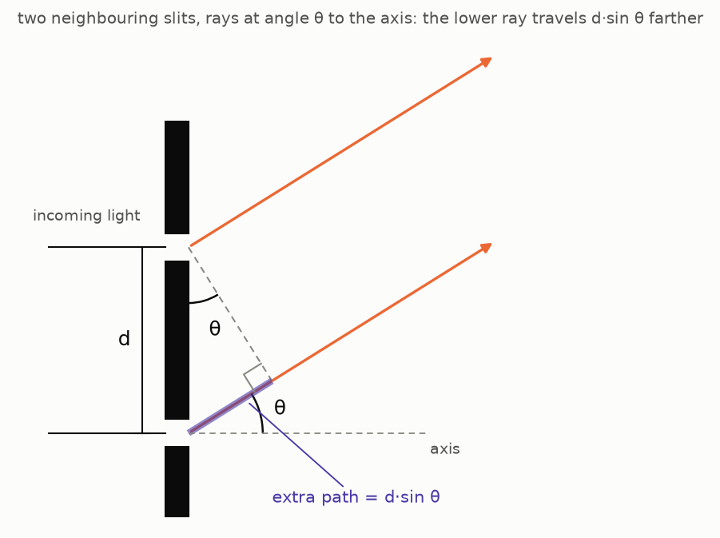
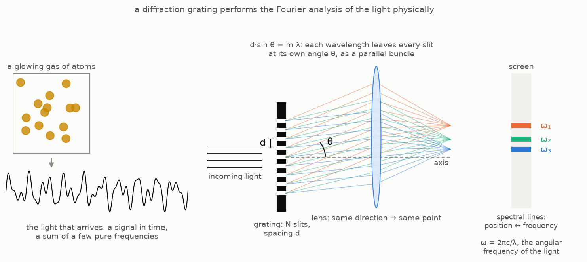
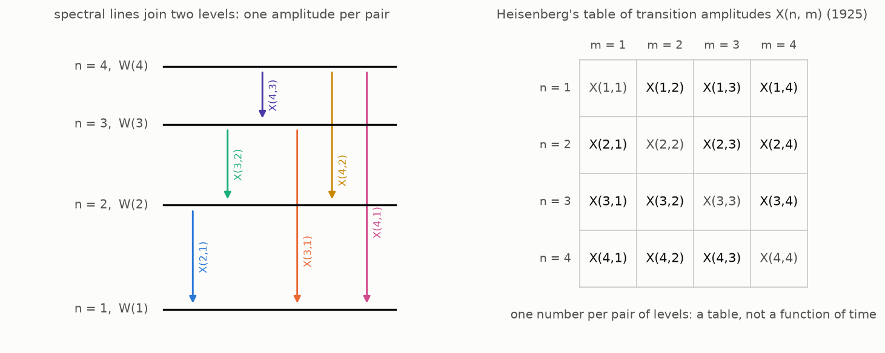
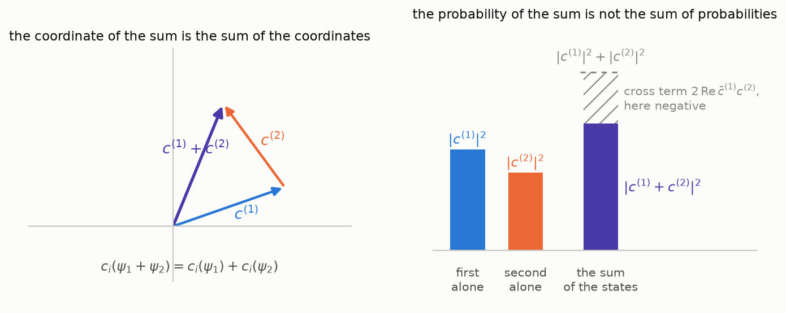
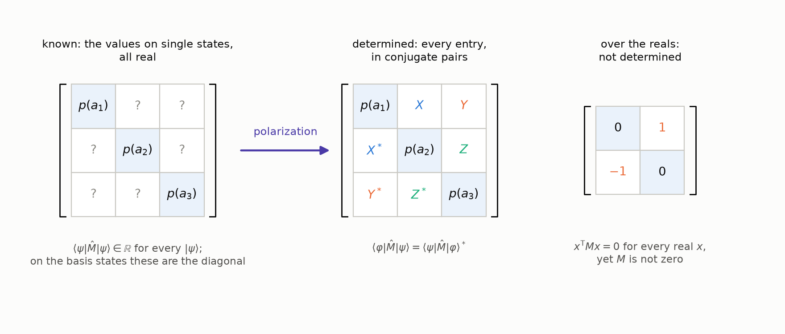
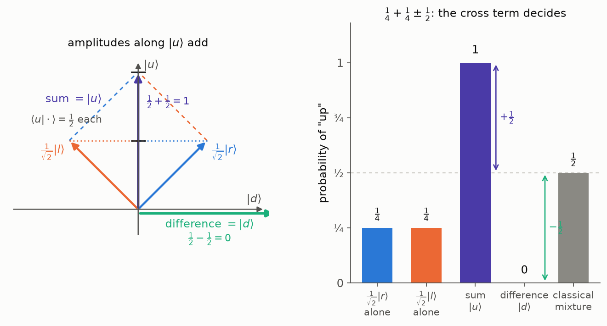

The [first post](/quantum/the-apparatus-and-the-arrow/#the-wishlist) of
the quantum road ended with a wishlist. Items 1 and 2 — a state
object, and a way to blend outcomes into states — were paid in the
[second post](/quantum/states-are-vectors/): states are unit vectors in
a Hilbert space, blends are superpositions. Item 3 is still open:
*measurable quantities as actors, not numbers*. The first post found
that the electron does not carry a value of "spin along $\hat n$"
the way it carries a mass; what it carries is two possible readings
of the apparatus pointed along $\hat n$, $+1$ and $-1$, each with a
probability. So the quantity itself needs a mathematical object,
separate from the states, and the wishlist asked for one per
quantity.

This post builds that object, and it answers one question on the
way: where do the matrices of quantum mechanics come from, and how
are they tied to what an experiment measures? Most textbooks open
this chapter with a postulate — "observables are Hermitian
operators" — and derive the rest from it. Here the postulate comes
last, in the next post: this one starts from what an apparatus
actually gives us and follows that as far as it goes. That is the
road of chapter II of Dirac's *Principles* and of §3 of Landau and
Lifshitz (see the references); Heisenberg took its first steps in
1925 without knowing where they led, and the middle of the post
retells how. The Born rule, which the second post took on credit, is
paid on the way, and the post ends where quantum mechanics parts
from classical probability: at interference.

## Where we stand

Three facts from the earlier posts are used throughout.

- A measurement along an axis has two outcomes, $+1$ and $-1$, and
  two states that the measurement prepares and then confirms on every
  repetition (the first post's experiment one). This post needs a
  name for them: **definite states**. For the $z$ axis they are
  $|u\rangle$ and $|d\rangle$; for the $x$ axis, $|r\rangle$ and
  $|l\rangle$, which the
  [second post built](/quantum/states-are-vectors/#the-machinery-earns-its-keep-right-and-left)
  from the experiments.
- Each axis donates an **orthonormal basis**: its two definite states
  are perfectly distinguishable by the apparatus, hence orthogonal,
  and normalized to length one. Any state expands in any of these
  bases, with coordinates that are inner products,
  $c_i = \langle E_i | \psi \rangle$.
- The outer product $|E_i\rangle\langle E_i|$ is a
  [projector](/quantum/states-are-vectors/#coordinates-and-a-formula-for-the-identity-operator)
  onto the $i$-th basis direction, and the projectors of a basis add
  up to the identity: $\sum_i |E_i\rangle\langle E_i| = \hat I$.

What is missing is an object for the *quantity itself*. The two
answers of the $z$ measurement have objects, the states $|u\rangle$
and $|d\rangle$; "spin along $z$", the thing that is being measured,
has none yet.

## From averages to operators

### What the apparatus gives us: averages

Go back to the [first post's third
experiment](/quantum/the-apparatus-and-the-arrow/#experiment-three-turning-the-arrow).
A single reading of the window is random: $+1$ or $-1$, and no
preparation makes the next reading of a tilted apparatus predictable.
What *is* predictable is the average over many rounds —
$\langle \sigma \rangle = \cos\theta$, the one formula of that post.
This is true of every measurable quantity, not only of the spin: for
a system prepared in a given state, the numbers an experiment can
actually reproduce are averages over many repetitions.

So whatever mathematical object we assign to a measurable quantity,
it must first of all do this: given a state, return the average of
the outcomes. The rest of the post is what that requirement forces
the object to be.

### Heisenberg's table

The object was found before anyone knew what it was. The account
below follows Heisenberg's paper of July 1925 as reconstructed by
Aitchison, MacManus and Snyder (see the references), who quote him
throughout.

The problem Bohr faced in 1913 was the one the first post started
from: atoms emit light at a discrete set of frequencies, and they are
stable. The set of frequencies is called the atom's **spectrum**, and
the word means what it meant on the Fourier road. The light arriving
from a gas of atoms is a signal in time; a prism or a diffraction
grating performs its Fourier analysis physically, spreading the power
over frequency, and a **spectral line** is a frequency at which that
power is concentrated — a sharp peak in the same kind of plot as
[Part 2's reading of $|X[k]|^2$](/fourier/fourier-series-to-spectrogram-part-2/#what-does-xk-measure).
Hydrogen's spectrum is a handful of such peaks, not a continuous
band.

Why a grating sorts frequencies

A diffraction grating is a row of $N$ equally spaced slits, a
distance $d$ apart. Light of wavelength $\lambda$ passes through all
of them, and in the direction at angle $\theta$ to the axis the waves
from neighbouring slits travel different distances. Drop a
perpendicular from the upper slit onto the lower ray: it cuts off a
right triangle whose hypotenuse is the slit spacing $d$ and whose
angle at the upper slit is $\theta$, so the lower ray's extra path is
the opposite side, $d \sin\theta$.

The two waves add up in phase only if that difference is a whole number of
wavelengths, $d \sin\theta = m\lambda$ — so each wavelength leaves the
grating at its own angle, as a bundle of parallel rays, and a mixture
of wavelengths is spread into a fan. The grating itself does not
bring the bundle to a point — parallel rays stay parallel; a lens
behind it (or the eye's own lens, when one looks through a grating)
does that, sending every direction to one point of its focal plane. The lines are sharp because the contributions of the $N$ slits
form a finite geometric series, $\sum_{n} e^{\,i n \cdot 2\pi d \sin\theta / \lambda}$,
the same series that made the DFT of Part 2 peak at the right bin; its
peak has width about $\lambda / N d$, and gratings have thousands of
slits. A prism does the same job by a different mechanism — the glass
bends each frequency by a slightly different angle — with poorer
resolution.

The classical model of the atom — Rutherford's, from 1911 — is a
small planetary system: a heavy positive nucleus, and a light,
negatively charged electron moving around it on an orbit under the
electric attraction, exactly as a planet moves around the Sun under
gravity, with Newton's laws for the motion and Maxwell's laws for
the electric and magnetic fields.

Such an electron can produce neither sharp peaks nor a stable atom.
Maxwell's
electrodynamics says that an electric charge
[emits electromagnetic waves whenever its velocity changes](https://www.feynmanlectures.caltech.edu/I_28.html).
An electron
on a circular orbit changes its velocity at every moment, since the
direction of its motion keeps turning, so it would radiate without
pause. The energy carried away by the waves has to come from
somewhere, and the only source is the electron's own energy of
motion: as it loses energy, its orbit shrinks, and it spirals into
the nucleus — within a fraction of a nanosecond, if one does the
arithmetic. And as the
orbit shrank, the frequency of the emitted light would sweep through
a continuous range rather than sit at a few sharp values. (The first
video of the Quantum Sense series,
[*Why we need quantum mechanics*](https://youtu.be/3nvbBEzfmE8),
opens with this failure.)

Bohr's answer, in 1913, was to keep the planetary picture but to
allow only some of its orbits. His theory still pictured the
electron as a classical particle on an orbit, with a position $x(t)$
and a period, and it added one extra condition on which orbits are
possible — a condition that Newton's mechanics knows nothing about
and that nothing in the theory justified; it was postulated because
it gave the right spectrum. Mechanics allows a circular orbit of any radius; Bohr kept only those on which
the electron's [angular momentum](https://en.wikipedia.org/wiki/Angular_momentum)
— mass times speed times radius — is
a whole multiple of Planck's constant divided by $2\pi$,
$m v r = n\hbar$ with $n = 1, 2, 3, \dots$ The rule produced a
discrete set of radii and of energies $W(n)$ for hydrogen. A second
postulate connected them to the light: the electron does not radiate
while on an allowed orbit, only when it *jumps* from one to another,
and the frequency of the emitted light is set not by the orbital
motion but by the energy difference,

$$
\omega = \frac{W(n) - W(m)}{\hbar}
$$

(here $\omega$ is the angular frequency of the light, $2\pi$ times the
frequency in hertz, and $\hbar = h / 2\pi$). With these two rules the
levels reproduced the hydrogen spectrum line by line. Nothing in the
theory explained either rule, and for atoms beyond hydrogen the
scheme failed.

Heisenberg's opening move was to
"discard all hope of observing hitherto unobservable quantities, such
as the position and period of the electron", and to build "a
theoretical quantum mechanics, analogous to classical mechanics, but
in which only relations between observable quantities occur". What
*is* observable about an atom is its light: the frequencies and
intensities of its spectral lines. To see what that programme does
to the description of the electron, start with what the classical
picture says the light should be, then compare with what is measured.

**The classical picture.** In Bohr's picture the electron on the
orbit with label $n$ moves as a classical particle, periodically,
with a period $T(n)$ that depends on the orbit and an orbital
frequency $\omega(n) = 2\pi / T(n)$. Any periodic motion is a sum of
harmonics of its fundamental frequency — a
[Fourier series](/fourier/fourier-series-to-spectrogram-part-1/#the-fourier-series),
as on the Fourier road:

$$
x(n, t) = \sum_\alpha X_\alpha(n)\, e^{i\omega(n)\alpha t},
$$

one amplitude $X_\alpha(n)$ per harmonic. By Maxwell such an electron
radiates at exactly these harmonic frequencies, $\omega(n)\alpha$, with
the intensity of the $\alpha$-th line proportional to
$|X_\alpha(n)|^2$: the spectrum of an orbit is an evenly spaced
ladder of overtones above one fundamental, as for a vibrating string.
One more consequence of the classical picture will be needed later:
the Fourier series of the square of the position. Multiply the series
for $x(n, t)$ by itself and collect the terms with the same frequency:

$$
\begin{aligned}
x^2(n, t) &= \sum_\alpha \sum_\gamma X_\alpha(n) X_\gamma(n)\, e^{i\omega(n)(\alpha + \gamma) t} \\
&= \sum_\beta \Big( \sum_\alpha X_\alpha(n)\, X_{\beta - \alpha}(n) \Big) e^{i\omega(n)\beta t} ,
\end{aligned}
$$

with $\beta = \alpha + \gamma$. The square is again a series in the
same harmonics, because the frequencies of two harmonics *add*,
$\omega(n)\alpha + \omega(n)\gamma = \omega(n)(\alpha + \gamma)$; its
coefficients are $Y_\beta(n) = \sum_\alpha X_\alpha(n)\, X_{\beta - \alpha}(n)$.

**The measured spectrum.** The classical picture thus makes a
definite prediction about the light: for each orbit, a fundamental
frequency and its multiples. The prediction is wrong. Hydrogen's lines
are not the multiples of a fundamental — no choice of orbits arranges
them into ladders of overtones. What they do form had been noticed in the 1890s
by Rydberg and Ritz, by inspecting the tables of lines, before there was any
theory: every observed frequency of an atom is the *difference* of two
numbers from a single list — the
[Rydberg–Ritz combination principle](https://en.wikipedia.org/wiki/Rydberg%E2%80%93Ritz_combination_principle).
This is exactly the pattern Bohr's second postulate produces: the
numbers in the list are the energies of the stationary states, and a
line is a jump between *two* of them,

$$
\omega(n, n - \alpha) = \frac{W(n) - W(n - \alpha)}{\hbar} .
$$

Two consequences. Every
observable quantity of the atom carries *two* indices, the two levels
a line joins, where the classical motion carried one. And the frequencies combine in a new way. Classically, two harmonics
of the *same* orbit add to a third harmonic of that orbit:
$\omega(n)\alpha + \omega(n)\gamma = \omega(n)(\alpha + \gamma)$. For
transition frequencies, two lines add up to a third only if they form
a *chain* — the second jump starts at the level where the first one
ended — and then the shared energy cancels:

$$
\begin{aligned}
&\omega(n, n - \alpha) + \omega(n - \alpha, n - \beta) \\
&\qquad = \frac{W(n) - W(n - \alpha)}{\hbar} + \frac{W(n - \alpha) - W(n - \beta)}{\hbar} \\
&\qquad = \frac{W(n) - W(n - \beta)}{\hbar} = \omega(n, n - \beta) .
\end{aligned}
$$

So where the classical rule pairs two harmonics of one orbit, the
quantum rule pairs two jumps through an intermediate level, and the
second factor depends on where the first jump landed. For large $n$,
when neighbouring levels are nearly equally spaced and
$\omega(n, n - \alpha) \approx \alpha\, \omega(n)$, the chain reduces to
the classical rule; at small $n$ it does not. Bohr had made this a
requirement, separate from the two postulates of his model: for large
quantum numbers the quantum rules must turn into the classical ones.
He called it the
[correspondence principle](https://en.wikipedia.org/wiki/Correspondence_principle),
and it was the main tool in the search for the new mechanics,
Heisenberg's included.

**Heisenberg's reinterpretation.** Keep the classical formulas, but
replace in them every classical quantity by the measured one. The
harmonic $\omega(n)\alpha$ becomes the transition frequency
$\omega(n, n - \alpha)$, and the amplitude $X_\alpha(n)$ becomes a
**transition amplitude** $X(n, n - \alpha)$ whose squared magnitude
gives the intensity of the line from $n$ to $n - \alpha$. Heisenberg's
step — the first of what Aitchison and his coauthors call his
"magical jumps" — was to let the whole set of quantities
$X(n, n - \alpha)\, e^{i\omega(n, n - \alpha) t}$ *stand for* the
position $x(t)$: not a function of time any more, but a table of
numbers indexed by pairs of states.

In this reinterpretation every classical quantity has a measured
counterpart, and the correspondence is one to one:

| | classical orbit | Heisenberg's reinterpretation |
|---|---|---|
| what labels a quantity | one orbit, $n$ | a pair of levels, $(n, n - \alpha)$ |
| frequency | harmonic $\omega(n)\,\alpha$ | transition $\omega(n, n - \alpha) = \dfrac{W(n) - W(n - \alpha)}{\hbar}$ |
| amplitude | $X_\alpha(n)$ | $X(n, n - \alpha)$ |
| intensity of the line | $\propto \lvert X_\alpha(n) \rvert^2$ | $\propto \lvert X(n, n - \alpha) \rvert^2$ |
| the position | $x(n, t) = \sum_\alpha X_\alpha(n)\, e^{i\omega(n)\alpha t}$ | the set of all $X(n, n - \alpha)\, e^{i\omega(n, n - \alpha) t}$ |

A table of numbers is not yet a mechanics. The classical equation of
motion of a one-dimensional system is Newton's $\ddot x + f(x) = 0$,
with a force $f(x)$ that is in general a nonlinear function of the
position. Heisenberg tested his scheme on the simplest such systems,
oscillators with $f(x) = \omega_0^2 x + \lambda x^2$ or
$f(x) = \omega_0^2 x + \lambda x^3$, whose classical motion is periodic
and so has a Fourier description. To translate such an equation into
the language of tables one has to know what the table of $x^2$ or
$x^3$ is, given the table of $x$: positions have to be *multiplied*.
So Heisenberg needed a multiplication rule.

Classically the coefficients of $x^2$ came out as
$Y_\beta = \sum_\alpha X_\alpha X_{\beta - \alpha}$ — the computation
[under *The classical picture*](#the-classical-picture) above — a sum
over pairs of harmonics of one orbit. Heisenberg arrived at the quantum
rule not from a physical picture of what multiplication means, but
from three formal requirements that the rule had to satisfy.

1. **$x^2$ is a measurable quantity too.** So its representative must
   be a set of the same kind as that of $x$:
   $Y(n, n - \beta)\, e^{i\omega(n, n - \beta) t}$, one entry per pair of
   levels, with transition frequencies obeying the Ritz rule.
2. **It should be built the way the classical one was.** Squaring a
   Fourier series meant multiplying every term by every term, so each
   coefficient of $x^2$ became a sum of products of two coefficients
   of $x$; the quantum $Y$ should likewise be a sum of products of two
   $X$'s.
3. **The frequencies must come out right.** A product
   $X(n, n - \alpha)\, e^{i\omega(n, n - \alpha) t} \cdot X(k, k - \gamma)\, e^{i\omega(k, k - \gamma) t}$
   oscillates at the sum of the two frequencies, and that sum is a
   transition frequency only when the second jump starts where the
   first ended, $k = n - \alpha$; every other pairing produces a
   frequency the atom does not emit.

So the only products allowed into $Y(n, n - \beta)$ are the chains
through an intermediate level $n - \alpha$, and it is, in
Heisenberg's words, "almost necessary" to sum over that level:

$$
Y(n, n - \beta) = \sum_\alpha X(n, n - \alpha)\, X(n - \alpha, n - \beta) .
$$

He noted at once that with this rule the product of two different
quantities need not commute, $xy \neq yx$ — in the chain from $n$
to $n - \beta$ it matters which quantity supplies the first jump and
which the second, since $x(n, n - \alpha)\, y(n - \alpha, n - \beta)$ and
$y(n, n - \alpha)\, x(n - \alpha, n - \beta)$ are different numbers —
and found the point disturbing. He did not recognize the rule: it is the multiplication of
matrices, "something unknown to Heisenberg in July 1925". Max Born
did recognize it within weeks; he and Jordan then wrote down the
commutation relation $\hat x \hat p - \hat p \hat x = i\hbar$ between
position and momentum — the relation behind the uncertainty
principle, which the road will take up when momentum gets its
operator — Dirac in Cambridge built the same structure as an algebra of non-commuting
"q-numbers", and the "three-man paper" of Born, Heisenberg and Jordan
completed matrix mechanics before the year was out. The reading of
the sum as "all ways of getting from $n$ to $n - \beta$ through an
intermediate state" came later, with the matrix formulation and then
with Dirac; in July 1925 it was the only combination that had the
right frequencies and the right classical limit.

What survives from that summer, for this post, is the shape of the
object: **a measurable quantity is a table of numbers indexed by
pairs of states.** And a word. Heisenberg's programme admitted only
observable quantities, and the name stuck: from here on a measurable
quantity — what the first post called a *question* asked of the
system — is an **observable**.

### A table for an observable

The same shape appears in the laboratory of the first post, in
Feynman's treatment of it (volume III, chapter 5). Feynman's apparatus is
the real one behind the [first post's black box](/quantum/the-apparatus-and-the-arrow/#the-apparatus),
a Stern–Gerlach magnet, used as a *filter*: it lets through only the
atoms in one definite state and blocks the rest.

Put any device $A$ between two such filters. It is described
completely by the amplitudes $\langle j | A | i \rangle$ that an atom
entering the device in the base state $i$ leaves it in the base state
$j$. For Feynman's spin-one atom, with three base states, that is
nine numbers, "usually written as a square matrix, called the matrix
$A$". Two devices in series are described by the product of their
matrices, and the order matters. Feynman's $A$ is a
device that acts on states, not yet a measurable quantity. What we
take from his setup is only the form of the description — one number
for every ordered pair of basis states — and apply it to an observable.
Fix the $z$ basis $\{|u\rangle, |d\rangle\}$. A
observable $A$ of the spin is to be described by four numbers —
one for each ordered pair of basis states:

$$
A_{ij} = \langle E_i |\, A\, | E_j \rangle, \qquad E_i, E_j \in \{u, d\},
$$

a two-by-two table. Its entries are complex numbers in general — they
are amplitudes, like the coordinates of a state, and the second post
showed that real amplitudes are not enough for the spin. The notation
already says how the table acts: the
second post showed that an $n \times n$ table of numbers, written
with respect to an orthonormal basis, *is* a linear operator — a
machine $\hat A : V \to V$ that sends vectors to vectors and respects
sums and scalar multiples,
$\hat A(\alpha|\psi\rangle + \beta|\varphi\rangle) = \alpha\hat A|\psi\rangle + \beta\hat A|\varphi\rangle$.
Here is the correspondence in detail. The entry
$A_{ij} = \langle E_i | A | E_j \rangle$ is, by the second post's
"coordinates are inner products", the $i$-th coordinate of the
vector that the machine returns when fed the basis vector
$|E_j\rangle$; so the $j$-th column of the table lists the
coordinates of $\hat A |E_j\rangle$:

$$
\hat A\, |E_j\rangle = \sum_i A_{ij}\, |E_i\rangle .
$$

That fixes the machine on the basis vectors, and linearity fixes it
everywhere else. Feed it a state $|\psi\rangle = \sum_j c_j |E_j\rangle$
with $c_j = \langle E_j | \psi \rangle$:

$$
\begin{aligned}
\hat A\, |\psi\rangle &= \hat A \sum_j c_j\, |E_j\rangle = \sum_j c_j\, \hat A |E_j\rangle \\
&= \sum_j c_j \sum_i A_{ij}\, |E_i\rangle = \sum_i \Big( \sum_j A_{ij}\, c_j \Big) |E_i\rangle .
\end{aligned}
$$

The $i$-th coordinate of the output is $\sum_j A_{ij} c_j$ — the
$i$-th row of the table times the column of the input — which is
the matrix times the column. For the spin:

$$
\hat A \begin{pmatrix} c_u \\ c_d \end{pmatrix} = \begin{pmatrix} A_{uu} & A_{ud} \\ A_{du} & A_{dd} \end{pmatrix} \begin{pmatrix} c_u \\ c_d \end{pmatrix} = \begin{pmatrix} A_{uu} c_u + A_{ud} c_d \\ A_{du} c_u + A_{dd} c_d \end{pmatrix} .
$$

A table with two indices and a linear operator are one object in two
notations, as a column of coordinates and a vector are. So
the wishlist's "object per quantity" is a linear operator on the
space of states, written with a hat: $\hat E$ for
energy, $\sigma_z$ for the spin along $z$ (the spin operators are
written without a hat, by convention). Nothing has been said yet about
which operator belongs to which observable, or about eigenvectors. That
is what the averages will decide.

## What the averages decide

### Suppose the table is diagonal

We now have a table for an observable and a column for a state, and the
requirement set at the
[start of this chapter](#what-the-apparatus-gives-us-averages),
before the detour through 1925: the object assigned to a measurable
quantity must return, for every state, the average of the outcomes.
A table and a column make a column, $\hat A|\psi\rangle$, computed
above. To get a *number* out of them, do the one more thing the
second post allows — take the inner product with the state itself:

$$
\langle \psi | \hat A | \psi \rangle = \sum_{i,j} c_i^*\, A_{ij}\, c_j .
$$

This is a row times a matrix times a column, and for a general table
it is $n^2$ terms with no visible meaning. So try the simplest table
first. What if the table is diagonal in the basis we are using —
$A_{ij} = \lambda_i \delta_{ij}$, numbers $\lambda_1, \dots, \lambda_n$
on the diagonal and zeros elsewhere? Then only the terms with
$i = j$ survive:

$$
\langle \psi | \hat A | \psi \rangle = \sum_i \lambda_i\, |c_i|^2 .
$$

Look at this formula. The numbers $|c_i|^2$ are nonnegative and add
up to one, $\sum_i |c_i|^2 = \langle \psi | \psi \rangle = 1$ — the
normalization of unit states, written in this form in the
[second post's "Any finite menu"](/quantum/states-are-vectors/#any-finite-menu).
If they were the *probabilities*
of something, and if the numbers $\lambda_i$ on the diagonal were the
*possible outcomes* of the observable — $+1$ and $-1$ for the spin —
then this would be the sum of outcomes times their probabilities:
an expectation value, exactly the average that the apparatus
reports. So one formula does the whole job, provided two things are
true:

- the numbers on the diagonal are the outcomes;
- the squared coordinates are the probabilities.

The next two subsections take them in turn.

### The numbers on the diagonal are the outcomes

The computation assumed that the table is diagonal in the basis we
happened to be using, and that is too much to ask: for the spin, the
table of the $x$ observable is not diagonal in the $z$ basis. What can
be asked is weaker — that some *other* basis exists in which the
table is diagonal. That basis must be orthonormal, for two reasons.
Its vectors are about to be read as the states in which the outcome
is certain, and the
[second post](/quantum/states-are-vectors/#what-the-geometry-means-physically)
showed that states an apparatus tells apart with certainty are
orthogonal. And the weights $|c_i|^2$ can be read as
probabilities only if they add up to one,
$\sum_i |c_i|^2 = \langle \psi | \psi \rangle = 1$ — the condition the
next subsection will put on them — and that step holds only in an
orthonormal basis; in any other the squared coordinates do not add
up to one.

So the demand is this: there exists *some* orthonormal basis in
which the table is diagonal. It is enough, because the average does
not depend on which orthonormal basis it is computed in (the proof
is under the cut). So it may be computed in the orthonormal basis
that makes the table diagonal, and there it is
$\sum_i \lambda_i |c_i|^2$.

The average is the same in every orthonormal basis

The bracket $\langle \psi | \hat A | \psi \rangle$ is defined without
any basis: a bra, an operator, a ket. A basis enters only when the
bracket is written out in coordinates, and that is done by inserting
the resolution of identity of the chosen basis,
$\sum_j |e_j\rangle\langle e_j| = \hat I$, twice:

$$
\langle \psi | \hat A | \psi \rangle = \sum_{j,k} \langle \psi | e_j \rangle \langle e_j | \hat A | e_k \rangle \langle e_k | \psi \rangle = \sum_{j,k} d_j^*\, A_{jk}\, d_k ,
$$

with $d_j = \langle e_j | \psi \rangle$ the coordinates and
$A_{jk} = \langle e_j | \hat A | e_k \rangle$ the table in that basis.
Doing the same with another orthonormal basis $\{|a_i\rangle\}$
gives $\sum_{i,l} c_i^*\, A'_{il}\, c_l$ with the coordinates and
the table of that basis — and it is the same bracket on the left.
The coordinates change, the table changes, the number does not.

The same fact has a more standard linear-algebra form, without
bra-ket notation, which is how a linear algebra course states it.
The two bases are related by a
[unitary](https://en.wikipedia.org/wiki/Unitary_matrix) matrix
$U$, $U^\dagger U = I$ (Panov, §3.4, Proposition 3.4.2); the
coordinates and the table go as $c = U d$ and $A' = U A U^\dagger$,
the change-of-basis law for the matrix of a sesquilinear form
(Panov, §5.1); and the same conclusion reads
$c^\dagger A' c = d^\dagger U^\dagger U A U^\dagger U d = d^\dagger A d$.

So the assumption is this. The basis it speaks of will be used
throughout the chapter, so its vectors get a name, $|a_i\rangle$.

> **Assumption.** There is an orthonormal basis $\{|a_i\rangle\}$ in
> which the table of the observable is diagonal,
> $$\langle a_i | \hat A | a_j \rangle = \lambda_i\, \delta_{ij},$$
> with *real* numbers $\lambda_1, \dots, \lambda_n$ on the diagonal.

The numbers are required to be real because they are about to be
read as the outcomes of a measurement, and the readings of an
apparatus are real numbers.

The assumption does not hold for every table. A matrix that is
diagonal in some orthonormal basis, with real numbers on the
diagonal, equals its own conjugate transpose — the matrix with rows
and columns swapped and every entry conjugated, written
$\bar A^{\mathsf T}$, the bar for the conjugation and the
$\mathsf T$ for the transposition:

$$
A = \bar A^{\mathsf T} .
$$

Such matrices are called
[**Hermitian**](https://en.wikipedia.org/wiki/Hermitian_matrix), and
the assumption restricts the tables of observables to them. The next
post shows that the restriction is no loss: it already follows from
the reality of the readings, and it is enough for the assumed basis
to exist. The cut below is optional — for readers who want to see
what the assumption rules out.

For the linear algebra lovers: what the assumption rules out

Two things can go wrong, the second milder than the first.

*There may be no eigenbasis at all.* Over the complex numbers every
square matrix has at least one direction that it merely rescales:
the characteristic polynomial $\det(A - \lambda I)$ has a root, by
the fundamental theorem of algebra, and a root of it is a rescaling
factor (Panov, §2.6, Proposition 2.6.2 and Theorem 2.6.3). But it
need not have $n$ independent such directions (§2.7, the criterion
of diagonalizability). The matrix

$$
\begin{pmatrix} 0 & 1 \\ 0 & 0 \end{pmatrix}
$$

has the single root $\lambda = 0$ and rescales only the multiples of
$(1, 0)^{\mathsf T}$; no change of basis makes it diagonal.

*There may be an eigenbasis, but not an orthonormal one.* Take

$$
A = \begin{pmatrix} 1 & 1 \\ 0 & 2 \end{pmatrix},
$$

with the two distinct roots $1$ and $2$ and the eigenvectors
$(1, 0)^{\mathsf T}$ and $(1, 1)^{\mathsf T}$: a basis, so $A$ is
diagonalizable, but the angle between the two vectors is $45°$, not
$90°$. Gram–Schmidt does not help here. Inside one eigenspace any
combination of eigenvectors is again an eigenvector, so
orthogonalizing *within* a repeated eigenvalue is harmless; but
orthogonalizing $(1, 1)^{\mathsf T}$ against $(1, 0)^{\mathsf T}$
gives $(0, 1)^{\mathsf T}$, and $A (0, 1)^{\mathsf T} = (1, 2)^{\mathsf T}$
is not an eigenvector. Eigenspaces of *different* eigenvalues are
orthogonal only for special matrices. The computation that proves
it, in the next post, moves the operator across the bracket,
$\langle \varphi_1 | \hat A \varphi_2 \rangle = \langle \hat A^\dagger \varphi_1 | \varphi_2 \rangle$,
and then needs $\varphi_1$ to be an eigenvector of $\hat A^\dagger$ as
well. For a Hermitian operator that is automatic, since
$\hat A^\dagger = \hat A$; for the matrix above it fails, and indeed
the matrix is not Hermitian — its conjugate transpose is
$\begin{pmatrix} 1 & 0 \\ 1 & 2 \end{pmatrix}$.

So "diagonalizable" ($A = S \Lambda S^{-1}$ for some invertible $S$)
and "diagonalizable in an orthonormal basis" ($A = U \Lambda U^\dagger$
with $U$ unitary) are different classes, the second strictly inside
the first. The second class, without the requirement of a real
diagonal, is the class of *normal* matrices, those with
$A \bar A^{\mathsf T} = \bar A^{\mathsf T} A$ (Panov, §4.7, Theorem
4.7.3); with a real diagonal it is the Hermitian matrices, and those
are the only ones this road will need.

With the assumption in place, the first reading is settled as far
as it can be before the second. In any state the average is a
combination of the numbers $\lambda_i$ and nothing else; in the
basis state $|a_i\rangle$, whose only nonzero coordinate is
$c_i = 1$, it is exactly $\lambda_i$. So the numbers on the diagonal
are the values the observable can return, and $\lambda_i$ is the
value it returns in $|a_i\rangle$. In that state the weight of
$\lambda_i$ is $|c_i|^2 = 1$ and every other weight is zero; whether
this means that $\lambda_i$ is returned *every time* depends on
whether the weights are probabilities — the second reading.

### The weights are the probabilities

The reading "the $|c_i|^2$ are the probabilities of the outcomes"
was a guess made to fit the formula. Here is why it is the only
guess available. Whatever the probabilities are, they must be built
from the coordinates of the state in this basis,
$c_i = \langle a_i | \psi \rangle$ with
$|\psi\rangle = \sum_i c_i |a_i\rangle$ — nothing else about the
state is available — and three things are known about them:

- They are nonnegative.
- They add up to one for every unit state.
- The probability of the $i$-th outcome is one when the state is
  $|a_i\rangle$ itself, and zero when the state has no component
  along $|a_i\rangle$ (the second post: a state orthogonal to
  $|a_i\rangle$ is perfectly distinguishable from it).

These three do not yet pin the probabilities down: $|c_i|^2$
satisfies them, but so does $|c_i|^4 / \sum_j |c_j|^4$. One more
condition is needed, and it is the one Landau and Lifshitz postulate
in their §2 (p. 20): the probability of the $i$-th outcome is
an expression *bilinear* in the coordinates and their conjugates,
that is, of the same shape as the average itself,

$$
p_i = \sum_{j,k} M^{(i)}_{jk}\, c_j^*\, c_k = \langle \psi | \hat M_i | \psi \rangle
$$

for some operator $\hat M_i$, one per outcome, with matrix
$M^{(i)}_{jk} = \langle a_j | \hat M_i | a_k \rangle$ in the basis
$\{|a_i\rangle\}$. (On notation: the index names the outcome, and
the probability depends on the state — $p_i(\psi)$ in full. Where
the outcome is fixed the index is dropped on both $p$ and $\hat M$,
and the state is written: $p(\psi) = \langle \psi | \hat M | \psi \rangle$.)

Why should probabilities be bilinear in the coordinates? Three
things the bilinear form gets right, and one it deliberately does
not.

- A unit factor on the state, $|\psi\rangle \mapsto e^{i\theta}|\psi\rangle$,
  changes no measurement (the second post,
  ["The leftover freedom: global phase"](/quantum/states-are-vectors/#global-phase)).
  A bilinear expression has this property automatically: each term
  $c_j^* c_k$ picks up $e^{-i\theta} e^{i\theta} = 1$. An expression
  linear in the coordinates does not — each term picks up
  $e^{i\theta}$ — so degree one in $\psi$ and one in $\psi^*$ is the
  lowest that qualifies.
- Its value does not depend on the basis: the cut above showed that
  $\langle \psi | \hat M | \psi \rangle$ computed in any orthonormal
  basis is the same number, $c^\dagger M c = d^\dagger M' d$. A
  probability must be a property of the state, not of the
  coordinates chosen to write it, and a bilinear expression is one.
- Probabilities of exclusive outcomes add, and they should: the
  probability of "$\lambda_i$ or $\lambda_j$" is $p_i + p_j$, the
  operator of the combined outcome being $\hat M_i + \hat M_j$.
  Gleason's theorem, in the references, runs this in reverse: in a
  state space of dimension three and more, any assignment of
  probabilities that adds over exclusive outcomes *is* bilinear. In
  two dimensions — our spin — it is not forced, and there it stays
  an assumption.

What bilinearity does *not* give is additivity in the state. Take
$|\psi\rangle = |\psi_1\rangle + |\psi_2\rangle$ and expand the
bracket, using linearity in the ket and conjugate linearity in the
bra:

$$
\begin{aligned}
p(\psi) &= \langle \psi_1 + \psi_2 \,|\, \hat M \,|\, \psi_1 + \psi_2 \rangle \\
&= \langle \psi_1 | \hat M | \psi_1 \rangle + \langle \psi_2 | \hat M | \psi_2 \rangle + \langle \psi_1 | \hat M | \psi_2 \rangle + \langle \psi_2 | \hat M | \psi_1 \rangle .
\end{aligned}
$$

The first two terms are $p(\psi_1)$ and $p(\psi_2)$. The last two
are conjugates of each other, because $p$ is real for every state —
this is the **polarization** lemma, stated just below — and a number
plus its conjugate is twice its real part:

$$
p(\psi) = p(\psi_1) + p(\psi_2) + 2\,\mathrm{Re}\, \langle \psi_1 | \hat M | \psi_2 \rangle .
$$

The cross term is **interference**. When states are added, their
coordinates add: $c_i = \langle a_i | \psi \rangle$, the *probability
amplitudes* of the second post. The probabilities, their squared
magnitudes, do not add; this is the
[second post's remark](/quantum/states-are-vectors/#what-the-geometry-means-physically)
that amplitudes can cancel in a superposition, and it is the quantum
content of the assumption. A worked example on the spin — the same
two pieces reinforcing in one combination and cancelling in the
other — ends this subsection.

Here is the polarization lemma that the pairing of the cross terms
rested on; it is used again in the argument below and in the next
post. What it
says is less obvious than it looks. Reality of $p$ is a condition on
the values $\langle \psi | \hat M | \psi \rangle$, one number per
state; conjugate symmetry is a condition on
$\langle \varphi | \hat M | \psi \rangle$, one number per *pair* of
states.

> **Polarization.** Over the complex numbers, the values
> $\langle \psi | \hat M | \psi \rangle$ on single states determine
> every $\langle \varphi | \hat M | \psi \rangle$. In particular, if the
> values vanish for every $|\psi\rangle$ in a subspace, the block of
> the matrix of $\hat M$ on that subspace is zero; and if the values
> are real for every $|\psi\rangle$, the bracket is
> conjugate-symmetric,
> $$\langle \varphi | \hat M | \psi \rangle = \langle \psi | \hat M | \varphi \rangle^* .$$
> Over the real numbers none of this holds: the values
> $x^{\mathsf T} M x$ on single vectors do not determine the rest of
> the matrix $M$.

The proof is under the cut, together with the real counterexample.

Proof of polarization, and why it needs complex numbers

Take any two states $|\psi_1\rangle, |\psi_2\rangle$ and write
$X = \langle \psi_1 | \hat M | \psi_2 \rangle$,
$Y = \langle \psi_2 | \hat M | \psi_1 \rangle$. The expansion above
was

$$
p(\psi_1 + \psi_2) = p(\psi_1) + p(\psi_2) + X + Y .
$$

Now expand on $|\psi_1\rangle + i|\psi_2\rangle$ instead. The factor
$i$ comes out of the ket as $i$ and out of the bra as $-i$, so
$\langle \psi_1 | \hat M | i\psi_2 \rangle = iX$,
$\langle i\psi_2 | \hat M | \psi_1 \rangle = -iY$, and
$\langle i\psi_2 | \hat M | i\psi_2 \rangle = p(\psi_2)$:

$$
p(\psi_1 + i\psi_2) = p(\psi_1) + p(\psi_2) + iX - iY .
$$

Subtract $p(\psi_1) + p(\psi_2)$ from both and combine: the first
line gives $X + Y$, the second gives $i(X - Y)$, and
$(X + Y) - i \cdot i(X - Y) = 2X$. So

$$
X = \tfrac12 \big[ p(\psi_1 + \psi_2) - p(\psi_1) - p(\psi_2) \big] - \tfrac{i}{2} \big[ p(\psi_1 + i\psi_2) - p(\psi_1) - p(\psi_2) \big] ,
$$

every bracket $\langle \psi_1 | \hat M | \psi_2 \rangle$ is a
combination of four values on single states — the claim. The two
consequences follow at once. If $p$ is real on every state, then
$X + Y$ is real and $X - Y$ is purely imaginary; with $X = a + ib$
and $Y = c + id$ this gives $d = -b$ and $c = a$, so $Y = X^*$: the
bracket is conjugate-symmetric. If $p$ vanishes on every state of a
subspace, take $|\psi_1\rangle, |\psi_2\rangle$ in it: $X + Y = 0$
and $X - Y = 0$, so $X = 0$ — every bracket between two vectors of
the subspace vanishes, and the block of the matrix is zero.

Over the real numbers the state $|\psi_1\rangle + i|\psi_2\rangle$
cannot be formed, the second equation is missing, and $X + Y$ alone
does not determine $X$. The matrix

$$
M = \begin{pmatrix} 0 & 1 \\ -1 & 0 \end{pmatrix}
$$

shows it: $x^{\mathsf T} M x = x_1 x_2 - x_2 x_1 = 0$ for every real
$x$, yet $M$ is not the zero matrix. With complex coordinates and the conjugation in
the bra, the same matrix gives
$c^\dagger M c = c_1^* c_2 - c_2^* c_1 = 2i\,\mathrm{Im}(c_1^* c_2)$,
which is not identically zero — the expansion on
$|\psi_1\rangle + i|\psi_2\rangle$ detects it.

The name "polarization" comes from the geometry of conics: for a
quadric $Q(x) = 0$ the *polar* of a point $y$ is the set of $x$ with
$B(x, y) = 0$, where $B$ is the symmetric bilinear form with
$Q(x) = B(x, x)$; so $B$ is the *polar form* of $Q$, recovering it
from $Q$ is *polarization*, and the formula for $X$ above is the
[polarization identity](https://en.wikipedia.org/wiki/Polarization_identity)
for the form $\langle \varphi | \hat M | \psi \rangle$.

Now back to the weights. Recall what was required of the
probabilities at the start of this subsection, in formulas:

1. $p_i(\psi) \geq 0$ for every state;
2. $\sum_i p_i(\psi) = 1$ for every unit state;
3. $p_i(a_i) = 1$, and $p_i(\psi) = 0$ whenever $c_i = \langle a_i | \psi \rangle = 0$.

Landau and Lifshitz conclude that the only bilinear expression
satisfying these three conditions is the squared modulus $|c_i|^2$.
In terms of the matrix of the bilinear expression: $M$ has a single $1$, in the
$i$-th place on the diagonal, and zeros everywhere else. For the spin
and the outcome "up",

$$
p_u = c^\dagger M c = \begin{pmatrix} c_u^* & c_d^* \end{pmatrix} \begin{pmatrix} 1 & 0 \\ 0 & 0 \end{pmatrix} \begin{pmatrix} c_u \\ c_d \end{pmatrix} = |c_u|^2 .
$$

In operator form, $\hat M = |a_i\rangle\langle a_i|$, the projector
onto $|a_i\rangle$, one for each outcome. In coordinates an outer
product is a column times a row, and for the spin and "up" it gives
the matrix above:

$$
|u\rangle\langle u| = \begin{pmatrix} 1 \\ 0 \end{pmatrix} \begin{pmatrix} 1 & 0 \end{pmatrix} = \begin{pmatrix} 1 & 0 \\ 0 & 0 \end{pmatrix} .
$$

The proof that no other matrix $M$ will do takes three steps, under
the cut.

Why the matrix must be the projector (Landau and Lifshitz, §3)

1. The state $|a_i\rangle$ has $c_i = 1$ and every other coordinate
   zero, so of the whole sum $p_i(\psi) = \sum_{j,k} M_{jk}\, c_j^* c_k$
   only the term $j = k = i$ survives: $p_i(a_i) = M_{ii}$, and the
   third condition gives $M_{ii} = 1$ — the entry of $M$ in row $i$, column $i$, the row
   and the column that belong to $|a_i\rangle$.
2. Now take a state with $c_i = 0$, that is, any combination
   $|\psi\rangle = \sum_{j \neq i} c_j |a_j\rangle$ of the *other*
   basis vectors. It has no component along $|a_i\rangle$, so by the
   third condition $p_i(\psi) = 0$. In the
   sum $\sum_{j,k} M_{jk}\, c_j^* c_k$ every term with $j = i$ or
   $k = i$ contains the factor $c_i = 0$, so what the condition says
   is
   $$\sum_{j \neq i,\, k \neq i} M_{jk}\, c_j^*\, c_k = 0 \quad \text{for all values of the } c_j,\ j \neq i .$$
   This is a bilinear expression in the coordinates $c_j$, $j \neq i$,
   that vanishes for every choice of them, and polarization — the
   first consequence — says its matrix is zero: $M_{jk} = 0$ whenever
   $j \neq i$ and $k \neq i$. Only the $i$-th row and the $i$-th
   column of $M$ can be nonzero.
3. After the first two steps the sum has only the terms with $j = i$
   or $k = i$ left:
   $$p_i = M_{ii}\, |c_i|^2 + \sum_{k \neq i} \big( M_{ik}\, c_i^* c_k + M_{ki}\, c_k^* c_i \big) , \qquad M_{ii} = 1 .$$
   To isolate one pair $M_{ik}, M_{ki}$, take the state with
   $c_i = \varepsilon$, $c_k = \sqrt{1 - \varepsilon^2}\, e^{i\varphi}$
   for one $k \neq i$, and zero elsewhere (a unit state, since
   $\varepsilon^2 + (1 - \varepsilon^2) = 1$). Only one term of the sum
   survives, and with $c_i^* c_k = \varepsilon \sqrt{1 - \varepsilon^2}\, e^{i\varphi}$
   and $c_k^* c_i = \varepsilon \sqrt{1 - \varepsilon^2}\, e^{-i\varphi}$:
   $$p_i = \varepsilon^2 + \varepsilon \sqrt{1 - \varepsilon^2}\, \big( M_{ik}\, e^{i\varphi} + M_{ki}\, e^{-i\varphi} \big) .$$
   Since $p_i$ is real for every state, polarization gives
   $M_{ki} = M_{ik}^*$, so the bracket is
   $M_{ik} e^{i\varphi} + (M_{ik} e^{i\varphi})^* = 2\,\mathrm{Re}(M_{ik} e^{i\varphi})$,
   and we are free to choose $\varphi$. Write the complex number
   $M_{ik}$ as modulus times phase, $M_{ik} = |M_{ik}|\, e^{i\alpha}$;
   then $M_{ik} e^{i\varphi} = |M_{ik}|\, e^{i(\alpha + \varphi)}$, and
   choosing $\varphi = \pi - \alpha$ makes it the negative real number
   $-|M_{ik}|$, with real part $-|M_{ik}|$:
   $$p_i = \varepsilon^2 - 2 \varepsilon \sqrt{1 - \varepsilon^2}\, |M_{ik}| .$$
   Factor out $\varepsilon$:
   $$p_i = \varepsilon \Big( \varepsilon - 2 \sqrt{1 - \varepsilon^2}\, |M_{ik}| \Big) .$$
   As $\varepsilon \to 0$ the bracket tends to $-2|M_{ik}|$. So if
   $M_{ik} \neq 0$, then for all small enough $\varepsilon$ the bracket
   is negative and $p_i \lt 0$, against the first condition. Hence
   $M_{ik} = 0$, and with it $M_{ki} = 0$, for every $k \neq i$.

What is left of $M$ is the single $1$ in the $i$-th place, and
$p_i = |c_i|^2$.

So the guess is forced, and the formula is an
average in the plain sense:

$$
\langle A \rangle = \sum_i \lambda_i\, |c_i|^2 ,
$$

the outcomes on the diagonal, weighted by a probability
distribution — Landau and Lifshitz's (3.7). The weights are the rule
the [second post](/quantum/states-are-vectors/#what-the-geometry-means-physically)
took on credit:

> **The Born rule.** If $|\psi\rangle = \sum_i c_i |a_i\rangle$ in the
> basis where the table of the observable is diagonal, the probability
> that a measurement of the observable returns $\lambda_i$ is
> $$P(\lambda_i) = |c_i|^2 = |\langle a_i | \psi \rangle|^2 .$$

The average $\langle \psi | \hat A | \psi \rangle$ is the bracket of the
first post, $\langle \sigma \rangle$, with its meaning finally spelled
out: the operator of the observable between the bra and the ket of
the state. Landau and Lifshitz *define* the operator of a quantity
by this requirement, that the bracket return the mean (their (3.8)).

### The spin along $z$: operator, average, interference

Let us now compute the objects of this chapter — the table, the
average, the probabilities — for the observable the road began with,
the spin along $z$. Its outcomes are $+1$ and $-1$,
its definite states are $|u\rangle$ and $|d\rangle$, and in that basis
its table is diagonal with the outcomes on the diagonal. The
operator is written $\sigma_z$:

$$
\sigma_z = \begin{pmatrix} 1 & 0 \\ 0 & -1 \end{pmatrix}, \qquad \sigma_z |u\rangle = |u\rangle, \quad \sigma_z |d\rangle = -|d\rangle .
$$

**The average.** Take the state $|r\rangle$ of the second post,
spin $+1$ along $x$, whose coordinates in the $z$ basis are
$c_u = c_d = \tfrac{1}{\sqrt 2}$:

$$
\langle r | \sigma_z | r \rangle = (+1)\, |c_u|^2 + (-1)\, |c_d|^2 = \tfrac12 - \tfrac12 = 0 .
$$

This agrees with the first post's $\langle \sigma \rangle = \cos\theta$
at $\theta = 90°$, the angle between the $x$ preparation and the $z$
measurement. In a general state
$|\psi\rangle = c_u |u\rangle + c_d |d\rangle$ the same computation
gives $\langle \sigma_z \rangle = |c_u|^2 - |c_d|^2$: the Born
probabilities $|c_u|^2$ and $|c_d|^2$ of the two outcomes, weighted
by the outcomes.

**Interference.** The probability of "up" in a state $|\psi\rangle$
is the Born weight of $|u\rangle$,

$$
p_u(\psi) = |\langle u | \psi \rangle|^2 ,
$$

and for the two $x$-definite states it is the same number, since
$|r\rangle$ and $|l\rangle$ are each half up and half down:

$$
p_u(r) = p_u(l) = \tfrac12 .
$$

Next, superpose them. The two combinations

$$
\tfrac{1}{\sqrt 2}\,|r\rangle + \tfrac{1}{\sqrt 2}\,|l\rangle = |u\rangle, \qquad \tfrac{1}{\sqrt 2}\,|r\rangle - \tfrac{1}{\sqrt 2}\,|l\rangle = |d\rangle
$$

— the second post's formulas for $|r\rangle$ and $|l\rangle$, read
backwards — are built from the same two pieces,
$\tfrac{1}{\sqrt 2}|r\rangle$ and $\pm\tfrac{1}{\sqrt 2}|l\rangle$.
Apply the interference formula with $\hat M = |u\rangle\langle u|$,
$|\psi_1\rangle = \tfrac{1}{\sqrt 2}|r\rangle$ and
$|\psi_2\rangle = \pm\tfrac{1}{\sqrt 2}|l\rangle$. Each piece alone
contributes a quarter, $p_u(\psi_1) = p_u(\psi_2) = \tfrac14$, and the
cross term is

$$
2\,\mathrm{Re}\, \langle \psi_1 | u \rangle \langle u | \psi_2 \rangle = 2 \cdot \tfrac{1}{\sqrt 2} \langle r | u \rangle \cdot \big(\pm \tfrac{1}{\sqrt 2}\big) \langle u | l \rangle = \pm\, 2 \cdot \tfrac12 \cdot \tfrac12 = \pm \tfrac12 ,
$$

using $\langle r | u \rangle = \langle u | l \rangle = \tfrac{1}{\sqrt 2}$.
So

$$
p_u(u) = \tfrac14 + \tfrac14 + \tfrac12 = 1, \qquad p_u(d) = \tfrac14 + \tfrac14 - \tfrac12 = 0 .
$$

The two probabilities are correct — $|u\rangle$ is certainly up and
$|d\rangle$ certainly down — and they came from the *same* two pieces
with *opposite* cross terms.

**Superposition is not a mixture.** Suppose one tried to model the
spin without amplitudes, as a classical *mixture*: an electron that
is $|r\rangle$ with probability $w$ and $|l\rangle$ with probability
$1 - w$, we just do not know which. Then every probability is a
weighted sum of conditional probabilities,

$$
P(\text{up}) = w\, P(\text{up} \mid r) + (1 - w)\, P(\text{up} \mid l) = w \cdot \tfrac12 + (1 - w) \cdot \tfrac12 = \tfrac12 ,
$$

for every $w$: probabilities of alternatives add, and no choice of
weights makes "up" certain. No mixture of $|r\rangle$ and $|l\rangle$
is $|u\rangle$. In a superposition the alternatives are not weighted,
they are added as vectors; amplitudes add, the probability is the
squared magnitude of the sum, and the pieces can reinforce — the
combination $|u\rangle$ above, with $P(\text{up}) = 1$ — or cancel.
(In probability theory a weighted sum of distributions is a *mixture
distribution*; in quantum mechanics a state of this kind is a *mixed
state*, and it has its own object, the density matrix, which a later
post introduces.)

**The two-slit experiment.** The same arithmetic, with two slits in
place of two states, is the experiment that opens volume III of
Feynman (chapter 1, §1, eq. 1.3): an electron can reach a point $x$ of the
screen through slit 1 or through slit 2, with amplitudes
$\phi_1 = \langle x | 1 \rangle \langle 1 | s \rangle$ and
$\phi_2 = \langle x | 2 \rangle \langle 2 | s \rangle$.

With one slit
open at a time the counts across the screen form one smooth spot
opposite the slit, $P_1 = |\phi_1|^2$ or $P_2 = |\phi_2|^2$, with no
fringes. With both open they are not the sum $P_1 + P_2$ but
$P_{12} = |\phi_1 + \phi_2|^2$: a pattern of fringes whose envelope is
roughly $P_1 + P_2$, but in whose dark fringes there are *fewer*
electrons than with one slit alone. Opening a second path reduced
the count at those points — which no mixture can do, since adding
an alternative to a mixture can only add probability. (The single
slit spot is drawn as a plain hump, as Feynman draws it; the exact
shape of a single slit's diffraction pattern has small side lobes,
which change nothing here.)

## What we built

The chain of the post. What an apparatus gives us is averages. An
observable is a table with two indices — an operator, the object
Heisenberg found in 1925 in the spectral lines of the atom. Assume
an orthonormal basis in which the table is diagonal; then the
average $\langle \psi | \hat A | \psi \rangle$, the same number in
every basis, is a weighted average of the numbers on the diagonal.
They are the outcomes, and the weights $|c_i|^2$ are the only
probabilities compatible with the apparatus and with bilinearity —
the Born rule, which the second post took on credit. The same
bilinearity means that probabilities of superposed states do not
add: the cross term is interference, computed on the spin and seen
in the two-slit experiment.

Wishlist item 3 is paid in part: **an observable is an operator**,
whose average in a state is $\langle \psi | \hat A | \psi \rangle$ and
whose outcome probabilities are the squared coordinates $|c_i|^2$ in
the basis where its table is diagonal. Three questions are left for
the next post: what that basis is, what the reality of the outcomes
does to the table, and whether the assumption excludes anything
physical.

## Onward

Next stop: the Hermitian operators promised above, and with them
the sentence most modern textbooks start from — "observables are
Hermitian operators" — reached as a conclusion, the way Landau and
Lifshitz and Dirac reach it. The diagonal basis is the eigenbasis
of the operator and the outcomes are its eigenvalues; definite
states are eigenvectors; and the spectrum can repeat a value or
fill an interval, which is the situation in every problem of this
road, from the particle in a box to the hydrogen atom.

## References

- Л. Д. Ландау, Е. М. Лифшиц. *Квантовая механика (нерелятивистская
  теория)*, Теоретическая физика, т. III — chapter I, §2
  "Принцип суперпозиции" (p. 20 of the 6th Russian edition: every
  probability is an expression bilinear in $\Psi$ and $\Psi^*$, eq.
  (2.1)) and §3 "Операторы" (pp. 22–28; §3 "Operators" in the
  English *Quantum Mechanics: Non-Relativistic Theory*): the
  road of this post — the spectrum and the expansion, $|a_n|^2$ as
  the only admissible bilinear probability, the mean value (3.7), the
  operator *defined* by the mean value (3.8), eigenfunctions (3.12),
  Hermiticity from the reality of the mean (3.15–3.17).
- P. A. M. Dirac. *The Principles of Quantum Mechanics*, 4th ed.
  Oxford University Press, 1958 (Russian translation: П. А. М. Дирак,
  *Принципы квантовой механики*, 2-е изд., Наука, 1979, под ред.
  В. А. Фока) — chapter II, "Dynamical variables and observables":
  §10 (observables; Russian ed. p. 52), §11 (functions of
  observables; p. 60), §12 (the general physical interpretation;
  pp. 67–71): the basic assumption that the average of the results of
  measuring $\xi$ in the state $|x\rangle$ is $\langle x | \xi | x \rangle$
  (p. 68), and the probability of the value $a$ as the average of the
  function $\delta_{\xi a}$ of the observable, $P_a = \langle x | \delta_{\xi a} | x \rangle$,
  eq. (45) (p. 69) — the same road as this post's, which reaches the
  projector by Landau and Lifshitz's argument instead.
- R. P. Feynman, R. B. Leighton, M. Sands. *The Feynman Lectures on
  Physics*, vol. III (Russian edition: *Фейнмановские лекции по
  физике*, вып. 8–9 *Квантовая механика*, Мир, 1978) — chapter 1,
  "Quantum Behavior", §1-1 (Russian ed. глава 1, §1, pp. 11–12):
  the two-slit experiment, with $P_{12} = |\phi_1 + \phi_2|^2$ as
  eq. (1.3) and $\phi_1 = \langle x | 1 \rangle \langle 1 | s \rangle$
  as eq. (1.5); chapter 5,
  "Spin One", §5-6 "The machinery of quantum mechanics" (Russian ed.
  глава 3, §6, pp. 75–78): any apparatus between Stern–Gerlach
  filters is described by the nine amplitudes
  $\langle j | A | i \rangle$, written as a square matrix (eq. 3.33),
  and two apparatuses in series by the matrix product (eq. 3.36),
  "the order being essential, $AB \neq BA$"; and chapter 20, "Operators",
  §20-2 "Average energies" (глава 18, §2, pp. 469–473): the average
  energy as $\sum_i P_i E_i$ with $P_i = |C_i|^2$ (18.11), rewritten
  as $\langle \psi | \hat H | \psi \rangle$. Free online at
  [feynmanlectures.caltech.edu](https://www.feynmanlectures.caltech.edu/).
- W. Heisenberg. *Über quantentheoretische Umdeutung kinematischer
  und mechanischer Beziehungen.* Zeitschrift für Physik 33 (1925),
  879–893 — the paper of July 1925; English translation in van der
  Waerden's collection below.
- I. J. R. Aitchison, D. A. MacManus, T. M. Snyder. [*Understanding
  Heisenberg's "magical" paper of July 1925: a new look at the
  calculational details*](https://arxiv.org/abs/quant-ph/0404009).
  American Journal of Physics 72 (2004), 1370–1379 — §2.1 is the
  source of this post's account: the programme of observable
  quantities only, the two-index transition amplitudes, the
  multiplication rule from the Ritz combination principle, and
  Born's recognition of the matrix.
- B. L. van der Waerden (ed.). *Sources of Quantum Mechanics*.
  North-Holland, 1967; Dover reprint — Heisenberg's July 1925 paper,
  Born and Jordan's and Dirac's papers of the same year, in
  translation, with the editor's account of how Born recognized the
  matrix.
- [Quantum Sense](https://www.youtube.com/@quantumsensechannel), *Maths
  of Quantum Mechanics* — video 1 ([why we need quantum
  mechanics](https://youtu.be/3nvbBEzfmE8): the classical collapse of
  the atom), video 7 ([observables as linear
  operators](https://youtu.be/ANLRQ7X6h5A)) and video 9
  ([Hermitian operators](https://youtu.be/da1rH0Hq62Q)).
- A. M. Gleason. *Measures on the closed subspaces of a Hilbert
  space.* Journal of Mathematics and Mechanics 6 (1957), 885–893 — the
  theorem that on a Hilbert space of dimension at least three every
  additive probability assignment is a quadratic form;
  [Wikipedia's account](https://en.wikipedia.org/wiki/Gleason%27s_theorem)
  is a good first reading.
- Т. Е. Панов. [*Лекции по линейной алгебре*](http://higeom.math.msu.su/people/taras/teaching/panov-linalg.pdf)
  (in Russian) — §2.6 (the characteristic polynomial: Proposition
  2.6.2, eigenvalues are its roots, and Theorem 2.6.3, over
  $\mathbb C$ every operator has an eigenvector, p. 35), §2.7
  (diagonalizable operators and the criterion, p. 37), §3.4
  (transition matrices between orthonormal bases are unitary,
  Proposition 3.4.2), §4.7 (normal operators: Theorem 4.7.3,
  an operator is diagonalizable in an orthonormal basis if and only
  if it commutes with its adjoint, p. 76) and §5.1 (bilinear and
  sesquilinear forms, their matrices and the change-of-basis law,
  pp. 79–81; Definition 5.1.7 is the sesquilinear case).
