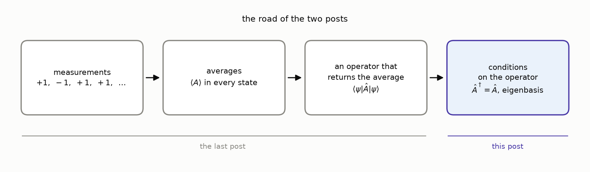
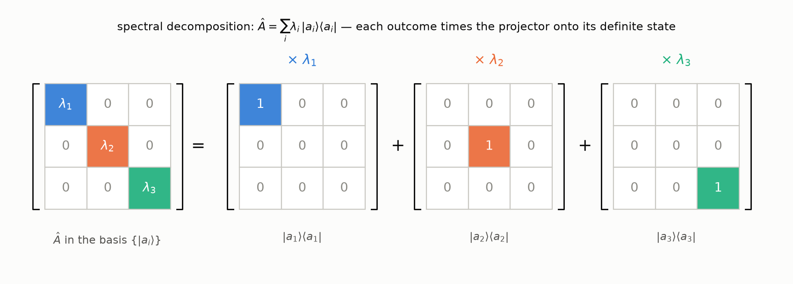
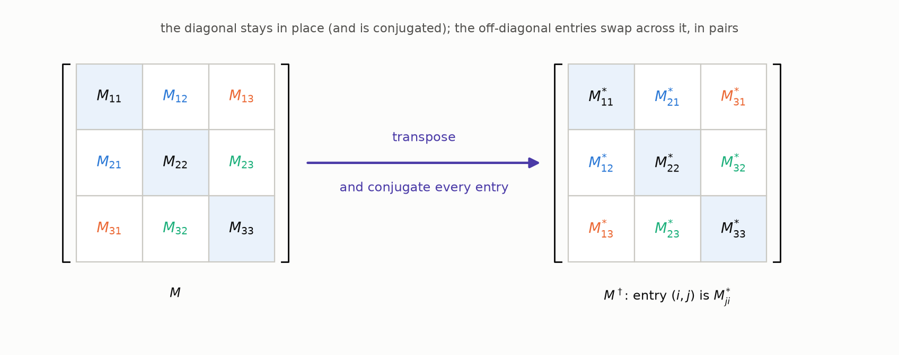
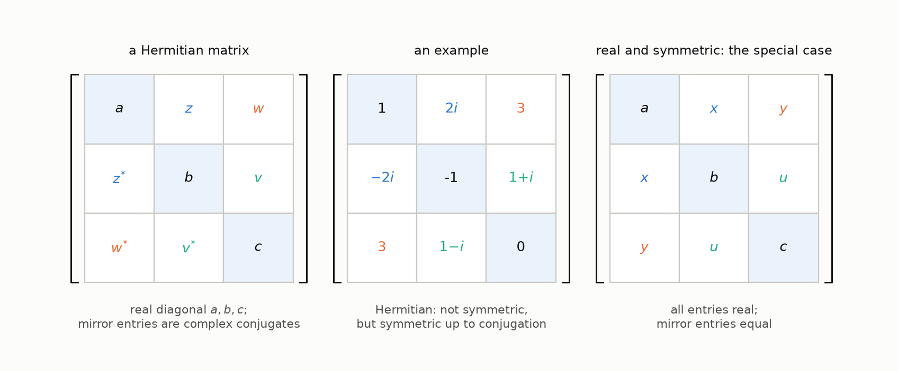
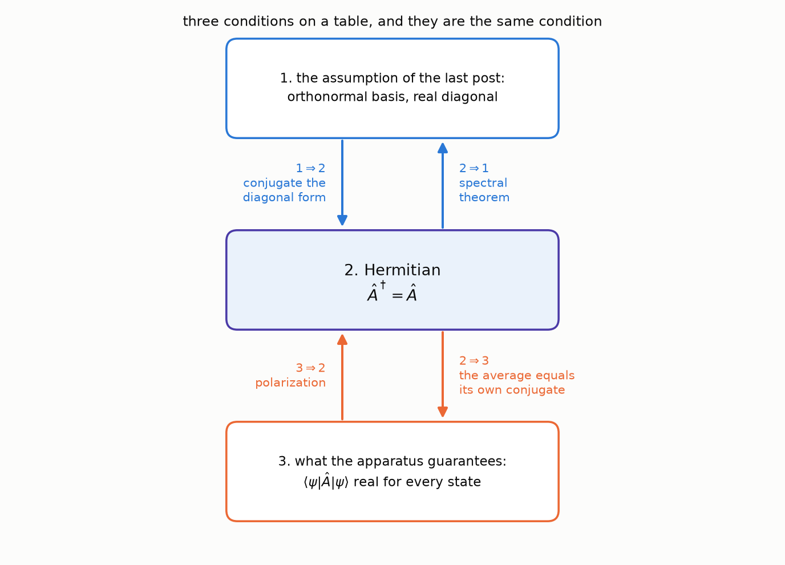
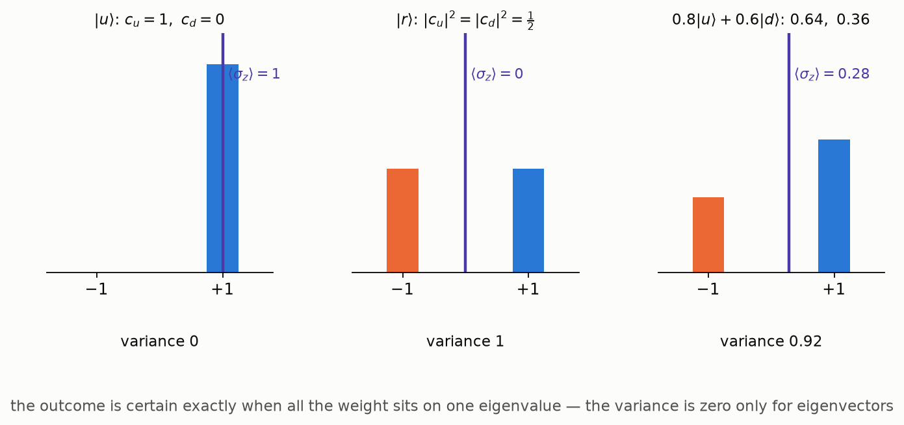
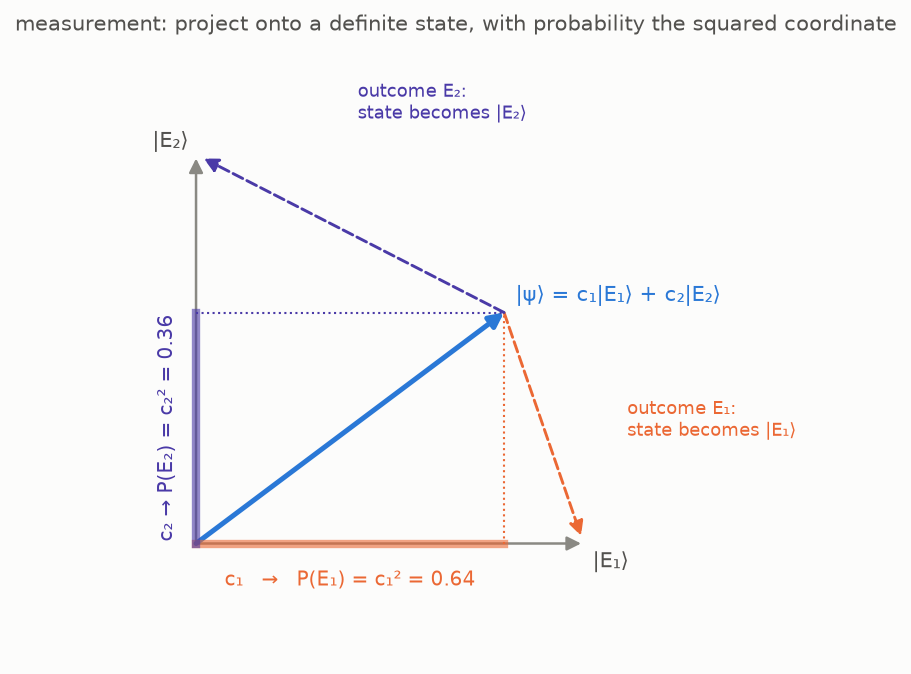
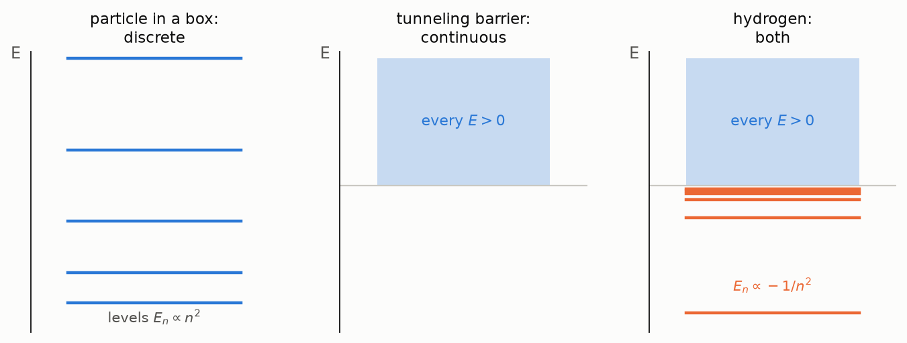

The [last post](/quantum/heisenbergs-table/) ended with an
observable as a table with two indices — an operator $\hat A$ —
and one assumption about it: that there is an orthonormal basis
$\{|a_i\rangle\}$ in which the table is diagonal, with real numbers
$\lambda_1, \dots, \lambda_n$ on the diagonal. In that basis the
average of the observable in the state
$|\psi\rangle = \sum_i c_i |a_i\rangle$ came out as
$\langle A \rangle = \sum_i \lambda_i |c_i|^2$, the $\lambda_i$ were
read as the outcomes, and the weights $|c_i|^2$ were shown to be
the only admissible probabilities — the Born rule. Every table that
satisfies the assumption is Hermitian, equal to its own conjugate
transpose. Two things were left unproved: that every Hermitian table
satisfies the assumption, and that the assumption does not exclude
any observable.

This post proves both, and arrives at the sentence most modern
textbooks open with — "observables are Hermitian operators" — as
the last line. Not all of them do: Landau and Lifshitz define the
operator by the mean value and derive Hermiticity from the reality
of the mean, and Dirac defines an observable as a *real dynamical
variable* with a complete set of eigenstates — "dynamical variable"
being his word for a linear operator standing for a physical
quantity, and "real" his word for self-adjoint, chosen because a
measurement returns a real number. This road follows them — Landau
and Lifshitz's §3 and chapter II of Dirac's *Principles*, as in the
last post — and takes its linear algebra from chapter 4 of Panov's
lectures.

## Where we stand

Three facts from the earlier posts are used throughout.

- A measurement along an axis has two outcomes, $+1$ and $-1$, and
  two **definite states**, the states that the measurement prepares
  and then confirms on every repetition: $|u\rangle$ and $|d\rangle$
  for the $z$ axis, $|r\rangle$ and $|l\rangle$ for the $x$ axis.
  States an apparatus tells apart with certainty are orthogonal
  (the [second post](/quantum/states-are-vectors/#what-the-geometry-means-physically)).
- The outer product $|a_i\rangle\langle a_i|$ is a
  [projector](/quantum/states-are-vectors/#coordinates-and-a-formula-for-the-identity-operator)
  onto the direction of $|a_i\rangle$, and the projectors of an
  orthonormal basis add up to the identity.
- An observable is an operator $\hat A$; in the orthonormal basis
  $\{|a_i\rangle\}$ where its table is diagonal,
  $\langle a_i | \hat A | a_j \rangle = \lambda_i \delta_{ij}$, its
  average is $\langle \psi | \hat A | \psi \rangle = \sum_i \lambda_i |c_i|^2$,
  the $\lambda_i$ are its outcomes, and $|c_i|^2$ is the probability
  of the outcome $\lambda_i$
  (the [last post](/quantum/heisenbergs-table/)).

## From the diagonal basis to the eigenbasis

### The diagonal basis is the eigenbasis

Recall the definitions. A nonzero vector $|v\rangle$ is an
[**eigenvector**](https://en.wikipedia.org/wiki/Eigenvalues_and_eigenvectors)
of $\hat A$ if the operator merely rescales it,

$$
\hat A\, |v\rangle = \lambda\, |v\rangle ,
$$

and the factor $\lambda$ is the corresponding **eigenvalue**; the
set of eigenvalues is the **spectrum** of $\hat A$. A diagonal table
says exactly this about
its basis vectors. By the
[column rule](/quantum/heisenbergs-table/#column-rule) of the last
post,
$\hat A |a_j\rangle = \sum_i A_{ij} |a_i\rangle$, and with
$A_{ij} = \lambda_i \delta_{ij}$ only one term survives:

$$
\hat A\, |a_j\rangle = \lambda_j\, |a_j\rangle .
$$

So the basis of the
[assumption](/quantum/heisenbergs-table/#assumption) — the
orthonormal basis in which the table is diagonal, with real numbers
on the diagonal — is a basis of eigenvectors, the numbers on the
diagonal are the eigenvalues, and the possible
outcomes of an observable are the spectrum of its operator.

> 💡 **Where the word comes from.** The two spectra of this road
> met by accident. Hilbert chose "spectrum" around 1906 for the set
> of values attached to a quadratic form in infinitely many
> variables, with no physics in mind; the spectrum of an atom was
> Kirchhoff's and Bunsen's word for its lines, from Newton's
> spectrum of light. Twenty years later matrix mechanics made
> Hilbert's spectrum of the energy operator *be* the atom's spectrum
> of levels. Hilbert, in Constance Reid's biography: he had
> developed the theory "from purely mathematical interests, and
> even called it spectral analysis without any presentiment that it
> would later find application to the actual spectrum of physics."

Rewriting
the diagonal table without coordinates gives the operator as a sum
over its own definite directions,

$$
\boxed{\; \hat A = \sum_i \lambda_i\, |a_i\rangle\langle a_i| \;}
$$

— the **spectral decomposition**: each outcome times the projector
onto its eigenvector. To check that the right side is the same
operator, apply it to a state $|\psi\rangle = \sum_j c_j |a_j\rangle$,
with $\langle a_i | \psi \rangle = c_i$:

$$
\Big( \sum_i \lambda_i\, |a_i\rangle\langle a_i| \Big) |\psi\rangle = \sum_i \lambda_i\, |a_i\rangle \langle a_i | \psi \rangle = \sum_i \lambda_i c_i\, |a_i\rangle ,
$$

while applying $\hat A$ directly, by linearity and
$\hat A |a_j\rangle = \lambda_j |a_j\rangle$,

$$
\hat A\, |\psi\rangle = \sum_j c_j\, \hat A |a_j\rangle = \sum_j \lambda_j c_j\, |a_j\rangle .
$$

The two agree on every state, so the operators are equal. Set every
$\lambda_i$ to $1$ and the decomposition collapses to the
resolution of identity of the second post; keep a single $\lambda_i$
equal to $1$ and set the rest to $0$ and it is the projector
$|a_i\rangle\langle a_i|$ whose average was the Born weight $|c_i|^2$
in the last post.

### Real outcomes make the table Hermitian

The assumption asked for real numbers on the diagonal, in one
particular basis. What does that condition look like in another
orthonormal basis, where the same table is not diagonal — in the $z$
basis of the spin, say, for the $x$ observable? The answer is a
property of the table that does not mention any basis, and to state
it one more notion is needed.

Write $|\hat M \psi\rangle$ for the vector $\hat M |\psi\rangle$, so
that the bracket $\langle \varphi | \hat M | \psi \rangle$ can also be
read as the inner product $\langle \varphi | \hat M \psi \rangle$ of two
vectors.
The [**adjoint**](https://en.wikipedia.org/wiki/Hermitian_adjoint)
$\hat M^\dagger$ of $\hat M$ is the operator that lets the operator
act on the bra instead:

$$
\langle \varphi | \hat M \psi \rangle = \langle \hat M^\dagger \varphi | \psi \rangle \qquad \text{for all } |\varphi\rangle, |\psi\rangle .
$$

Such an operator exists and is unique; the proof, from the second
post's Riesz theorem, is under the cut.

Why the adjoint exists

Fix $|\varphi\rangle$. The number
$\langle \varphi | \hat M \psi \rangle$ depends linearly on
$|\psi\rangle$, so by the second post's
[Riesz theorem](/quantum/states-are-vectors/#bras-and-why-the-bracket-splits)
there is exactly one vector $|\chi\rangle$ with
$\langle \varphi | \hat M \psi \rangle = \langle \chi | \psi \rangle$ for
all $|\psi\rangle$. This assigns to every $|\varphi\rangle$ a vector
$|\chi\rangle$, and an assignment of a vector to every vector is an
operator; call it $\hat M^\dagger$. The displayed equation holds for
it by construction. It is also linear: if $|\chi_1\rangle$ and
$|\chi_2\rangle$ are the Riesz vectors of $|\varphi_1\rangle$ and
$|\varphi_2\rangle$, then for every $|\psi\rangle$

$$
\langle \alpha\varphi_1 + \beta\varphi_2 \,|\, \hat M \psi \rangle = \alpha^* \langle \chi_1 | \psi \rangle + \beta^* \langle \chi_2 | \psi \rangle = \langle \alpha\chi_1 + \beta\chi_2 \,|\, \psi \rangle ,
$$

so the Riesz vector of $\alpha|\varphi_1\rangle + \beta|\varphi_2\rangle$
is $\alpha|\chi_1\rangle + \beta|\chi_2\rangle$, by uniqueness.

In a matrix with respect to an orthonormal basis the adjoint is the
**conjugate transpose**, $(M^\dagger)_{ij} = M_{ji}^*$ (Panov's
lectures, §4.1).

Four rules follow from the definition:

- $(\hat A^\dagger)^\dagger = \hat A$;
- $(\hat A + \hat B)^\dagger = \hat A^\dagger + \hat B^\dagger$;
- $(\hat A\hat B)^\dagger = \hat B^\dagger \hat A^\dagger$ — the order
  reverses;
- $(\lambda \hat A)^\dagger = \lambda^* \hat A^\dagger$ — a scalar comes
  out conjugated.

The adjoint of a ket is its bra, $(|v\rangle)^\dagger = \langle v|$ —
the second post's bra–ket correspondence in this notation.

Now use what is given. The assumption of the last post supplies an
orthonormal basis $\{|a_i\rangle\}$ in which the table of $\hat A$ is
diagonal with real numbers $\lambda_i$ on the diagonal, and the
previous subsection turned that into the spectral decomposition

$$
\hat A = \sum_i \lambda_i\, |a_i\rangle\langle a_i| .
$$

Take the adjoint of the decomposition. By the rules,
$(|a_i\rangle\langle a_i|)^\dagger = (\langle a_i|)^\dagger (|a_i\rangle)^\dagger = |a_i\rangle\langle a_i|$,
so

$$
\hat A^\dagger = \sum_i \lambda_i^*\, |a_i\rangle\langle a_i| .
$$

With real eigenvalues, $\lambda_i^* = \lambda_i$, the right side is
$\hat A$ again. An operator equal to its own adjoint,
$\hat A^\dagger = \hat A$, is called **Hermitian** (or self-adjoint).

The matrix equals its conjugate transpose in every orthonormal basis, not only the diagonal one

In matrix language, with the change-of-basis law of the
[last post](/quantum/heisenbergs-table/#the-numbers-on-the-diagonal-are-the-outcomes):
if $\Lambda$ is the diagonal table and $U$ the unitary matrix
taking the eigenbasis to another orthonormal basis, the table there
is $A = U \Lambda U^\dagger$, and by the rules for the conjugate
transpose — order reversed, $(U^\dagger)^\dagger = U$ —

$$
A^\dagger = (U \Lambda U^\dagger)^\dagger = U\, \Lambda^\dagger\, U^\dagger = U \Lambda U^\dagger = A ,
$$

since $\Lambda^\dagger = \Lambda$ for a diagonal matrix with real
entries. So the matrix equals its conjugate transpose in every
orthonormal basis, not only in the diagonal one.

This answers the question the section opened with. The condition
"real numbers on the diagonal" becomes, in any basis:

> **The table of every measurable quantity is Hermitian** — equal
> to its own conjugate transpose in every orthonormal basis.

What such a table looks like: real numbers on the diagonal, and
every entry below the diagonal the complex conjugate of its mirror
image above it. A real symmetric matrix is the special case with no
imaginary parts.

> 💡 **But what guarantees that every table an experiment produces is Hermitian?** A table has $n^2$ complex entries, and nature was not
> consulted about them. Why should an apparatus, which can give any
> numbers it likes, produce a table with the mirror symmetry just
> described?
>
> Because the experiment *never* hands us a table. It hands us two
> lists: the outcomes, which are real numbers, and the definite
> states, which the apparatus tells apart with certainty. The second
> post translated that certainty into the model as orthogonality, so
> in the model the definite states are an orthonormal set, and the
> table is *assembled* from the two lists by the spectral
> decomposition. Anything assembled
> that way is Hermitian, as shown above by conjugating the
> decomposition; the mirror symmetry is not a constraint on
> the laboratory but a consequence of how the table is built from
> what the laboratory gives. A table that is not Hermitian would need a complex
> outcome, or a pair of definite states that are not orthogonal, and
> no apparatus produces either.

The first table in history passed the test by itself. Heisenberg's
amplitudes satisfy $X(n - \alpha, n) = X(n, n - \alpha)^*$, as the
[last post noted](/quantum/heisenbergs-table/#conjugate-pairs),
because the coordinate $x(t)$ they describe is real. In the language
of this post: let $|n\rangle$ be the state of the atom with energy
$W(n)$, the $n$-th of Bohr's levels, and $\hat x$ the operator of
the electron's position; Heisenberg's table is the matrix of $\hat x$
in the basis of the levels, $X(n, n - \alpha) = \langle n | \hat x | n - \alpha \rangle$,
and his pairing is exactly
$\langle n - \alpha | \hat x | n \rangle = \langle n | \hat x | n - \alpha \rangle^*$,
the mirror symmetry of a Hermitian table.

Tables that are not Hermitian do appear in the theory, but as
operators that *transform* states rather than ask questions of them:
Feynman's apparatus matrix from the last post, which sends the state
entering a device to the state leaving it; a rotation of the spin
from one axis to another; the evolution of a state in time. These
are *unitary*, $U^\dagger U = \hat I$, the subject of a later post, and
their eigenvalues are unit complex numbers $e^{i\theta}$ rather than
real outcomes.

### And back: the three conditions are one

The last post left one question open: does the assumption exclude
any observable? To answer it, put side by side the three conditions
on a table that have appeared so far:

> 1. **The assumption.** There is an orthonormal basis in which the
>    table is diagonal, with real numbers on the diagonal.
> 2. **Hermitian.** $\hat A^\dagger = \hat A$.
> 3. **What the apparatus guarantees.** The average
>    $\langle \psi | \hat A | \psi \rangle$ is a real number in every
>    state.
>
> **Theorem.** The three conditions are equivalent.

The proof puts condition 2 in the middle and shows that each of the
other two is equivalent to it: four arrows,
$1 \Rightarrow 2$, $2 \Rightarrow 3$, $3 \Rightarrow 2$ and
$2 \Rightarrow 1$.

**$1 \Rightarrow 2$.** Already proved: this was the computation
above, conjugating the spectral decomposition.

**$2 \Rightarrow 3$.** One line: if $\hat A^\dagger = \hat A$, then
$\langle \psi | \hat A \psi \rangle = \langle \hat A \psi | \psi \rangle = \langle \psi | \hat A \psi \rangle^*$,
so the average equals its own conjugate.

**$3 \Rightarrow 2$.** This arrow, with the next, answers the open
question. Condition 3 is all that an apparatus guarantees about its
observable; if it is enough to reach condition 1, then every
observable that can be measured at all has a table of the assumed
kind, and the assumption, which looked like a restriction on the
tables, restricted nothing. So suppose only that
$\langle \psi | \hat A | \psi \rangle$ is real in every state. Then
$\hat A$ is Hermitian, by the
[polarization lemma](/quantum/heisenbergs-table/#polarization) of
the last post: real diagonal values make the bracket
conjugate-symmetric,
$\langle \varphi | \hat A \psi \rangle = \langle \psi | \hat A \varphi \rangle^* = \langle \hat A \varphi | \psi \rangle$
for all $|\varphi\rangle, |\psi\rangle$, and the outer equality is
the definition of $\hat A^\dagger = \hat A$.

**$2 \Rightarrow 1$.** A Hermitian operator has exactly the basis the
assumption asked for:

> **Spectral theorem** (finite dimensions). A Hermitian operator has
> real eigenvalues and an orthonormal basis of eigenvectors.

The theorem makes three claims. The first two take one line each —
the trick in both is to move the operator from the ket to the bra —
and the third is quoted from Panov.

*Real eigenvalues.* If $\hat A|\varphi\rangle = \lambda|\varphi\rangle$
with $|\varphi\rangle \neq 0$, then

$$
\lambda\, \langle \varphi | \varphi \rangle = \langle \varphi | \hat A \varphi \rangle = \langle \hat A \varphi | \varphi \rangle = \lambda^*\, \langle \varphi | \varphi \rangle ,
$$

and $\langle \varphi | \varphi \rangle \gt 0$ gives $\lambda = \lambda^*$.

*Orthogonal eigenvectors.* If $\hat A|\varphi_1\rangle = \lambda_1|\varphi_1\rangle$,
$\hat A|\varphi_2\rangle = \lambda_2|\varphi_2\rangle$ and
$\lambda_1 \neq \lambda_2$, then

$$
\lambda_2\, \langle \varphi_1 | \varphi_2 \rangle = \langle \varphi_1 | \hat A \varphi_2 \rangle = \langle \hat A \varphi_1 | \varphi_2 \rangle = \lambda_1\, \langle \varphi_1 | \varphi_2 \rangle ,
$$

so $(\lambda_2 - \lambda_1)\langle \varphi_1 | \varphi_2 \rangle = 0$
and the inner product vanishes.

*The eigenvectors fill the space.* That there are enough of them to
form an orthonormal basis is proved by induction on the dimension
(Panov, §4.2, Theorem 4.2.3), and the induction uses the same trick
once more.

Proof that a Hermitian operator has an orthonormal eigenbasis

Let $\hat A$ be Hermitian on a space of dimension $n$. If $n = 1$
there is nothing to prove. For $n \gt 1$, three steps.

1. *One eigenvector exists.* Over the complex numbers the
   characteristic polynomial of $\hat A$ has a root $\lambda$, and a
   root is an eigenvalue (Panov, §2.6, Theorem 2.6.3); take an
   eigenvector $|v\rangle$ of unit length, $\hat A|v\rangle = \lambda|v\rangle$.
   By the first claim, $\lambda$ is real.
2. *The orthogonal complement is invariant.* Let $W^\perp$ be the
   set of vectors orthogonal to $|v\rangle$; it has dimension
   $n - 1$. If $|u\rangle$ is in it, so is $\hat A|u\rangle$: move the
   operator across the bracket,
   $$\langle v | \hat A u \rangle = \langle \hat A v | u \rangle = \lambda\, \langle v | u \rangle = 0 .$$
   So $\hat A$ sends $W^\perp$ to itself, and restricted to $W^\perp$ it
   is still Hermitian — the defining equation
   $\langle \varphi | \hat A \psi \rangle = \langle \hat A \varphi | \psi \rangle$
   holds for all vectors, so in particular for those of $W^\perp$.
3. *Induction.* By the induction hypothesis $W^\perp$ has an
   orthonormal basis of eigenvectors of $\hat A$. Add $|v\rangle$ to
   it: $n$ orthonormal eigenvectors in a space of dimension $n$, a
   basis.

Finite dimension enters in step 1 only, through the existence of a
root; in infinite dimensions that step can fail, as the position
operator shows. Gram–Schmidt is not needed: the induction produces
the orthonormal basis by itself, also within a repeated eigenvalue.

With the four arrows in place the theorem is proved. "Diagonal in some orthonormal basis, with real
numbers on the diagonal", "Hermitian" and "real average in every
state" are one condition on a table, and the assumption of the last
post excluded no observable. The textbook postulate — "observables
are Hermitian operators" — is this equivalence, stated as a
definition.

### Definite states are eigenvectors

The last post read the average formula in the basis state
$|a_i\rangle$: all the weight sits on the single outcome $\lambda_i$,
so by the Born rule that outcome has probability one. A state whose
outcome is certain, and which the measurement therefore confirms on
every repetition, is what the [first post](/quantum/the-apparatus-and-the-arrow/#experiment-one-the-window-shows-1--and-repetition-confirms)
called a definite state. So every eigenvector is a definite state.

The converse also holds: no state outside the eigenvectors has a
certain outcome. In the language of averages, a certain answer is
one with no spread — the average of the squared deviation from the
mean is zero. The squared deviation is the same observable with its
window relabeled, $\lambda_i \mapsto (\lambda_i - \langle A \rangle)^2$,
so by the average rule its mean, the **variance**, is

$$
\langle (A - \langle A \rangle)^2 \rangle = \sum_i |c_i|^2\, (\lambda_i - \langle A \rangle)^2 .
$$

Every term is nonnegative, so the sum vanishes only if every $c_i$
with $\lambda_i \neq \langle A \rangle$ is zero — that is, only if
$|\psi\rangle$ has components along eigenvectors of a single
eigenvalue, which makes it an eigenvector itself. So:

> **Definite states are eigenvectors.** A state in which the outcome
> of an observable is certain is an eigenvector of its operator, and
> the certain outcome is the eigenvalue; and every eigenvector
> $|a_i\rangle$ is such a state, with the certain outcome $\lambda_i$.

This is the statement textbooks start from — Susskind's principles 1
and 2 — and here it arrives as a consequence of the average rule.
For the spin: $|u\rangle$ and $|d\rangle$, the definite states of the
$z$ observable, are the eigenvectors of its operator $\sigma_z$, with
eigenvalues $+1$ and $-1$; the first post's "the measurement
prepares a state that repeats its answer" is the statement that the
state after a measurement is an eigenvector, made precise below. From now on the word *observable* is used for the
Hermitian operator as well as for the quantity it stands for. The
three conditions one would otherwise have to *demand* of such an
operator
— real outcomes, definite states that span the space, definite
states that are orthogonal — are the spectral theorem above.

## What a measurement does

### Applying the operator is not measuring

The notation invites a confusion, so it is addressed first.
Applying an operator to a state is a *mathematical* operation that
returns a vector; a measurement is a *physical* operation that
returns a number and changes the state. They are not the same
thing, and the last post's warning about the output of the machine
can now be made concrete on the spin.

Apply $\sigma_z$ to the $x$-definite state $|r\rangle$, using
$\sigma_z|u\rangle = |u\rangle$, $\sigma_z|d\rangle = -|d\rangle$ and
linearity:

$$
\sigma_z\, |r\rangle = \tfrac{1}{\sqrt 2}\, \sigma_z |u\rangle + \tfrac{1}{\sqrt 2}\, \sigma_z |d\rangle = \tfrac{1}{\sqrt 2}\, |u\rangle - \tfrac{1}{\sqrt 2}\, |d\rangle = |l\rangle .
$$

The operator turned *right* into *left*. No $z$ measurement of an
electron prepared along $x$ ever produces an electron pointing left
along $x$: it produces $|u\rangle$ or $|d\rangle$, at random. So
$\sigma_z|r\rangle$ is not the state after a measurement. Written in
the eigenbasis of $\sigma_z$, the input
$|r\rangle = \frac{1}{\sqrt 2}|u\rangle + \frac{1}{\sqrt 2}|d\rangle$
lists the possible answers as its basis directions, and the operator
has multiplied each direction by the answer's value — the
coordinates tagged with their outcomes, not yet squared into
probabilities. (Susskind and Friedman devote their §3.5, "A common
misconception", to this point.)

### Measurement

Wishlist item 4 of the
[first post](/quantum/the-apparatus-and-the-arrow/#the-wishlist)
asked how a measurement changes the state. Everything needed is now
available: the outcomes are the eigenvalues, their probabilities are
the Born weights, and the states a measurement prepares are the
eigenvectors.

> **Measurement.** Measuring the observable $\hat A$ in the state
> $|\psi\rangle = \sum_i c_i|a_i\rangle$ returns one of the
> eigenvalues $\lambda_i$, with probability $|c_i|^2$; immediately
> after a measurement that returned $\lambda_i$, the state is the
> definite state $|a_i\rangle$.

In the language of projectors: the outcome $\lambda_i$ projects the
state onto the $i$-th definite direction and renormalizes it,

$$
|\psi\rangle \;\longmapsto\; \frac{|a_i\rangle\langle a_i | \psi \rangle}{\lVert\, |a_i\rangle\langle a_i | \psi \rangle \,\rVert} = \frac{c_i}{|c_i|}\, |a_i\rangle ,
$$

a unit factor times $|a_i\rangle$ — the same physical state. The
probability of the outcome is the average of the projector,
$\langle \psi | a_i \rangle \langle a_i | \psi \rangle = |c_i|^2$, as in the
last post's derivation of the Born rule.

Read the first post's three experiments in this language.

- *Repetition confirms.* After a $z$ measurement the state is
  $|u\rangle$ or $|d\rangle$, an eigenvector of $\sigma_z$; measuring
  $\sigma_z$ again finds coefficient $1$ on that eigenvector and
  returns the same value with probability one.
- *Flipping negates.* The apparatus turned upside down measures
  $-\sigma_z$, whose definite states are the same two vectors with
  the outcomes exchanged.
- *A new axis erases the old answer.* Measure the spin along $x$ in
  the state $|u\rangle = \frac{1}{\sqrt 2}|r\rangle + \frac{1}{\sqrt 2}|l\rangle$:
  the outcome is $\pm 1$ with probability $\frac12$ each, and the
  state becomes $|r\rangle$ or $|l\rangle$. Measure along $z$ once
  more: $|r\rangle$ and $|l\rangle$ are each half $|u\rangle$, half
  $|d\rangle$, so the old certainty is gone — probability $\frac12$
  for either answer. The erasure of the first post is the statement
  that the $z$ and $x$ observables have no eigenvector in common.

## Beyond the spin

### Degeneracy and the continuous spectrum

Two refinements. An eigenvalue may belong to more than one
independent eigenvector; it is then called **degenerate**, and the
outcome does not determine the state, only the subspace it lands in
— the hydrogen atom will make this concrete, with several orbitals
sharing one energy. And in infinite dimensions the spectrum need not
be a list of eigenvalues with eigenvectors inside the space: the
position operator of the [delta post](/quantum/from-kronecker-to-dirac/)
is the first example, its
"eigenvectors" $|x\rangle$ living just outside $L^2$ and its spectrum
being the whole real line — a **continuous spectrum**, with
$\hat x = \int x\, |x\rangle\langle x|\, dx$ as its spectral
decomposition. The problems ahead show all three kinds: the particle
in a box has a purely discrete spectrum, the tunneling problem a
purely continuous one, and hydrogen both at once.

**What carries over, and what does not.** Everything in this post
was proved for an $n \times n$ table. The state space of a particle
on a line is $L^2$, infinite-dimensional, and the problems of this
road live there. Here is the honest inventory, with the post where
each gap is taken up; none of the gaps is filled here, only named.

| statement | finite dimensions (this post) | infinite dimensions |
|---|---|---|
| the operator | an $n \times n$ table, defined on every vector | may be *unbounded*: $\hat x$ multiplies $\psi(x)$ by $x$, and $x\,\psi(x)$ need not stay in $L^2$, so the operator is defined only on a dense subspace — the dynamics posts |
| real averages $\Rightarrow$ Hermitian | proved, by polarization | the same argument; but for unbounded operators "equal to its adjoint" needs care with domains, and *symmetric* and *self-adjoint* come apart — named in the dynamics posts |
| real eigenvalues, orthogonal eigenvectors | one line each | the same one line each, for the eigenvectors that exist |
| an orthonormal eigenbasis exists | Panov, Theorem 4.2.3 | not in general: $\hat x$ has no eigenvector in $L^2$ at all. True for *compact* self-adjoint operators (the Hilbert–Schmidt theorem; Sergeev, Theorem 40) — the particle in a box |
| the spectrum | a finite list of eigenvalues | discrete (box), continuous (barrier) or mixed (hydrogen); the continuous part has no eigenvectors in the space, only *generalized* ones like $\lvert x\rangle$, normalized to a delta — the delta post, the tunneling post |
| spectral decomposition $\hat A = \sum_i \lambda_i \lvert a_i\rangle\langle a_i\rvert$ | proved | becomes an integral over the spectrum; for position, $\hat x = \int x\,\lvert x\rangle\langle x\rvert\,dx$ — the delta post's Appendix A |
| the average $\sum_i \lambda_i \lvert c_i\rvert^2$ | proved | a sum over the discrete part plus an integral $\int \lambda\,\lvert\psi(\lambda)\rvert^2\,d\lambda$ over the continuous part — the Born rule on a line, next post |

The spectral theorem for self-adjoint operators on a Hilbert space,
which makes the right column precise, is a theorem of functional
analysis rather than of this road; the road names it where it is
used and takes it from the references.

### Where every calculation starts

The post ends where a textbook begins. Shankar's *Principles*
states the content of this post as postulates and then gives the
procedure for using them (§4.2, p. 117):

1. construct the operator of the quantity;
2. find its orthonormal eigenvectors $|\omega_i\rangle$ and
   eigenvalues $\omega_i$;
3. expand the state in that basis,
   $|\psi\rangle = \sum_i |\omega_i\rangle\langle\omega_i|\psi\rangle$;
4. the probability of the result $\omega_i$ is
   $|\langle\omega_i|\psi\rangle|^2$.

Steps 2–4 are the last post and this one. In his words (p. 119): "To extract this information for any
observable, we must determine the eigenbasis of the corresponding
operator and find the projection of $|\psi\rangle$ along all its
eigenkets." A working habit follows, also his: there is no need to
change basis each time. One keeps the state written in the eigenbasis
of a chosen observable and computes the eigenvectors of any other
observable as columns in that basis. Landau and Lifshitz go further and
open their §3 with the eigenfunctions: the wave functions of the
states in which the quantity has a definite value are the first
objects they name, and the operator is built afterwards to fit them.

For the problems of this road the chosen observable is the energy, and
the first step — which operator belongs to the observable — is what
the posts on dynamics settle. The second step is then the whole
work: for a particle on a line the eigenvectors are functions, and
"find the eigenbasis" means solving a differential equation. The
particle in a box, the tunneling barrier, the harmonic oscillator and
the hydrogen atom each begin by finding the eigenfunctions of their
energy operator, and everything else about them is read off the
expansion of the state in that basis.

## What we built

The chain of the post. The orthonormal basis in which an
observable's table is diagonal is a basis of eigenvectors, and the
numbers on the diagonal — the outcomes — are the eigenvalues; the
operator is the sum of outcomes times projectors, its spectral
decomposition. Readings are real, so the operator equals its own
adjoint: Hermitian. And Hermitian is enough: a Hermitian operator
has real eigenvalues and an orthonormal eigenbasis, so the
assumption of the last post costs nothing beyond the reality of the
readings. The eigenvectors are exactly the definite states of the
first post, and a measurement projects the state onto one of them.
In more than two dimensions an eigenvalue can repeat, and in
infinite dimensions the spectrum can be continuous, as it is for
position.

The wishlist of the first post, with two more items paid:

1. **A state object** — a unit vector in a Hilbert space. ✓ (second post)
2. **A way to blend outcomes** — superposition; probabilities are
   squared amplitudes. ✓ (last post)
3. **Measurable quantities as actors** — Hermitian operators, whose
   eigenvalues are the outcomes and whose eigenvectors are the
   definite states; the average of a quantity is
   $\langle \psi | \hat A | \psi \rangle$. ✓ (last post and this one)
4. **Measurement as an operation on states** — projection onto a
   definite state, with the Born probability. ✓
5. **Geometry must enter** — still open: the dictionary between
   directions in the laboratory and operators on the two-dimensional
   state space, with the cosine of the first post as its first entry.

## Onward

Next stop: the qubit and the Bloch sphere. The spin operators
$\sigma_z$ and $\sigma_x$ are read off the definite states by the
spectral decomposition; the $y$-axis states are built and complex
amplitudes become unavoidable; $\sigma_y$ joins the other two, and
the spin operator along an arbitrary direction $\hat n$ turns out to
be $\hat n \cdot \vec\sigma$ — from which the first post's
$\langle \sigma \rangle = \cos\theta$ follows in one line, and a
two-dimensional complex state space acquires the geometry of an
ordinary sphere.

## References

- Л. Д. Ландау, Е. М. Лифшиц. *Квантовая механика (нерелятивистская
  теория)*, Теоретическая физика, т. III — chapter I, §3
  "Операторы" (pp. 24–28 of the 6th Russian edition; §3 "Operators"
  in the English *Quantum Mechanics: Non-Relativistic Theory*): the
  operator *defined* by the mean value (3.8), eigenfunctions (3.12),
  Hermiticity from the reality of the mean (3.15–3.17), and the
  orthogonality of eigenfunctions.
- P. A. M. Dirac. *The Principles of Quantum Mechanics*, 4th ed.
  Oxford University Press, 1958 (Russian translation: П. А. М. Дирак,
  *Принципы квантовой механики*, 2-е изд., Наука, 1979, под ред.
  В. А. Фока) — chapter II, §8 "Conjugate relations" (Russian ed.
  p. 42: a self-adjoint linear operator "corresponds to a real
  dynamical variable, and may therefore be called a real linear
  operator") and §10 "Observables" (pp. 52–53: a measurement gives a
  real number, so a measurable dynamical variable must be real; the
  eigenstates of a real variable, and an observable as a real
  dynamical variable whose eigenstates form a complete set).
- W. Heisenberg. *Über quantentheoretische Umdeutung kinematischer
  und mechanischer Beziehungen.* Zeitschrift für Physik 33 (1925),
  879–893; English translation in B. L. van der Waerden (ed.),
  *Sources of Quantum Mechanics*, North-Holland, 1967 — the
  conjugate symmetry of the transition amplitudes,
  $X(m, n) = X(n, m)^*$, follows from the reality of the coordinate.
- Leonard Susskind, Art Friedman. *Quantum Mechanics: The Theoretical
  Minimum*. Basic Books, 2014 — lecture 3, §3.5 "A common
  misconception": applying an operator is not measuring.
- I. J. R. Aitchison, D. A. MacManus, T. M. Snyder. [*Understanding
  Heisenberg's "magical" paper of July 1925*](https://arxiv.org/abs/quant-ph/0404009).
  American Journal of Physics 72 (2004), 1370–1379 — eqs. (44)–(45):
  the conjugate pairing of the transition amplitudes from the
  reality of $x(t)$, "nothing but" the Hermiticity of $\hat x$.
- Constance Reid. *Hilbert*. Springer, 1970 — the source of
  Hilbert's remark on the word "spectrum", in the chapter on his
  work on integral equations.
- [Quantum Sense](https://www.youtube.com/@quantumsensechannel), *Maths
  of Quantum Mechanics* — video 9
  ([Hermitian operators](https://youtu.be/da1rH0Hq62Q)).
- Т. Е. Панов. [*Лекции по линейной алгебре*](http://higeom.math.msu.su/people/taras/teaching/panov-linalg.pdf)
  (in Russian) — §4.1 (adjoint operators; the matrix of the adjoint
  is the conjugate transpose, p. 65) and §4.2 (self-adjoint
  operators: Theorem 4.2.3 on the orthonormal eigenbasis, with Lemmas
  4.2.4 and 4.2.5, pp. 66–67).
- R. Shankar. *Principles of Quantum Mechanics*, 2nd ed. Plenum, 1994 —
  chapter 4, "The Postulates — a General Discussion", §4.2, pp. 117–119:
  the four-step procedure (construct the operator, find its
  eigenbasis, expand the state, square the projections) and the
  remark that the eigenbasis of every observable must be found, but
  the basis one works in need not change.
- А. Г. Сергеев. [*Лекции по функциональному анализу*](https://mi-ras.ru/noc/13_14/2/sergeev/funkan.pdf)
  (in Russian) — Theorem 40, the Hilbert–Schmidt theorem, p. 81: the
  spectral theorem for compact self-adjoint operators in infinite
  dimensions.
- 3Blue1Brown, [*Eigenvectors and eigenvalues*](https://youtu.be/PFDu9oVAE-g)
  — the geometric picture of an eigenvector, in twenty minutes.
