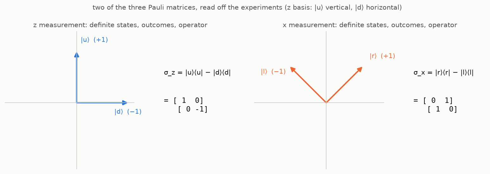

The [last post](/quantum/heisenbergs-table/) ended with an
observable as a table with two indices — an operator $\hat A$ —
and one assumption about it: that there is an orthonormal basis
$\{|a_i\rangle\}$ in which the table is diagonal, with real numbers
$\lambda_1, \dots, \lambda_n$ on the diagonal. In that basis the
average of the observable in the state
$|\psi\rangle = \sum_i c_i |a_i\rangle$ came out as
$\langle A \rangle = \sum_i \lambda_i |c_i|^2$, the $\lambda_i$ were
read as the outcomes, and the weights $|c_i|^2$ were shown to be
the only admissible probabilities — the Born rule. Every table that
satisfies the assumption is Hermitian, equal to its own conjugate
transpose. Two things were left unproved: that every Hermitian table
satisfies the assumption, and that the assumption does not exclude
any observable.

This post proves both, and arrives at the sentence most modern
textbooks open with — "observables are Hermitian operators" — as
the last line. Not all of them do: Landau and Lifshitz define the
operator by the mean value and derive Hermiticity from the reality
of the mean, and Dirac defines an observable as a *real dynamical
variable* with a complete set of eigenstates — "dynamical variable"
being his word for a linear operator standing for a physical
quantity, and "real" his word for self-adjoint, chosen because a
measurement returns a real number. This road follows them — Landau
and Lifshitz's §3 and chapter II of Dirac's *Principles*, as in the
last post — and takes its linear algebra from chapter 4 of Panov's
lectures.

## Where we stand

Three facts from the earlier posts are used throughout.

- A measurement along an axis has two outcomes, $+1$ and $-1$, and
  two **definite states**, the states that the measurement prepares
  and then confirms on every repetition: $|u\rangle$ and $|d\rangle$
  for the $z$ axis, $|r\rangle$ and $|l\rangle$ for the $x$ axis.
  States an apparatus tells apart with certainty are orthogonal
  (the [second post](/quantum/states-are-vectors/#what-the-geometry-means-physically)).
- The outer product $|a_i\rangle\langle a_i|$ is a
  [projector](/quantum/states-are-vectors/#coordinates-and-a-formula-for-the-identity-operator)
  onto the direction of $|a_i\rangle$, and the projectors of an
  orthonormal basis add up to the identity.
- An observable is an operator $\hat A$; in the orthonormal basis
  $\{|a_i\rangle\}$ where its table is diagonal,
  $\langle a_i | \hat A | a_j \rangle = \lambda_i \delta_{ij}$, its
  average is $\langle \psi | \hat A | \psi \rangle = \sum_i \lambda_i |c_i|^2$,
  the $\lambda_i$ are its outcomes, and $|c_i|^2$ is the probability
  of the outcome $\lambda_i$
  (the [last post](/quantum/heisenbergs-table/)).

## From the diagonal basis to the eigenbasis

### The diagonal basis is the eigenbasis

Recall the definitions. A nonzero vector $|v\rangle$ is an
[**eigenvector**](https://en.wikipedia.org/wiki/Eigenvalues_and_eigenvectors)
of $\hat A$ if the operator merely rescales it,

$$
\hat A\, |v\rangle = \lambda\, |v\rangle ,
$$

and the factor $\lambda$ is the corresponding **eigenvalue**; the
set of eigenvalues is the **spectrum** of $\hat A$. A diagonal table
says exactly this about
its basis vectors. By the
[column rule](/quantum/heisenbergs-table/#column-rule) of the last
post,
$\hat A |a_j\rangle = \sum_i A_{ij} |a_i\rangle$, and with
$A_{ij} = \lambda_i \delta_{ij}$ only one term survives:

$$
\hat A\, |a_j\rangle = \lambda_j\, |a_j\rangle .
$$

So the basis of the
[assumption](/quantum/heisenbergs-table/#assumption) — the
orthonormal basis in which the table is diagonal, with real numbers
on the diagonal — is a basis of eigenvectors, the numbers on the
diagonal are the eigenvalues, and the possible
outcomes of an observable are the spectrum of its operator.

> 💡 **Where the word comes from.** The two spectra of this road
> met by accident. Hilbert chose "spectrum" around 1906 for the set
> of values attached to a quadratic form in infinitely many
> variables, with no physics in mind; the spectrum of an atom was
> Kirchhoff's and Bunsen's word for its lines, from Newton's
> spectrum of light. Twenty years later matrix mechanics made
> Hilbert's spectrum of the energy operator *be* the atom's spectrum
> of levels. Hilbert, in Constance Reid's biography: he had
> developed the theory "from purely mathematical interests, and
> even called it spectral analysis without any presentiment that it
> would later find application to the actual spectrum of physics."

Rewriting
the diagonal table without coordinates gives the operator as a sum
over its own definite directions,

$$
\boxed{\; \hat A = \sum_i \lambda_i\, |a_i\rangle\langle a_i| \;}
$$

— the **spectral decomposition**: each outcome times the projector
onto its eigenvector. To check that the right side is the same
operator, apply it to a state $|\psi\rangle = \sum_j c_j |a_j\rangle$,
with $\langle a_i | \psi \rangle = c_i$:

$$
\Big( \sum_i \lambda_i\, |a_i\rangle\langle a_i| \Big) |\psi\rangle = \sum_i \lambda_i\, |a_i\rangle \langle a_i | \psi \rangle = \sum_i \lambda_i c_i\, |a_i\rangle ,
$$

while applying $\hat A$ directly, by linearity and
$\hat A |a_j\rangle = \lambda_j |a_j\rangle$,

$$
\hat A\, |\psi\rangle = \sum_j c_j\, \hat A |a_j\rangle = \sum_j \lambda_j c_j\, |a_j\rangle .
$$

The two agree on every state, so the operators are equal. Set every
$\lambda_i$ to $1$ and the decomposition collapses to the
resolution of identity of the second post; keep a single $\lambda_i$
equal to $1$ and set the rest to $0$ and it is the projector
$|a_i\rangle\langle a_i|$ whose average was the Born weight $|c_i|^2$
in the last post.

### Real outcomes make the table Hermitian

The assumption asked for real numbers on the diagonal, in one
particular basis. What does that condition look like in another
orthonormal basis, where the same table is not diagonal — in the $z$
basis of the spin, say, for the $x$ observable? The answer is a
property of the table that does not mention any basis, and to state
it one more notion is needed.

Write $|\hat M \psi\rangle$ for the vector $\hat M |\psi\rangle$, so
that the bracket $\langle \varphi | \hat M | \psi \rangle$ can also be
read as the inner product $\langle \varphi | \hat M \psi \rangle$ of two
vectors.
The [**adjoint**](https://en.wikipedia.org/wiki/Hermitian_adjoint)
$\hat M^\dagger$ of $\hat M$ is the operator that lets the operator
act on the bra instead:

$$
\langle \varphi | \hat M \psi \rangle = \langle \hat M^\dagger \varphi | \psi \rangle \qquad \text{for all } |\varphi\rangle, |\psi\rangle .
$$

Such an operator exists and is unique; the proof, from the second
post's Riesz theorem, is under the cut.

Why the adjoint exists

Fix $|\varphi\rangle$. The number
$\langle \varphi | \hat M \psi \rangle$ depends linearly on
$|\psi\rangle$, so by the second post's
[Riesz theorem](/quantum/states-are-vectors/#bras-and-why-the-bracket-splits)
there is exactly one vector $|\chi\rangle$ with
$\langle \varphi | \hat M \psi \rangle = \langle \chi | \psi \rangle$ for
all $|\psi\rangle$. This assigns to every $|\varphi\rangle$ a vector
$|\chi\rangle$, and an assignment of a vector to every vector is an
operator; call it $\hat M^\dagger$. The displayed equation holds for
it by construction. It is also linear: if $|\chi_1\rangle$ and
$|\chi_2\rangle$ are the Riesz vectors of $|\varphi_1\rangle$ and
$|\varphi_2\rangle$, then for every $|\psi\rangle$

$$
\langle \alpha\varphi_1 + \beta\varphi_2 \,|\, \hat M \psi \rangle = \alpha^* \langle \chi_1 | \psi \rangle + \beta^* \langle \chi_2 | \psi \rangle = \langle \alpha\chi_1 + \beta\chi_2 \,|\, \psi \rangle ,
$$

so the Riesz vector of $\alpha|\varphi_1\rangle + \beta|\varphi_2\rangle$
is $\alpha|\chi_1\rangle + \beta|\chi_2\rangle$, by uniqueness.

In a matrix with respect to an orthonormal basis the adjoint is the
**conjugate transpose**, $(M^\dagger)_{ij} = M_{ji}^*$ (Panov's
lectures, §4.1).

Four rules follow from the definition:

- $(\hat A^\dagger)^\dagger = \hat A$;
- $(\hat A + \hat B)^\dagger = \hat A^\dagger + \hat B^\dagger$;
- $(\hat A\hat B)^\dagger = \hat B^\dagger \hat A^\dagger$ — the order
  reverses;
- $(\lambda \hat A)^\dagger = \lambda^* \hat A^\dagger$ — a scalar comes
  out conjugated.

The adjoint of a ket is its bra, $(|v\rangle)^\dagger = \langle v|$ —
the second post's bra–ket correspondence in this notation.

Now use what is given. The assumption of the last post supplies an
orthonormal basis $\{|a_i\rangle\}$ in which the table of $\hat A$ is
diagonal with real numbers $\lambda_i$ on the diagonal, and the
previous subsection turned that into the spectral decomposition

$$
\hat A = \sum_i \lambda_i\, |a_i\rangle\langle a_i| .
$$

Take the adjoint of the decomposition. By the rules,
$(|a_i\rangle\langle a_i|)^\dagger = (\langle a_i|)^\dagger (|a_i\rangle)^\dagger = |a_i\rangle\langle a_i|$,
so

$$
\hat A^\dagger = \sum_i \lambda_i^*\, |a_i\rangle\langle a_i| .
$$

With real eigenvalues, $\lambda_i^* = \lambda_i$, the right side is
$\hat A$ again. An operator equal to its own adjoint,
$\hat A^\dagger = \hat A$, is called **Hermitian** (or self-adjoint).

The matrix equals its conjugate transpose in every orthonormal basis, not only the diagonal one

In matrix language, with the change-of-basis law of the
[last post](/quantum/heisenbergs-table/#the-numbers-on-the-diagonal-are-the-outcomes):
if $\Lambda$ is the diagonal table and $U$ the unitary matrix
taking the eigenbasis to another orthonormal basis, the table there
is $A = U \Lambda U^\dagger$, and by the rules for the conjugate
transpose — order reversed, $(U^\dagger)^\dagger = U$ —

$$
A^\dagger = (U \Lambda U^\dagger)^\dagger = U\, \Lambda^\dagger\, U^\dagger = U \Lambda U^\dagger = A ,
$$

since $\Lambda^\dagger = \Lambda$ for a diagonal matrix with real
entries. So the matrix equals its conjugate transpose in every
orthonormal basis, not only in the diagonal one.

This answers the question the section opened with. The condition
"real numbers on the diagonal" becomes, in any basis:

> **The table of every measurable quantity is Hermitian** — equal
> to its own conjugate transpose in every orthonormal basis.

What such a table looks like: real numbers on the diagonal, and
every entry below the diagonal the complex conjugate of its mirror
image above it. A real symmetric matrix is the special case with no
imaginary parts.

> 💡 **But what guarantees that every table an experiment produces is Hermitian?** A table has $n^2$ complex entries, and nature was not
> consulted about them. Why should an apparatus, which can give any
> numbers it likes, produce a table with the mirror symmetry just
> described?
>
> Because the experiment *never* hands us a table. It hands us two
> lists: the outcomes, which are real numbers, and the definite
> states, which the apparatus tells apart with certainty. The second
> post translated that certainty into the model as orthogonality, so
> in the model the definite states are an orthonormal set, and the
> table is *assembled* from the two lists by the spectral
> decomposition. Anything assembled
> that way is Hermitian, as shown above by conjugating the
> decomposition; the mirror symmetry is not a constraint on
> the laboratory but a consequence of how the table is built from
> what the laboratory gives. A table that is not Hermitian would need a complex
> outcome, or a pair of definite states that are not orthogonal, and
> no apparatus produces either.

The first table in history passed the test by itself. Heisenberg's
amplitudes satisfy $X(n - \alpha, n) = X(n, n - \alpha)^*$, as the
[last post noted](/quantum/heisenbergs-table/#conjugate-pairs),
because the coordinate $x(t)$ they describe is real. In the language
of this post: let $|n\rangle$ be the state of the atom with energy
$W(n)$, the $n$-th of Bohr's levels, and $\hat x$ the operator of
the electron's position; Heisenberg's table is the matrix of $\hat x$
in the basis of the levels, $X(n, n - \alpha) = \langle n | \hat x | n - \alpha \rangle$,
and his pairing is exactly
$\langle n - \alpha | \hat x | n \rangle = \langle n | \hat x | n - \alpha \rangle^*$,
the mirror symmetry of a Hermitian table.

Tables that are not Hermitian do appear in the theory, but as
operators that *transform* states rather than ask questions of them:
Feynman's apparatus matrix from the last post, which sends the state
entering a device to the state leaving it; a rotation of the spin
from one axis to another; the evolution of a state in time. These
are *unitary*, $U^\dagger U = \hat I$, the subject of a later post, and
their eigenvalues are unit complex numbers $e^{i\theta}$ rather than
real outcomes.

### And back: the three conditions are one

The last post left one question open: does the assumption exclude
any observable? To answer it, put side by side the three conditions
on a table that have appeared so far:

> 1. **The assumption.** There is an orthonormal basis in which the
>    table is diagonal, with real numbers on the diagonal.
> 2. **Hermitian.** $\hat A^\dagger = \hat A$.
> 3. **What the apparatus guarantees.** The average
>    $\langle \psi | \hat A | \psi \rangle$ is a real number in every
>    state.
>
> **Theorem.** The three conditions are equivalent.

The answer to the open question is in the arrow from 3 back to 1:
condition 3 is all that an apparatus guarantees about its
observable, so if it implies condition 1, then every observable
that can be measured at all has a table of the assumed kind, and
the assumption, which looked like a restriction on the tables,
restricted nothing. The proof is under the cut; it puts condition 2
in the middle and shows that each of the other two is equivalent to
it, and the step from 2 to 1 is the spectral theorem of linear
algebra.

Proof: the three conditions are equivalent

Four arrows: $1 \Rightarrow 2$, $2 \Rightarrow 3$, $3 \Rightarrow 2$
and $2 \Rightarrow 1$.

**$1 \Rightarrow 2$.** Already proved: this was the computation
above, conjugating the spectral decomposition.

**$2 \Rightarrow 3$.** One line: if $\hat A^\dagger = \hat A$, then
$\langle \psi | \hat A \psi \rangle = \langle \hat A \psi | \psi \rangle = \langle \psi | \hat A \psi \rangle^*$,
so the average equals its own conjugate.

**$3 \Rightarrow 2$.** Suppose only that
$\langle \psi | \hat A | \psi \rangle$ is real in every state. Then
$\hat A$ is Hermitian, by the
[polarization lemma](/quantum/heisenbergs-table/#polarization) of
the last post: real diagonal values make the bracket
conjugate-symmetric,
$\langle \varphi | \hat A \psi \rangle = \langle \psi | \hat A \varphi \rangle^* = \langle \hat A \varphi | \psi \rangle$
for all $|\varphi\rangle, |\psi\rangle$, and the outer equality is
the definition of $\hat A^\dagger = \hat A$.

**$2 \Rightarrow 1$.** A Hermitian operator has exactly the basis the
assumption asked for:

> **Spectral theorem** (finite dimensions). A Hermitian operator has
> real eigenvalues and an orthonormal basis of eigenvectors.

The theorem makes three claims. The first two take one line each —
the trick in both is to move the operator from the ket to the bra —
and the third is quoted from Panov.

*Real eigenvalues.* If $\hat A|\varphi\rangle = \lambda|\varphi\rangle$
with $|\varphi\rangle \neq 0$, then

$$
\lambda\, \langle \varphi | \varphi \rangle = \langle \varphi | \hat A \varphi \rangle = \langle \hat A \varphi | \varphi \rangle = \lambda^*\, \langle \varphi | \varphi \rangle ,
$$

and $\langle \varphi | \varphi \rangle \gt 0$ gives $\lambda = \lambda^*$.

*Orthogonal eigenvectors.* If $\hat A|\varphi_1\rangle = \lambda_1|\varphi_1\rangle$,
$\hat A|\varphi_2\rangle = \lambda_2|\varphi_2\rangle$ and
$\lambda_1 \neq \lambda_2$, then

$$
\lambda_2\, \langle \varphi_1 | \varphi_2 \rangle = \langle \varphi_1 | \hat A \varphi_2 \rangle = \langle \hat A \varphi_1 | \varphi_2 \rangle = \lambda_1\, \langle \varphi_1 | \varphi_2 \rangle ,
$$

so $(\lambda_2 - \lambda_1)\langle \varphi_1 | \varphi_2 \rangle = 0$
and the inner product vanishes.

*The eigenvectors fill the space.* That there are enough of them to
form an orthonormal basis is proved by induction on the dimension
(Panov, §4.2, Theorem 4.2.3), and the induction uses the same trick
once more. Let $\hat A$ be Hermitian on a space of dimension $n$. If $n = 1$
there is nothing to prove. For $n \gt 1$, three steps.

1. *One eigenvector exists.* Over the complex numbers the
   characteristic polynomial of $\hat A$ has a root $\lambda$, and a
   root is an eigenvalue (Panov, §2.6, Theorem 2.6.3); take an
   eigenvector $|v\rangle$ of unit length, $\hat A|v\rangle = \lambda|v\rangle$.
   By the first claim, $\lambda$ is real.
2. *The orthogonal complement is invariant.* Let $W^\perp$ be the
   set of vectors orthogonal to $|v\rangle$; it has dimension
   $n - 1$. If $|u\rangle$ is in it, so is $\hat A|u\rangle$: move the
   operator across the bracket,
   $$\langle v | \hat A u \rangle = \langle \hat A v | u \rangle = \lambda\, \langle v | u \rangle = 0 .$$
   So $\hat A$ sends $W^\perp$ to itself, and restricted to $W^\perp$ it
   is still Hermitian — the defining equation
   $\langle \varphi | \hat A \psi \rangle = \langle \hat A \varphi | \psi \rangle$
   holds for all vectors, so in particular for those of $W^\perp$.
3. *Induction.* By the induction hypothesis $W^\perp$ has an
   orthonormal basis of eigenvectors of $\hat A$. Add $|v\rangle$ to
   it: $n$ orthonormal eigenvectors in a space of dimension $n$, a
   basis.

> **Where finite dimension is used.** In step 1 only, through the
> existence of a root. In infinite dimensions that step can fail:
> the position operator has no eigenvector in $L^2$ at all, as the
> [section on spectra](#degeneracy-and-the-continuous-spectrum)
> below and the [delta post](/quantum/from-kronecker-to-dirac/)
> discuss.

So "diagonal in some orthonormal basis, with real numbers on the
diagonal", "Hermitian" and "real average in every state" are one
condition on a table, and the assumption of the last post excluded
no observable. This is also where the road meets the textbooks.
They begin by *postulating* that observables are Hermitian
operators; here that sentence is the conclusion of the theorem,
reached from what an apparatus gives — real outcomes and
distinguishable definite states — and from nothing else.

### Definite states are eigenvectors

[Heisenberg's Table](/quantum/heisenbergs-table/) gave the name
**definite states** to the states that a measurement prepares and
then confirms. Measure an electron along $z$, then measure the same
electron along $z$ again without touching it in between: the second
measurement repeats the first answer, and so does every following
one ([the first post's experiment one](/quantum/the-apparatus-and-the-arrow/#experiment-one-the-window-shows-1--and-repetition-confirms)).
So in a definite state the outcome is certain. The eigenbasis gives
all such states:

> **Definite states are eigenvectors.**
>
> - **(a)** Every eigenvector $|a_i\rangle$ is a definite state, with
>   the certain outcome $\lambda_i$.
> - **(b)** Conversely, every definite state is an eigenvector of
>   $\hat A$, and the certain outcome is its eigenvalue.

**(a) Eigenvector ⇒ definite.** Take the basis state $|a_i\rangle$.
Its coordinates and, by the Born rule, its outcome probabilities are

$$
c_j = \langle a_j | a_i \rangle = \delta_{ij}, \qquad P(\lambda_j) = |c_j|^2 = \delta_{ij} ,
$$

so in the state $|a_i\rangle$ the outcome $\lambda_i$ is certain and
every other outcome has probability zero.

**(b) Definite ⇒ eigenvector.** Take a state
$|\psi\rangle = \sum_i c_i |a_i\rangle$ in which the outcome is
certain. In the language of averages, a certain answer is
one with no spread — the average of the squared deviation from the
mean $\langle A \rangle$ is zero. The squared deviation
$(A - \langle A \rangle)^2$ is an observable in its own right: the same
apparatus, with its window reading $(\lambda_i - \langle A \rangle)^2$
in place of $\lambda_i$. Its operator is $(\hat A - \langle A \rangle \hat I)^2$,
and the definite states are unchanged: applying
$\hat A - \langle A \rangle \hat I$ to $|a_i\rangle$ once, with
$\hat A |a_i\rangle = \lambda_i |a_i\rangle$ and
$\hat I |a_i\rangle = |a_i\rangle$, gives

$$
(\hat A - \langle A \rangle \hat I)\, |a_i\rangle = \lambda_i |a_i\rangle - \langle A \rangle |a_i\rangle = (\lambda_i - \langle A \rangle)\, |a_i\rangle .
$$

So $|a_i\rangle$ comes back multiplied by the number
$\lambda_i - \langle A \rangle$. Apply the same operator a second time;
the number passes through by linearity:

$$
\begin{aligned}
(\hat A - \langle A \rangle \hat I)^2\, |a_i\rangle
&= (\hat A - \langle A \rangle \hat I)\, \big[ (\lambda_i - \langle A \rangle)\, |a_i\rangle \big] \\
&= (\lambda_i - \langle A \rangle)\, (\hat A - \langle A \rangle \hat I)\, |a_i\rangle \\
&= (\lambda_i - \langle A \rangle)^2\, |a_i\rangle .
\end{aligned}
$$

Each $|a_i\rangle$ is an eigenvector of the squared deviation, with
eigenvalue $(\lambda_i - \langle A \rangle)^2$. So by the average
rule of the last post its mean, the **variance**, is

$$
\langle (A - \langle A \rangle)^2 \rangle = \sum_i |c_i|^2\, (\lambda_i - \langle A \rangle)^2 .
$$

A certain outcome means this sum is zero. Every term is nonnegative,
so each term is zero on its own: for every $i$, either $c_i = 0$ or
$\lambda_i = \langle A \rangle$. So $|\psi\rangle$ has nonzero
coordinates only along basis vectors with one and the same
eigenvalue, $\lambda = \langle A \rangle$.

- If the $\lambda_i$ are all different, that is a single basis vector
  $|a_i\rangle$, and $|\psi\rangle = c_i |a_i\rangle$ with
  $|c_i| = 1$: the eigenvector $|a_i\rangle$ up to a
  [global phase](/quantum/states-are-vectors/#global-phase).
- If several basis vectors share the eigenvalue $\lambda$ (the
  [degenerate case](#degeneracy-and-the-continuous-spectrum) below),
  $|\psi\rangle$ is a combination of them, and it is still an
  eigenvector:
  $\hat A |\psi\rangle = \sum_i c_i \lambda\, |a_i\rangle = \lambda\, |\psi\rangle$.

For the spin: $|u\rangle$ and $|d\rangle$, the definite states of the
$z$ observable, are the eigenvectors of its operator $\sigma_z$, with
eigenvalues $+1$ and $-1$.
From now on the word *observable* is used for the Hermitian
operator as well as for the quantity it stands for.

### The recipe, and the qubit as its first case

Step back and look at what the theorem does to the way problems are
solved. It says that every measurable quantity comes with an
orthonormal basis of its own, the eigenbasis of its operator, and
that this basis is not a convenience chosen by the calculator, as a
coordinate system is in geometry, but a physical fact about the
quantity: its vectors are the states in which the quantity has a
definite value. The $z$ spin has one such basis, $|u\rangle, |d\rangle$;
the $x$ spin has another, $|r\rangle, |l\rangle$. By the Born rule,
the probabilities of the outcomes of a quantity are the squared
coordinates of the state in its eigenbasis. So:

> **Choosing the quantity is choosing the basis.** The question
> "which quantity are we measuring?" is the same as "in which
> eigenbasis are we writing the state?"

A calculation in quantum mechanics therefore begins by finding the eigenbasis of the operator at hand,
and the rest of the calculation is reading coordinates off it. In
Shankar's *Principles* (§4.2, p. 117) the procedure is stated in
four steps:

1. construct the operator of the quantity;
2. find its orthonormal eigenvectors $|\omega_i\rangle$ and
   eigenvalues $\omega_i$;
3. expand the state in that basis,
   $|\psi\rangle = \sum_i |\omega_i\rangle\langle\omega_i|\psi\rangle$;
4. the probability of the result $\omega_i$ is
   $|\langle\omega_i|\psi\rangle|^2$.

Steps 2–4 are the last post and this one. In Shankar's words (p. 119):
"To extract this information for any observable, we must determine
the eigenbasis of the corresponding operator and find the
projection of $|\psi\rangle$ along all its eigenkets." Landau and
Lifshitz take the opposite order in their §3: the wavefunctions of
the states in which the quantity has a definite value are the first
objects they name, and the operator is built afterwards to fit them.
So the link between an operator and its definite states can be
followed in two directions:

> **Two directions.**
>
> - **From the definite states to the operator**, by the spectral
>   decomposition. This is the order of Landau and Lifshitz.
> - **From the operator to the definite states**, by finding its
>   eigenbasis. This is the order of Shankar.

The spin is the one case where every step of both can be done by hand.

**From the states to the operator.** Work in the $z$ basis, with
$|u\rangle = (1, 0)^{\mathsf T}$ and $|d\rangle = (0, 1)^{\mathsf T}$ as in
the second post. For the $z$ spin the decomposition is immediate,
outcomes $\pm 1$ on the projectors onto its definite states:

$$
\sigma_z = (+1)\,|u\rangle\langle u| + (-1)\,|d\rangle\langle d| = \begin{pmatrix} 1 & 0 \\ 0 & -1 \end{pmatrix}.
$$

For the $x$ spin the definite states are $|r\rangle = \tfrac{1}{\sqrt 2}(1, 1)^{\mathsf T}$
and $|l\rangle = \tfrac{1}{\sqrt 2}(1, -1)^{\mathsf T}$, found from the
experiments in the second post, with outcomes $+1$ and $-1$. The
same decomposition gives $\sigma_x = |r\rangle\langle r| - |l\rangle\langle l|$,
and the two outer products are

$$
|r\rangle\langle r| = \tfrac12 \begin{pmatrix} 1 & 1 \\ 1 & 1 \end{pmatrix}, \qquad |l\rangle\langle l| = \tfrac12 \begin{pmatrix} 1 & -1 \\ -1 & 1 \end{pmatrix},
$$

and subtracting the second from the first, entry by entry, gives

$$
\begin{aligned}
\sigma_x &= \tfrac12 \begin{pmatrix} 1 & 1 \\ 1 & 1 \end{pmatrix} - \tfrac12 \begin{pmatrix} 1 & -1 \\ -1 & 1 \end{pmatrix} \\
&= \tfrac12 \begin{pmatrix} 0 & 2 \\ 2 & 0 \end{pmatrix} = \begin{pmatrix} 0 & 1 \\ 1 & 0 \end{pmatrix}.
\end{aligned}
$$

Both matrices are Hermitian, as the theorem requires, and since their
entries happen to be real, Hermitian here simply means symmetric.

**The third matrix, $\sigma_y$.** The $y$ axis goes through the
same steps, with one new thing: the coordinates of its definite states
cannot be real. The
[second post](/quantum/states-are-vectors/#the-y-axis) named these
states $|i\rangle$ and $|o\rangle$, *in* and *out*, and left the
derivation open. The $y$ axis is perpendicular to both $z$ and $x$.
By [experiment three of the first post](/quantum/the-apparatus-and-the-arrow/#experiment-three-turning-the-arrow),
an electron prepared along one axis and measured along a perpendicular
one has the average $\cos 90^\circ = 0$. With outcomes $\pm 1$, an
average of zero means probability $\tfrac12$ for each outcome. So the
two states must satisfy three requirements:

1. measured along $z$, each gives $\pm 1$ with probability $\tfrac12$;
2. measured along $x$, each gives $\pm 1$ with probability $\tfrac12$;
3. they are mutually exclusive, $\langle i | o \rangle = 0$.

Take a state with coordinates $(a, b)^{\mathsf T}$. Requirement 1 says
$|a|^2 = |b|^2 = \tfrac12$, so the moduli are known and only the phases
are not. Write both coordinates in polar form, modulus times phase:

$$
a = \tfrac{1}{\sqrt 2}\, e^{i\alpha}, \qquad b = \tfrac{1}{\sqrt 2}\, e^{i\beta} .
$$

A [global phase](/quantum/states-are-vectors/#global-phase) changes
nothing measurable, so multiply the state by $e^{-i\alpha}$. The first
coordinate becomes real and positive, and one unknown angle remains,
$\varphi = \beta - \alpha$:

$$
|\psi\rangle = \tfrac{1}{\sqrt 2} (1, e^{i\varphi})^{\mathsf T} .
$$

Requirement 2 determines $\varphi$. By the Born rule, the probability
of $+1$ along $x$ is

$$
\begin{aligned}
|\langle r | \psi \rangle|^2 &= \tfrac14\, |1 + e^{i\varphi}|^2 \\
&= \tfrac14\, (1 + e^{i\varphi})(1 + e^{-i\varphi}) \\
&= \tfrac12\, (1 + \cos\varphi) .
\end{aligned}
$$

Setting this equal to $\tfrac12$ gives $\cos\varphi = 0$, so
$e^{i\varphi} = i$ or $e^{i\varphi} = -i$. This is what the second post
promised. Real coordinates would require $e^{i\varphi} = \pm 1$, and
those two values give $|r\rangle$ and $|l\rangle$ themselves, with
probabilities $1$ and $0$. No real choice gives $\tfrac12$: on the unit
circle, the point $e^{i\varphi}$ has the horizontal coordinate
$\cos\varphi$ and the vertical coordinate $\sin\varphi$, the probability
depends only on $\cos\varphi$, and the condition $\cos\varphi = 0$
selects the two points on the vertical axis.

The two solutions also satisfy requirement 3: the bra conjugates the
coordinates, so the inner product of $\tfrac{1}{\sqrt 2}(1, -i)^{\mathsf T}$
with $\tfrac{1}{\sqrt 2}(1, i)^{\mathsf T}$ is
$\tfrac12 (1 \cdot 1 + i \cdot i) = 0$. So these are the two definite
states of the $y$ axis. The requirements do not say which one to call
$|i\rangle$, and exchanging the names changes the sign of $\sigma_y$.
The standard choice is

$$
|i\rangle = \tfrac{1}{\sqrt 2} (1, i)^{\mathsf T}, \qquad |o\rangle = \tfrac{1}{\sqrt 2} (1, -i)^{\mathsf T} ,
$$

and the qubit post explains it: this choice makes the axes $x, y, z$ a
right-handed triple.

Now the same decomposition, with outcomes $+1$ on $|i\rangle$ and $-1$ on
$|o\rangle$. The bras are $\langle i| = \tfrac{1}{\sqrt 2}(1, -i)$ and
$\langle o| = \tfrac{1}{\sqrt 2}(1, i)$, so

$$
|i\rangle\langle i| = \tfrac12 \begin{pmatrix} 1 & -i \\ i & 1 \end{pmatrix}, \qquad |o\rangle\langle o| = \tfrac12 \begin{pmatrix} 1 & i \\ -i & 1 \end{pmatrix},
$$

and subtracting the second from the first gives

$$
\sigma_y = |i\rangle\langle i| - |o\rangle\langle o| = \begin{pmatrix} 0 & -i \\ i & 0 \end{pmatrix} .
$$

This matrix is neither real nor symmetric, and it is Hermitian.
Transposing it and then conjugating the entries returns the same
matrix:

$$
\begin{pmatrix} 0 & -i \\ i & 0 \end{pmatrix}^{\mathsf T} = \begin{pmatrix} 0 & i \\ -i & 0 \end{pmatrix}, \qquad \begin{pmatrix} 0 & i \\ -i & 0 \end{pmatrix}^{*} = \begin{pmatrix} 0 & -i \\ i & 0 \end{pmatrix} .
$$

These are the three
[**Pauli matrices**](https://en.wikipedia.org/wiki/Pauli_matrices),
obtained here from the experiments through their definite states:

$$
\sigma_x = \begin{pmatrix} 0 & 1 \\ 1 & 0 \end{pmatrix}, \qquad \sigma_y = \begin{pmatrix} 0 & -i \\ i & 0 \end{pmatrix}, \qquad \sigma_z = \begin{pmatrix} 1 & 0 \\ 0 & -1 \end{pmatrix} .
$$

All of this is written in the $z$ basis, and that is why $\sigma_z$
came out diagonal and the other two did not. The operators do not depend
on the basis, but their matrices do. In its own eigenbasis each of the
three has $+1$ and $-1$ on the diagonal, and the imaginary entries of
$\sigma_y$ come from writing it in the $z$ basis. The $z$ basis has no
special standing: it was only the basis we chose to write in. This is
["choosing the quantity is choosing the basis"](#quantity-is-basis) in
the form of matrices.

All three matrices in all three bases

By the [column rule](/quantum/heisenbergs-table/#column-rule), column
$j$ of a table holds the coordinates of what the operator returns on the
$j$-th basis vector. Applying each matrix to the coordinates of the
basis states gives:

| | on $\lvert r\rangle, \lvert l\rangle$ | on $\lvert i\rangle, \lvert o\rangle$ |
|---|---|---|
| $\sigma_x$ | $\sigma_x \lvert r\rangle = \lvert r\rangle$, $\sigma_x \lvert l\rangle = -\lvert l\rangle$ | $\sigma_x \lvert i\rangle = i \lvert o\rangle$, $\sigma_x \lvert o\rangle = -i \lvert i\rangle$ |
| $\sigma_y$ | $\sigma_y \lvert r\rangle = -i \lvert l\rangle$, $\sigma_y \lvert l\rangle = i \lvert r\rangle$ | $\sigma_y \lvert i\rangle = \lvert i\rangle$, $\sigma_y \lvert o\rangle = -\lvert o\rangle$ |
| $\sigma_z$ | $\sigma_z \lvert r\rangle = \lvert l\rangle$, $\sigma_z \lvert l\rangle = \lvert r\rangle$ | $\sigma_z \lvert i\rangle = \lvert o\rangle$, $\sigma_z \lvert o\rangle = \lvert i\rangle$ |

For example, $\sigma_y |r\rangle = -i |l\rangle$ has the coordinates
$(0, -i)$ in the basis $|r\rangle, |l\rangle$, so this is the first
column of $\sigma_y$ in that basis. Reading off all the columns:

| Operator | in the basis $\lvert u\rangle, \lvert d\rangle$ | in the basis $\lvert r\rangle, \lvert l\rangle$ | in the basis $\lvert i\rangle, \lvert o\rangle$ |
|---|---|---|---|
| $\sigma_x$ | $\begin{pmatrix} 0 & 1 \\ 1 & 0 \end{pmatrix}$ | $\begin{pmatrix} 1 & 0 \\ 0 & -1 \end{pmatrix}$ | $\begin{pmatrix} 0 & -i \\ i & 0 \end{pmatrix}$ |
| $\sigma_y$ | $\begin{pmatrix} 0 & -i \\ i & 0 \end{pmatrix}$ | $\begin{pmatrix} 0 & i \\ -i & 0 \end{pmatrix}$ | $\begin{pmatrix} 1 & 0 \\ 0 & -1 \end{pmatrix}$ |
| $\sigma_z$ | $\begin{pmatrix} 1 & 0 \\ 0 & -1 \end{pmatrix}$ | $\begin{pmatrix} 0 & 1 \\ 1 & 0 \end{pmatrix}$ | $\begin{pmatrix} 0 & 1 \\ 1 & 0 \end{pmatrix}$ |

Each row has the diagonal matrix once, in the column of that operator's
own eigenbasis. All nine matrices are Hermitian, as the theorem says
they must be in every orthonormal basis.

**From the operator to the states.** Given the operator, find its
eigenbasis: this is step 2 of the procedure above. Take $\sigma_x$ as given and forget where it came
from. Its eigenvalues are the roots of the characteristic
polynomial,

$$
\det(\sigma_x - \lambda I) = \det \begin{pmatrix} -\lambda & 1 \\ 1 & -\lambda \end{pmatrix} = \lambda^2 - 1 ,
$$

so $\lambda = \pm 1$ — real, as they must be. The eigenvector for
$\lambda = +1$ solves $\sigma_x v = v$, that is, $(v_2, v_1) = (v_1, v_2)$,
so $v_1 = v_2$; normalized, $v = \tfrac{1}{\sqrt 2}(1, 1)^{\mathsf T}$.
For $\lambda = -1$, $v_1 = -v_2$ and $v = \tfrac{1}{\sqrt 2}(1, -1)^{\mathsf T}$.
The two are orthogonal, as the spectral theorem says — and they are
$|r\rangle$ and $|l\rangle$. Linear algebra, given only the matrix,
returns the two states the second post had to extract from the
experiments by hand. That is the recipe working: the eigenbasis of
$\sigma_x$ *is* the pair of definite states of the $x$ measurement,
and from here on any observable of the spin is handled the same way.

For $\sigma_y$ the entries are not real, but the eigenvalues are, as
the theorem says they must be:

$$
\det(\sigma_y - \lambda I) = \det \begin{pmatrix} -\lambda & -i \\ i & -\lambda \end{pmatrix} = \lambda^2 - 1 ,
$$

so again $\lambda = \pm 1$. For $\lambda = +1$, the equation
$\sigma_y v = v$ reads $(-i v_2, i v_1) = (v_1, v_2)$, so $v_2 = i v_1$,
and normalizing returns $|i\rangle$. For $\lambda = -1$, $v_2 = -i v_1$
returns $|o\rangle$.

On the spin this direction is only a check: the matrices were built
from these same states a moment ago. In general an operator is not
built from its definite states, which are what we are looking for. It
can come from three other places.

- **The laws of motion.** This is the main case. The energy operator
  is derived from the dynamics, in later posts, and nobody has to
  measure its eigenvalues first. They come out as predictions: the
  energy levels of hydrogen are the answer to an eigenvalue problem,
  and the measured spectrum is then compared with them.
- **Operators already known.** As the qubit post shows, the spin along
  an arbitrary direction $\hat n$ is
  $\hat n \cdot \vec\sigma = n_x \sigma_x + n_y \sigma_y + n_z \sigma_z$.
  This matrix is built from the three above, with no separate
  experiment for each axis, and its definite states are then computed
  from it.
- **Measured averages.** An apparatus gives averages, and by
  [polarization](/quantum/heisenbergs-table/#polarization) the averages
  in all states determine the whole table. For the spin four states are
  enough: a Hermitian table there is
  $$\hat A = \begin{pmatrix} a & b \\ b^* & d \end{pmatrix}, \qquad a, d \in \mathbb R .$$
  Each average gives one real equation, and these four give $a$, $d$,
  $\operatorname{Re} b$ and $\operatorname{Im} b$:
  $$\begin{aligned} \langle u | \hat A | u \rangle &= a, \qquad \langle d | \hat A | d \rangle = d, \\ \langle r | \hat A | r \rangle &= \tfrac12 (a + d) + \operatorname{Re} b, \\ \langle i | \hat A | i \rangle &= \tfrac12 (a + d) - \operatorname{Im} b. \end{aligned}$$
  Heisenberg's table also began with measured spectral lines. This
  source has four limits:

  - It requires an apparatus that already measures the quantity, and
    with such an apparatus the outcomes can be read from its window
    without any matrix.
  - It requires states prepared with known coordinates.
  - It requires the size of the table, the number of independent states,
    and the readings of one apparatus give only a lower bound on it,
    since an eigenvalue can repeat.
  - The table of an atom is infinite, so it cannot be measured entry by
    entry.

So the main road in physics runs from the operator to its definite
states. The spin is the case where the answer can be compared with
states we already know.

## Beyond the spin

### Degeneracy and the continuous spectrum

Two refinements. An eigenvalue may belong to more than one
independent eigenvector; it is then called **degenerate**, and the
outcome does not determine the state, only the subspace it lands in
— the hydrogen atom will make this concrete, with several orbitals
sharing one energy. And in infinite dimensions the spectrum need not
be a list of eigenvalues with eigenvectors inside the space: the
position operator of the [delta post](/quantum/from-kronecker-to-dirac/)
is the first example, its
"eigenvectors" $|x\rangle$ living just outside $L^2$ and its spectrum
being the whole real line — a **continuous spectrum**, with
$\hat x = \int x\, |x\rangle\langle x|\, dx$ as its spectral
decomposition. The problems ahead show all three kinds: the particle
in a box has a purely discrete spectrum, the tunneling problem a
purely continuous one, and hydrogen both at once.

**What carries over, and what does not.** Everything in this post
was proved for an $n \times n$ table. The state space of a particle
on a line is $L^2$, infinite-dimensional, and the problems of this
road live there. Here is the honest inventory, with the post where
each gap is taken up; none of the gaps is filled here, only named.

| statement | finite dimensions (this post) | infinite dimensions |
|---|---|---|
| the operator | an $n \times n$ table, defined on every vector | may be *unbounded*: $\hat x$ multiplies $\psi(x)$ by $x$, and $x\,\psi(x)$ need not stay in $L^2$, so the operator is defined only on a dense subspace — the dynamics posts |
| real averages $\Rightarrow$ Hermitian | proved, by polarization | the same argument; but for unbounded operators "equal to its adjoint" needs care with domains, and *symmetric* and *self-adjoint* come apart — named in the dynamics posts |
| real eigenvalues, orthogonal eigenvectors | one line each | the same one line each, for the eigenvectors that exist |
| an orthonormal eigenbasis exists | Panov, Theorem 4.2.3 | not in general: $\hat x$ has no eigenvector in $L^2$ at all. True for *compact* self-adjoint operators (the Hilbert–Schmidt theorem; Sergeev, Theorem 40) — the particle in a box |
| the spectrum | a finite list of eigenvalues | discrete (box), continuous (barrier) or mixed (hydrogen); the continuous part has no eigenvectors in the space, only *generalized* ones like $\lvert x\rangle$, normalized to a delta — the delta post, the tunneling post |
| spectral decomposition $\hat A = \sum_i \lambda_i \lvert a_i\rangle\langle a_i\rvert$ | proved | becomes an integral over the spectrum; for position, $\hat x = \int x\,\lvert x\rangle\langle x\rvert\,dx$ — the delta post's Appendix A |
| the average $\sum_i \lambda_i \lvert c_i\rvert^2$ | proved | a sum over the discrete part plus an integral $\int \lambda\,\lvert\psi(\lambda)\rvert^2\,d\lambda$ over the continuous part: the Born rule with a density $\lvert\psi(\lambda)\rvert^2$ in place of the weights $\lvert c_i\rvert^2$. [Heisenberg's Table](/quantum/heisenbergs-table/) proved only the discrete case; the continuous one is a later post |

The spectral theorem for self-adjoint operators on a Hilbert space,
which makes the right column precise, is a theorem of functional
analysis rather than of this road; the road names it where it is
used and takes it from the references.

For the problems of this road the operator is the energy, and step 1
of the recipe — which operator belongs to the energy — is what the
posts on dynamics settle. Step 2 is then the whole work, and in the
right column of the table: for a particle on a line the eigenvectors
are functions, and "find the eigenbasis" means solving a differential
equation, with no characteristic polynomial to take roots of. How
that is done is a post of its own, before the first problem. The
particle in a box, the tunneling barrier, the harmonic oscillator and
the hydrogen atom each begin by finding the eigenfunctions of their
energy operator, and everything else about them is read off the
expansion of the state in that basis.

## What we built

The chain of the post. The orthonormal basis in which an
observable's table is diagonal is a basis of eigenvectors, and the
numbers on the diagonal — the outcomes — are the eigenvalues; the
operator is the sum of outcomes times projectors, its spectral
decomposition. Readings are real, so the operator equals its own
adjoint: Hermitian. And Hermitian is enough: a Hermitian operator
has real eigenvalues and an orthonormal eigenbasis, so the
assumption of the last post excluded no observable. The eigenvectors
are exactly the definite states of the first post. In more than two
dimensions an eigenvalue can repeat, and in infinite dimensions the
spectrum can be continuous, as it is for position. And the theorem
dictates the method: a calculation starts by finding the eigenbasis
of the operator at hand, which for the spin returns the states the
second post found by hand. The same steps on the $y$ axis force complex
coordinates and give the third Pauli matrix, $\sigma_y$, which is
Hermitian with entries that are not real.

Wishlist item 3 is paid: **an observable is a Hermitian operator**,
whose eigenvalues are the outcomes, whose eigenvectors are the
definite states, whose average in a state is
$\langle \psi | \hat A | \psi \rangle$, and whose outcome
probabilities are the squared coordinates $|c_i|^2$ in the
eigenbasis. One thing remains: nothing has been said about what a
measurement does to the state. That is the next post.

## Onward

Next stop: what a measurement does. The warning that applying an
operator is not measuring, and measurement itself as a projection
onto a definite state — the last item of the wishlist but one.
After that, the qubit and the Bloch sphere: all the states of the spin
on one sphere, and the spin operator along an arbitrary direction.

## References

- Л. Д. Ландау, Е. М. Лифшиц. *Квантовая механика (нерелятивистская
  теория)*, Теоретическая физика, т. III — chapter I, §3
  "Операторы" (pp. 24–28 of the 6th Russian edition; §3 "Operators"
  in the English *Quantum Mechanics: Non-Relativistic Theory*): the
  operator *defined* by the mean value (3.8), eigenfunctions (3.12),
  Hermiticity from the reality of the mean (3.15–3.17), and the
  orthogonality of eigenfunctions. The order here is from the states
  to the operator.
- P. A. M. Dirac. *The Principles of Quantum Mechanics*, 4th ed.
  Oxford University Press, 1958 (Russian translation: П. А. М. Дирак,
  *Принципы квантовой механики*, 2-е изд., Наука, 1979, под ред.
  В. А. Фока) — chapter II, §8 "Conjugate relations" (Russian ed.
  p. 42: a self-adjoint linear operator "corresponds to a real
  dynamical variable, and may therefore be called a real linear
  operator") and §10 "Observables" (pp. 52–53: a measurement gives a
  real number, so a measurable dynamical variable must be real; the
  eigenstates of a real variable, and an observable as a real
  dynamical variable whose eigenstates form a complete set).
- W. Heisenberg. *Über quantentheoretische Umdeutung kinematischer
  und mechanischer Beziehungen.* Zeitschrift für Physik 33 (1925),
  879–893; English translation in B. L. van der Waerden (ed.),
  *Sources of Quantum Mechanics*, North-Holland, 1967 — the
  conjugate symmetry of the transition amplitudes,
  $X(m, n) = X(n, m)^*$, follows from the reality of the coordinate.
- Leonard Susskind, Art Friedman. *Quantum Mechanics: The Theoretical
  Minimum*. Basic Books, 2014 — lecture 2: the states $|i\rangle$ and
  $|o\rangle$ from the same requirements; lecture 3, §§3.3–3.4: the
  spin operators constructed from the experiments.
- I. J. R. Aitchison, D. A. MacManus, T. M. Snyder. [*Understanding
  Heisenberg's "magical" paper of July 1925*](https://arxiv.org/abs/quant-ph/0404009).
  American Journal of Physics 72 (2004), 1370–1379 — eqs. (44)–(45):
  the conjugate pairing of the transition amplitudes from the
  reality of $x(t)$, "nothing but" the Hermiticity of $\hat x$.
- Constance Reid. *Hilbert*. Springer, 1970 — the source of
  Hilbert's remark on the word "spectrum", in the chapter on his
  work on integral equations.
- [Quantum Sense](https://www.youtube.com/@quantumsensechannel), *Maths
  of Quantum Mechanics* — video 9
  ([Hermitian operators](https://youtu.be/da1rH0Hq62Q)).
- Т. Е. Панов. [*Лекции по линейной алгебре*](http://higeom.math.msu.su/people/taras/teaching/panov-linalg.pdf)
  (in Russian) — §4.1 (adjoint operators; the matrix of the adjoint
  is the conjugate transpose, p. 65) and §4.2 (self-adjoint
  operators: Theorem 4.2.3 on the orthonormal eigenbasis, with Lemmas
  4.2.4 and 4.2.5, pp. 66–67).
- R. Shankar. *Principles of Quantum Mechanics*, 2nd ed. Plenum, 1994 —
  chapter 4, "The Postulates — a General Discussion", §4.2, pp. 117–119:
  the four-step procedure (construct the operator, find its
  eigenbasis, expand the state, square the projections) and the
  remark that the eigenbasis of every observable must be found, but
  the basis one works in need not change. The order here is from the
  operator to the states.
- А. Г. Сергеев. [*Лекции по функциональному анализу*](https://mi-ras.ru/noc/13_14/2/sergeev/funkan.pdf)
  (in Russian) — Theorem 40, the Hilbert–Schmidt theorem, p. 81: the
  spectral theorem for compact self-adjoint operators in infinite
  dimensions.
- 3Blue1Brown, [*Eigenvectors and eigenvalues*](https://youtu.be/PFDu9oVAE-g)
  — the geometric picture of an eigenvector, in twenty minutes.
