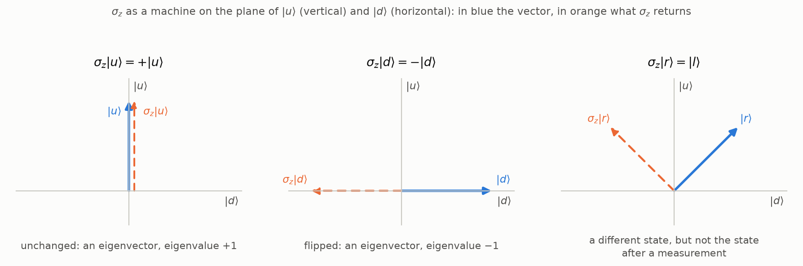

Two earlier posts,
[*Heisenberg's Table: Where the Matrices and the Born Rule Come From*](/quantum/heisenbergs-table/)
and [*Observables Are Hermitian Operators*](/quantum/observables-are-hermitian-operators/),
built the object that stands for a measurable quantity: a Hermitian
operator $\hat A$ with an orthonormal basis of eigenvectors
$\{|a_i\rangle\}$, the definite states, and real eigenvalues
$\lambda_i$, the outcomes. In a state
$|\psi\rangle = \sum_i c_i |a_i\rangle$ the outcome $\lambda_i$ has
probability $|c_i|^2$ and the average is
$\langle \psi | \hat A | \psi \rangle$. Two items of the
[first post's wishlist](/quantum/the-apparatus-and-the-arrow/#the-wishlist)
are still open. This post answers item 4, *measurement as an operation
on states*, that is, what a measurement does to the state it is
performed on. First it separates measuring from applying the operator
$\hat A$ of the observable, since the notation makes the two easy to confuse.

## Applying $\hat A$ is not measuring it

Applying the operator $\hat A$ of the measured observable to a state is
a mathematical operation: it returns a vector. A measurement is a physical operation: it returns a number
and changes the state.
The first of the two earlier posts
[warned](/quantum/heisenbergs-table/#what-the-operator-returns-and-what-the-brackets-mean)
that the vector the operator returns need not be a state at all.
On the spin the output can be a state, and it is still not the state
after a measurement.

Apply $\sigma_z$ to the $x$-definite state $|r\rangle$, using
$\sigma_z|u\rangle = |u\rangle$, $\sigma_z|d\rangle = -|d\rangle$ and
linearity:

$$
\sigma_z\, |r\rangle = \tfrac{1}{\sqrt 2}\, \sigma_z |u\rangle + \tfrac{1}{\sqrt 2}\, \sigma_z |d\rangle = \tfrac{1}{\sqrt 2}\, |u\rangle - \tfrac{1}{\sqrt 2}\, |d\rangle = |l\rangle .
$$

The operator turned *right* into *left*. But a $z$ measurement of an
electron prepared along $x$ never leaves it in the state $|l\rangle$:
it leaves it in $|u\rangle$ or $|d\rangle$, at random. So
$\sigma_z|r\rangle$ is not the state after a measurement. Susskind and
Friedman devote their §3.5, "A common misconception", to exactly this
mistake: the belief that measuring an observable means applying its
operator to the state.

If $\sigma_z|r\rangle$ is not the state after a measurement, what is
it? In the eigenbasis of $\sigma_z$ the answer is short. The input
$|r\rangle = \frac{1}{\sqrt 2}|u\rangle + \frac{1}{\sqrt 2}|d\rangle$
has one coordinate per possible answer, and $\sigma_z$ multiplies each
coordinate by the value of its answer, $+1$ or $-1$. The figure shows
this on the basis vectors in the two left panels, and on $|r\rangle$
in the right one: the coordinate along $|u\rangle$ stays, the one along
$|d\rangle$ changes sign, and the arrow is reflected into $|l\rangle$.
The operator was introduced for exactly one job:
[given a state, return the average](/quantum/heisenbergs-table/#what-the-apparatus-gives-us-averages)
of the outcomes. The vector $\sigma_z|r\rangle$ is the middle step of
that job, and its inner product with $|r\rangle$ finishes it:

$$
\langle r | \sigma_z | r \rangle = \tfrac12 \cdot (+1) + \tfrac12 \cdot (-1) = 0 ,
$$

the average of $z$ measurements in the state $|r\rangle$, which the
first of the two earlier posts
[computed on the same example](/quantum/heisenbergs-table/#the-spin-along--operator-average-interference).
The probabilities $\tfrac12$ enter only in this last step, as the squared magnitudes of the coordinates; the operator
alone does not produce them.

## Measurement

### What the experiments show

Item 4 of the
[wishlist](/quantum/the-apparatus-and-the-arrow/#the-wishlist)
asks what a measurement does to the state. As with the operators, start
from the experiments. The first post's experiments showed three things
about measuring the spin:

- the window of the apparatus shows a number, $+1$ or $-1$;
- which number appears is random, with probabilities that the
  [Born rule](/quantum/heisenbergs-table/#the-weights-are-the-probabilities-the-born-rule)
  gives;
- a second measurement made right after the first always repeats its
  answer
  ([experiment one](/quantum/the-apparatus-and-the-arrow/#experiment-one-the-window-shows-1--and-repetition-confirms)).

The third fact is the new one. Measurements with this property are
called **ideal**, or *measurements of the first kind*. This section
describes ideal measurements.

### What the mathematics must do

Let $\hat A$ be the observable and
$|\psi\rangle = \sum_i c_i |a_i\rangle$ the state before the
measurement, written in the eigenbasis of $\hat A$. A mathematical
description of an ideal measurement must give two results:

1. **A number**: one of the outcomes $\lambda_i$, chosen at random with
   the probability $|c_i|^2$. The earlier posts already provide this.
2. **A new state**: a unit vector, since states are unit vectors. A
   repeated measurement in this state must give $\lambda_i$ again,
   with probability one.

The second requirement fixes the new state. In it the outcome
$\lambda_i$ is certain, so it is a definite state, and definite states
are [eigenvectors](/quantum/observables-are-hermitian-operators/#definite-states):
the new state is an eigenvector of $\hat A$ with the eigenvalue
$\lambda_i$. How many such eigenvectors are there? Recall the spectral
theorem of
[*Observables Are Hermitian Operators*](/quantum/observables-are-hermitian-operators/#three-conditions):

> **Spectral theorem** (finite dimensions). A Hermitian operator
> $\hat A$ has real eigenvalues $\lambda_i$ and an orthonormal basis of
> eigenvectors $|a_i\rangle$.

The theorem does not say that the eigenvalues are different. One
eigenvalue can belong to several basis vectors; it is then called
[degenerate](/quantum/observables-are-hermitian-operators/#degeneracy-and-the-continuous-spectrum).
Take first the case where no eigenvalue is degenerate. Then only one
basis vector has the eigenvalue $\lambda_i$, and the new state is
$|a_i\rangle$, up to a
[global phase](/quantum/states-are-vectors/#global-phase).

### Projectors do it

Which operation turns $|\psi\rangle$ into $|a_i\rangle$? The projector
$\hat P_i = |a_i\rangle\langle a_i|$ keeps the component of the state
along $|a_i\rangle$ and removes the rest. The result is shorter than a
state, and renormalization brings it back to unit length:

$$
|\psi\rangle \;\longmapsto\; \frac{\hat P_i |\psi\rangle}{\lVert \hat P_i |\psi\rangle \rVert} = \frac{c_i\, |a_i\rangle}{|c_i|} = \frac{c_i}{|c_i|}\, |a_i\rangle .
$$

This is a unit factor times $|a_i\rangle$, which is the same physical
state.

The projector also meets the rest of the requirements: the repetition
of the answer and the probability of the outcome. The repetition of the
answer is, in linear algebra, *idempotence*: projecting twice is the
same as projecting once. It follows from the orthonormality of the
eigenbasis, $\langle a_i | a_j \rangle = \delta_{ij}$:

$$
\hat P_i \hat P_j = |a_i\rangle \langle a_i | a_j \rangle \langle a_j| = \delta_{ij}\, |a_i\rangle\langle a_j| .
$$

For $j = i$ this is $\hat P_i^2 = \hat P_i$: a second projection with
the same outcome changes nothing. For $j \ne i$ it is
$\hat P_i \hat P_j = 0$: after the outcome $\lambda_i$, no other outcome
can follow.

The probability of the outcome is the average of the projector,
computed the same way as the average of $\sigma_z$ in the first section:
apply the operator, then take the inner product with $|\psi\rangle$.
With $\langle a_i | \psi \rangle = c_i$ and
$\langle \psi | a_i \rangle = c_i^*$,

$$
\begin{aligned}
\hat P_i |\psi\rangle &= |a_i\rangle \langle a_i | \psi \rangle = c_i\, |a_i\rangle , \\
\langle \psi | \hat P_i | \psi \rangle &= c_i\, \langle \psi | a_i \rangle = c_i\, c_i^* = |c_i|^2 ,
\end{aligned}
$$

as in the
[derivation of the Born rule](/quantum/heisenbergs-table/#the-weights-are-the-probabilities-the-born-rule).

The number and the projector are tied by the spectral decomposition
$\hat A = \sum_i \lambda_i \hat P_i$: the outcome $\lambda_i$ is the
label of the projector $\hat P_i$.

### The definition

Put together, this is the mathematical definition of a measurement. It
has three levels: the measurement itself, the measurement in a given
state, and one run of the apparatus.

> **Measurement** (ideal, no degenerate eigenvalues).
>
> 1. **The measurement itself** is the set of projectors
>    $\hat P_i = |a_i\rangle\langle a_i|$ of the observable
>    $\hat A = \sum_i \lambda_i \hat P_i$, one for each outcome, with
>    $\hat P_i \hat P_j = \delta_{ij}\, \hat P_i$ and
>    $\sum_i \hat P_i = \hat I$. It depends only on the observable, that
>    is, on the apparatus.
> 2. **In a given state** $|\psi\rangle$ the measurement is a probability
>    distribution over the pairs (number, new state): the pair
>    $\big(\lambda_i,\ \hat P_i |\psi\rangle / \sqrt{p_i}\big)$ comes
>    with the probability $p_i = \langle \psi | \hat P_i | \psi \rangle$.
> 3. **One run** of the apparatus is one draw from this distribution:
>    one $i$, which gives both the number $\lambda_i$ in the window and
>    the new state.

Most of the definition was derived above: the first condition of point 1
is the repetition of the answer, and $p_i$ is the average of the
projector. Two parts are new.

The second condition of point 1 is the
[resolution of identity](/quantum/states-are-vectors/#coordinates-and-a-formula-for-the-identity-operator)
of *States Are Vectors*. Any state is the sum of its components along
the basis vectors, and each component is a projector applied to the
state:

$$
|\psi\rangle = \sum_i c_i\, |a_i\rangle = \sum_i |a_i\rangle \langle a_i | \psi \rangle = \Big( \sum_i \hat P_i \Big) |\psi\rangle .
$$

This holds for every $|\psi\rangle$, so $\sum_i \hat P_i$ leaves every
vector unchanged: $\sum_i \hat P_i = \hat I$. The condition makes the
probabilities of all outcomes add up to one, because the state has unit
length:

$$
\sum_i p_i = \sum_i \langle \psi | \hat P_i | \psi \rangle = \langle \psi | \Big( \sum_i \hat P_i \Big) | \psi \rangle = \langle \psi | \psi \rangle = 1 .
$$

The denominator $\sqrt{p_i}$ is the renormalization, written through the
probability. The projector is Hermitian,
$\hat P_i^\dagger = (|a_i\rangle\langle a_i|)^\dagger = |a_i\rangle\langle a_i| = \hat P_i$,
and idempotent, $\hat P_i^2 = \hat P_i$, so

$$
\lVert \hat P_i |\psi\rangle \rVert^2 = \langle \psi | \hat P_i^\dagger \hat P_i | \psi \rangle = \langle \psi | \hat P_i | \psi \rangle = p_i .
$$

### The three experiments

The first post's three experiments are three cases of this definition.

- *Repetition confirms.* After a $z$ measurement the state is
  $|u\rangle$ or $|d\rangle$, an eigenvector of $\sigma_z$. Measuring
  $\sigma_z$ again finds the coefficient $1$ on that eigenvector and
  returns the same value with probability one. This is the fact the
  definition was built from, so here it only checks itself.
- *Flipping negates.* The
  [first post](/quantum/the-apparatus-and-the-arrow/#experiment-two-flipping-the-apparatus-negates-the-answer)
  found that the apparatus turned upside down has the same definite
  states, $|u\rangle$ and $|d\rangle$, with the outcomes exchanged. By
  the spectral decomposition its operator is
  $(-1)|u\rangle\langle u| + (+1)|d\rangle\langle d| = -\sigma_z$, so by
  point 1 its measurement is the same pair of projectors with the
  numbers exchanged. After the upright apparatus has returned $+1$, the
  state is $|u\rangle$, and the flipped one returns $-1$ with
  probability $\langle u | \hat P_u | u \rangle = 1$: the answer is
  negated, with no randomness.
- *A new axis erases the old answer.* Start in $|u\rangle$, where a $z$
  measurement gives $+1$ with probability one. Now measure along $x$.
  By point 1 this measurement is the pair of projectors
  $\hat P_r = |r\rangle\langle r|$ and $\hat P_l = |l\rangle\langle l|$,
  and by point 2 its outcomes in $|u\rangle$ have the probabilities
  $\langle u | \hat P_r | u \rangle = |\langle r | u \rangle|^2 = \tfrac12$
  and $\langle u | \hat P_l | u \rangle = \tfrac12$. One run leaves the
  state in $|r\rangle$ or $|l\rangle$. Measure along $z$ again: in
  $|r\rangle$ the outcome $+1$ now has the probability
  $\langle r | \hat P_u | r \rangle = |\langle u | r \rangle|^2 = \tfrac12$,
  and the same holds in $|l\rangle$. Before the $x$ measurement this
  probability was $1$; the projection onto $|r\rangle$ or $|l\rangle$
  replaced the state, and the old certainty went with it. This happens
  because the $z$ and $x$ observables have no eigenvector in common:
  no state is definite for both, so the new state of the $x$
  measurement cannot keep the $z$ answer.

### A projector, not $\hat A$

In the definition, the new state comes from applying $\hat P_i$ to the
old one. So a measurement does apply an operator, but it is the
projector, not $\hat A$. This does not contradict the
[first section](#applying-is-not-measuring),
which showed on the spin that $\sigma_z|r\rangle$ is not the state after
a measurement. The projectors and $\hat A$ are built from the same
eigenbasis, but they use it differently. A measurement uses one of the
projectors $\hat P_i$, chosen at random. Applying $\hat A$ uses all of
them at once, each weighted by its outcome:

$$
\hat A |\psi\rangle = \sum_i \lambda_i\, \hat P_i |\psi\rangle = \sum_i \lambda_i c_i\, |a_i\rangle .
$$

This vector is not the state after a measurement: the outcome of a
measurement is random, while $\hat A|\psi\rangle$ is one fixed vector, in
general not an eigenvector, whose inner product with $|\psi\rangle$ is
the average of all the outcomes,
$\langle \psi | \hat A | \psi \rangle = \sum_i \lambda_i p_i$. For a
projector the same inner product is the probability of one outcome,
$\langle \psi | \hat P_i | \psi \rangle = p_i$.

### When a measurement is not ideal

Not every real measurement is ideal. A detector that absorbs a photon
leaves no photon to measure again, so there is no second answer to
compare. For such a measurement the new state in point 2 is not defined by the
projectors; measurements of this kind need a more general description,
by a set of operators with one operator per outcome, which this road
does not need. The numbers and their probabilities still hold: they
come from the Born rule, which was derived from averages. An average comes from many measurements, each on
a fresh system prepared in the same state, and it does not matter
whether each of them is ideal.

### The degenerate case

If the outcome $\lambda$ is degenerate, the argument for the new state
stops one step short. The new state is still an eigenvector with the
eigenvalue $\lambda$, so it lies in the subspace spanned by the
eigenvectors with $\lambda_j = \lambda$, but the repetition of the
answer does not say where in that subspace. The probability of
$\lambda$ is still determined: it is the sum of $|c_j|^2$ over those
eigenvectors. For the state, the standard answer is an extra postulate,
the **Lüders rule**: the state is projected onto that subspace and
renormalized. In the definition nothing changes except the
projectors. There is one projector per distinct eigenvalue, onto its
whole subspace,

$$
\hat P_\lambda = \sum_{j:\, \lambda_j = \lambda} |a_j\rangle\langle a_j| ,
$$

and the two conditions of point 1 still hold for these projectors. With
them, the definition covers every ideal measurement:
the outcome $\lambda$ comes with probability
$p_\lambda = \langle \psi | \hat P_\lambda | \psi \rangle$, and the new
state is $\hat P_\lambda |\psi\rangle / \sqrt{p_\lambda}$. Among the
states in the subspace, this one is the closest to $|\psi\rangle$. For
a non-degenerate outcome the definition follows from the repetition of
the answer; for a degenerate one it is a postulate.

## What we built

Wishlist item 4 is paid, by the same road as the operators: from the
experiments to the mathematics.

- **The experiments.** A measurement shows a number, at random, and an
  ideal measurement repeats its answer.
- **The requirements.** The mathematics must give a number, with the
  Born probability, and a new state in which that number is certain.
  By the spectral theorem and the theorem that
  [definite states are eigenvectors](/quantum/observables-are-hermitian-operators/#definite-states),
  for a non-degenerate outcome this state is $|a_i\rangle$.
- **The construction.** The projector $\hat P_i$, followed by
  renormalization. It is idempotent, its average is the probability of
  the outcome, and the spectral decomposition ties it to the number
  $\lambda_i$. The projectors of all outcomes together are the
  mathematical definition of an ideal measurement.
- **The difference from applying $\hat A$.** A measurement
  applies one projector, chosen at random; applying $\hat A$ is a step
  in computing the average.
- **The degenerate case.** The projection onto a subspace is an extra
  postulate, the Lüders rule.

## Onward

Next stop: the qubit and the Bloch sphere. The spin operator along an
arbitrary direction $\hat n$ is $\hat n \cdot \vec\sigma$, built from
the three Pauli matrices. From it the first post's
$\langle \sigma \rangle = \cos\theta$ follows in one line, and the
two-dimensional complex state space gets the geometry of an ordinary
sphere.

## References

- Leonard Susskind, Art Friedman. *Quantum Mechanics: The Theoretical
  Minimum*. Basic Books, 2014 — lecture 3, §3.5 "A common
  misconception": applying an operator is not measuring.
- P. A. M. Dirac. *The Principles of Quantum Mechanics*, 4th ed.
  Oxford University Press, 1958 (Russian translation: П. А. М. Дирак,
  *Принципы квантовой механики*, 2-е изд., Наука, 1979) — chapter
  II, §10 (Russian ed. pp. 52–53): a measurement of a real dynamical
  variable leaves the system in an eigenstate belonging to the
  measured eigenvalue.
- G. Lüders. Über die Zustandsänderung durch den Meßprozeß. *Annalen
  der Physik* 8 (1951), 322–328; English translation by K. A.
  Kirkpatrick, [Concerning the state-change due to the measurement
  process](https://arxiv.org/abs/quant-ph/0403007), *Annalen der Physik*
  15 (2006), 663–670 — the projection rule for degenerate outcomes, and
  why von Neumann's earlier proposal is rejected.
- R. Shankar. *Principles of Quantum Mechanics*, 2nd ed. Plenum, 1994 —
  chapter 4, §4.1, p. 116: Postulate III, the measurement yields one of
  the eigenvalues and changes the state to the eigenvector, with a
  footnote that this is an ideal measurement.
- M. A. Nielsen, I. L. Chuang. *Quantum Computation and Quantum
  Information*, 10th anniversary ed. Cambridge University Press, 2010 —
  §2.2.3, Postulate 3, pp. 84–85: the general description of a
  measurement by a set of measurement operators; §2.2.5, p. 88:
  projective measurements, with the observable written as its spectral
  decomposition $M = \sum_m m P_m$, which is the definition of this post,
  degenerate outcomes included.
