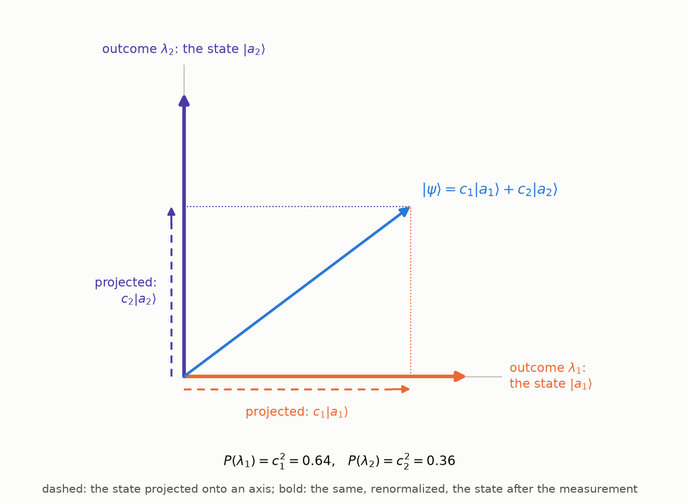

Two earlier posts,
[*Heisenberg's Table: Where the Matrices and the Born Rule Come From*](/quantum/heisenbergs-table/)
and [*Observables Are Hermitian Operators*](/quantum/observables-are-hermitian-operators/),
built the object that stands for a measurable quantity: a Hermitian
operator $\hat A$ with an orthonormal basis of eigenvectors
$\{|a_i\rangle\}$, the definite states, and real eigenvalues
$\lambda_i$, the outcomes. In a state
$|\psi\rangle = \sum_i c_i |a_i\rangle$ the outcome $\lambda_i$ has
probability $|c_i|^2$ and the average is
$\langle \psi | \hat A | \psi \rangle$. Two items of the
[first post's wishlist](/quantum/the-apparatus-and-the-arrow/#the-wishlist)
are still open. This post answers item 4, *measurement as an operation
on states*, that is, what a measurement does to the state it is
performed on. First it separates measuring from applying the operator,
since the notation makes the two easy to confuse.

## Applying the operator is not measuring

Applying an operator to a state is a mathematical operation: it returns
a vector. A measurement is a physical operation: it returns a number
and changes the state.
The first of the two earlier posts
[warned](/quantum/heisenbergs-table/#what-the-operator-returns-and-what-the-brackets-mean)
that the vector the operator returns need not be a state at all.
On the spin the output can be a state, and it is still not the state
after a measurement.

Apply $\sigma_z$ to the $x$-definite state $|r\rangle$, using
$\sigma_z|u\rangle = |u\rangle$, $\sigma_z|d\rangle = -|d\rangle$ and
linearity:

$$
\sigma_z\, |r\rangle = \tfrac{1}{\sqrt 2}\, \sigma_z |u\rangle + \tfrac{1}{\sqrt 2}\, \sigma_z |d\rangle = \tfrac{1}{\sqrt 2}\, |u\rangle - \tfrac{1}{\sqrt 2}\, |d\rangle = |l\rangle .
$$

The operator turned *right* into *left*. But a $z$ measurement of an
electron prepared along $x$ never leaves it in the state $|l\rangle$:
it leaves it in $|u\rangle$ or $|d\rangle$, at random. So
$\sigma_z|r\rangle$ is not the state after a measurement. Susskind and
Friedman devote their §3.5, "A common misconception", to exactly this
mistake: the belief that measuring an observable means applying its
operator to the state.

If $\sigma_z|r\rangle$ is not the state after a measurement, what is
it? In the eigenbasis of $\sigma_z$ the answer is short. The input
$|r\rangle = \frac{1}{\sqrt 2}|u\rangle + \frac{1}{\sqrt 2}|d\rangle$
has one coordinate per possible answer, and $\sigma_z$ multiplies each
coordinate by the value of its answer, $+1$ or $-1$. The figure shows
this on the basis vectors in the two left panels, and on $|r\rangle$
in the right one: the coordinate along $|u\rangle$ stays, the one along
$|d\rangle$ changes sign, and the arrow is reflected into $|l\rangle$.
The operator was introduced for exactly one job:
[given a state, return the average](/quantum/heisenbergs-table/#what-the-apparatus-gives-us-averages)
of the outcomes. The vector $\sigma_z|r\rangle$ is the middle step of
that job, and its inner product with $|r\rangle$ finishes it:

$$
\langle r | \sigma_z | r \rangle = \tfrac12 \cdot (+1) + \tfrac12 \cdot (-1) = 0 ,
$$

the average of $z$ measurements in the state $|r\rangle$, which the
first of the two earlier posts
[computed on the same example](/quantum/heisenbergs-table/#the-spin-along--operator-average-interference).
The probabilities $\tfrac12$ enter only in this last step, as the squared magnitudes of the coordinates; the operator
alone does not produce them.

## Measurement

Recall what the
[spectral theorem](/quantum/observables-are-hermitian-operators/#three-conditions)
gives: a Hermitian operator $\hat A$ has an orthonormal basis of
eigenvectors $|a_i\rangle$ with real eigenvalues $\lambda_i$. It does
not say that the eigenvalues are different. One eigenvalue can belong
to several basis vectors; it is then called
[degenerate](/quantum/observables-are-hermitian-operators/#degeneracy-and-the-continuous-spectrum),
and a certain outcome no longer determines the state.

Take first the case where each eigenvalue belongs to one eigenvector.
The question is: a measurement of $\hat A$ has returned $\lambda_i$;
what is the state now?

The answer rests on one fact from the experiments. In
[experiment one of the first post](/quantum/the-apparatus-and-the-arrow/#experiment-one-the-window-shows-1--and-repetition-confirms),
a second measurement made right after the first always repeated its
answer. Measurements with this property are called *ideal*, or
*measurements of the first kind*.

For an ideal measurement the argument is short. Right after the
outcome $\lambda_i$, measuring again gives $\lambda_i$ with
probability one, so in the new state the outcome $\lambda_i$ is
certain. A state with a certain outcome is a definite state, and
definite states are
[eigenvectors](/quantum/observables-are-hermitian-operators/#definite-states):
the new state is an eigenvector of $\hat A$ with the eigenvalue
$\lambda_i$. Only one basis vector has this eigenvalue, so the new state
is $|a_i\rangle$, up to a
[global phase](/quantum/states-are-vectors/#global-phase). Together
with the Born rule for the probabilities:

> **Measurement** (ideal, each eigenvalue belonging to one
> eigenvector).
> Measuring the observable $\hat A$ in the state
> $|\psi\rangle = \sum_i c_i|a_i\rangle$ returns one of the
> eigenvalues $\lambda_i$, with probability $|c_i|^2$; immediately
> after a measurement that returned $\lambda_i$, the state is the
> definite state $|a_i\rangle$.

Not every real measurement is ideal: a detector that absorbs a photon
leaves no photon to measure again. For such a measurement the second
half of the box, about the state afterwards, does not apply. The first
half still holds: the outcomes and their probabilities come from the
Born rule, which was derived from averages. An average comes from many
measurements, each on a fresh system prepared in the same state, and
it does not matter whether each of them is ideal.

In the language of projectors, a measurement with the outcome
$\lambda_i$ projects the state onto the $i$-th definite direction and
renormalizes it:

$$
|\psi\rangle \;\longmapsto\; \frac{|a_i\rangle\langle a_i | \psi \rangle}{\lVert\, |a_i\rangle\langle a_i | \psi \rangle \,\rVert} = \frac{c_i}{|c_i|}\, |a_i\rangle .
$$

The result is a unit factor times $|a_i\rangle$, which is the same
physical state. The probability of the outcome is the average of the
projector $\hat P_i = |a_i\rangle\langle a_i|$, computed the same way as
the average of $\sigma_z$ above: apply the operator, then take the
inner product with $|\psi\rangle$. With $\langle a_i | \psi \rangle = c_i$
and $\langle \psi | a_i \rangle = c_i^*$,

$$
\begin{aligned}
\hat P_i |\psi\rangle &= |a_i\rangle \langle a_i | \psi \rangle = c_i\, |a_i\rangle , \\
\langle \psi | \hat P_i | \psi \rangle &= c_i\, \langle \psi | a_i \rangle = c_i\, c_i^* = |c_i|^2 ,
\end{aligned}
$$

as in the
[derivation of the Born rule](/quantum/heisenbergs-table/#the-weights-are-the-probabilities-the-born-rule).

This does not contradict the first section. The state after a
measurement is obtained by applying an operator, but not $\hat A$: it
is the projector onto the definite state of the outcome, the outcome
is chosen at random with its Born probability, and the result is
renormalized. A measurement never applies $\hat A$ itself to the
state.

Both come from the spectral decomposition
$\hat A = \sum_i \lambda_i \hat P_i$. A measurement uses one of the
projectors $\hat P_i$, chosen at random. Applying $\hat A$ uses all of
them at once, each weighted by its outcome:

$$
\hat A |\psi\rangle = \sum_i \lambda_i\, \hat P_i |\psi\rangle = \sum_i \lambda_i c_i\, |a_i\rangle .
$$

This vector is not the state after a measurement. Its inner product with
$|\psi\rangle$ is the average, $\sum_i \lambda_i |c_i|^2$.

Read the first post's three experiments in this language.

- *Repetition confirms.* This experiment was the input of the
  argument above, so here the rule only checks itself. After a $z$ measurement the state is
  $|u\rangle$ or $|d\rangle$, an eigenvector of $\sigma_z$. Measuring
  $\sigma_z$ again finds the coefficient $1$ on that eigenvector and
  returns the same value with probability one.
- *Flipping negates.* The apparatus turned upside down measures
  $-\sigma_z$, whose definite states are the same two vectors with
  the outcomes exchanged.
- *A new axis erases the old answer.* Measure the spin along $x$ in
  the state $|u\rangle = \frac{1}{\sqrt 2}|r\rangle + \frac{1}{\sqrt 2}|l\rangle$:
  the outcome is $\pm 1$ with probability $\frac12$ each, and the
  state becomes $|r\rangle$ or $|l\rangle$. Measure along $z$ once
  more: $|r\rangle$ and $|l\rangle$ are each half $|u\rangle$ and half
  $|d\rangle$, so the old certainty is gone, and either answer has
  probability $\frac12$. The erasure of the first post is the
  statement that the $z$ and $x$ observables have no eigenvector in
  common.

**The degenerate case.** If the outcome $\lambda$ is degenerate,
the argument above stops one step short. The state after the measurement
is still an eigenvector with the eigenvalue $\lambda$, so it lies in the
subspace spanned by the eigenvectors with $\lambda_j = \lambda$, but
the repetition of the answer does not say where in that subspace. The probability of
$\lambda$ is still determined: it is the sum of $|c_j|^2$ over those
eigenvectors. For the state, the standard answer is an extra postulate,
the **Lüders rule**: the state is projected onto that subspace and
renormalized,

$$
|\psi\rangle \;\longmapsto\; \frac{\hat P |\psi\rangle}{\lVert \hat P |\psi\rangle \rVert}, \qquad \hat P = \sum_{j:\, \lambda_j = \lambda} |a_j\rangle\langle a_j| .
$$

Among the states in the subspace, this one is the closest to
$|\psi\rangle$, and for a non-degenerate outcome the rule reduces to
the box above.

## What we built

Wishlist item 4 is paid. A measurement of $\hat A$ returns an
eigenvalue $\lambda_i$ with probability $|c_i|^2$ and leaves the
system in the eigenvector $|a_i\rangle$: the state is projected onto
that definite direction and renormalized. For a non-degenerate outcome
of an ideal measurement this follows from the repetition of the answer
and the theorem that
[definite states are eigenvectors](/quantum/observables-are-hermitian-operators/#definite-states);
for a degenerate one, the projection onto a subspace is an extra
postulate. Applying $\hat A$ to a state is a different operation: it
is a step in computing the average, not a measurement. The three experiments of the first
post agree with the projection rule: the first was its input, and the
other two follow from it.

## Onward

Next stop: the qubit and the Bloch sphere. The spin operator along an
arbitrary direction $\hat n$ is $\hat n \cdot \vec\sigma$, built from
the three Pauli matrices. From it the first post's
$\langle \sigma \rangle = \cos\theta$ follows in one line, and the
two-dimensional complex state space gets the geometry of an ordinary
sphere.

## References

- Leonard Susskind, Art Friedman. *Quantum Mechanics: The Theoretical
  Minimum*. Basic Books, 2014 — lecture 3, §3.5 "A common
  misconception": applying an operator is not measuring.
- P. A. M. Dirac. *The Principles of Quantum Mechanics*, 4th ed.
  Oxford University Press, 1958 (Russian translation: П. А. М. Дирак,
  *Принципы квантовой механики*, 2-е изд., Наука, 1979) — chapter
  II, §10 (Russian ed. pp. 52–53): a measurement of a real dynamical
  variable leaves the system in an eigenstate belonging to the
  measured eigenvalue.
- G. Lüders. Über die Zustandsänderung durch den Meßprozeß. *Annalen
  der Physik* 8 (1951), 322–328; English translation by K. A.
  Kirkpatrick, [Concerning the state-change due to the measurement
  process](https://arxiv.org/abs/quant-ph/0403007), *Annalen der Physik*
  15 (2006), 663–670 — the projection rule for degenerate outcomes, and
  why von Neumann's earlier proposal is rejected.
