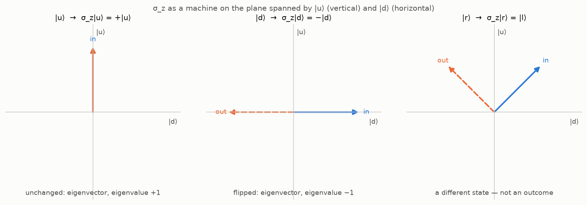
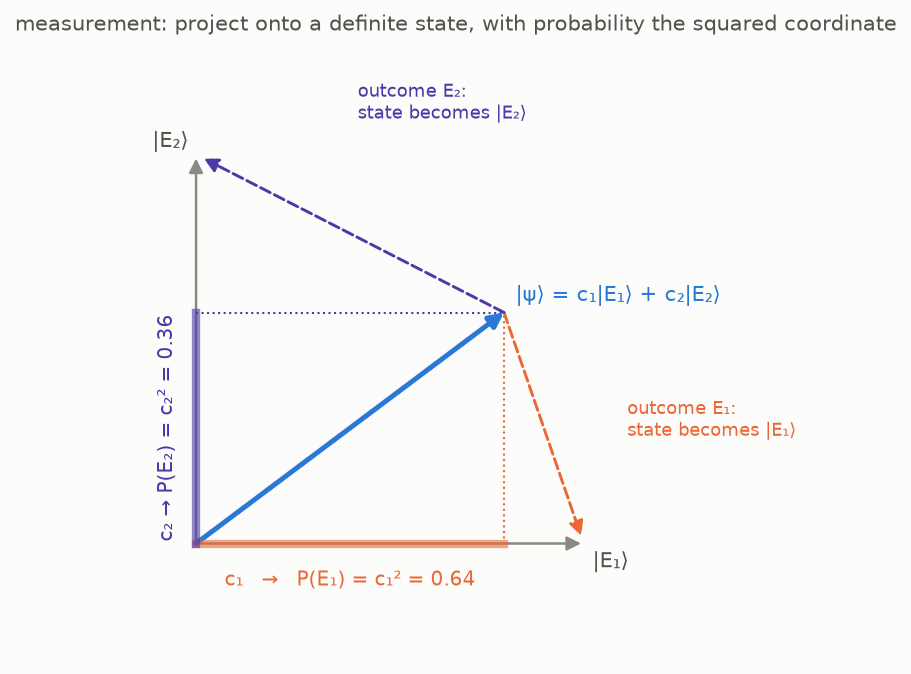

The last two posts — [Heisenberg's Table](/quantum/heisenbergs-table/)
and [Observables Are Hermitian Operators](/quantum/observables-are-hermitian-operators/)
— built the object that stands for a measurable quantity: a
Hermitian operator $\hat A$ with an orthonormal basis of
eigenvectors $\{|a_i\rangle\}$, the definite states, and real
eigenvalues $\lambda_i$, the outcomes. In a state
$|\psi\rangle = \sum_i c_i |a_i\rangle$ the outcome $\lambda_i$ has
probability $|c_i|^2$ and the average is
$\langle \psi | \hat A | \psi \rangle$. One item of the
[first post's wishlist](/quantum/the-apparatus-and-the-arrow/#the-wishlist)
is still open: *measurement as an operation on states* — what a
measurement does to the state it is performed on. This post pays
it, after clearing one confusion that the notation invites.

## Applying the operator is not measuring

The notation invites a confusion, so it is addressed first.
Applying an operator to a state is a *mathematical* operation that
returns a vector; a measurement is a *physical* operation that
returns a number and changes the state. They are not the same
thing, and the warning of
[Heisenberg's Table](/quantum/heisenbergs-table/#what-the-operator-returns-and-what-the-brackets-mean)
about the output of the machine can now be made concrete on the
spin.

Apply $\sigma_z$ to the $x$-definite state $|r\rangle$, using
$\sigma_z|u\rangle = |u\rangle$, $\sigma_z|d\rangle = -|d\rangle$ and
linearity:

$$
\sigma_z\, |r\rangle = \tfrac{1}{\sqrt 2}\, \sigma_z |u\rangle + \tfrac{1}{\sqrt 2}\, \sigma_z |d\rangle = \tfrac{1}{\sqrt 2}\, |u\rangle - \tfrac{1}{\sqrt 2}\, |d\rangle = |l\rangle .
$$

The operator turned *right* into *left*. No $z$ measurement of an
electron prepared along $x$ ever produces an electron pointing left
along $x$: it produces $|u\rangle$ or $|d\rangle$, at random. So
$\sigma_z|r\rangle$ is not the state after a measurement. Written in
the eigenbasis of $\sigma_z$, the input
$|r\rangle = \frac{1}{\sqrt 2}|u\rangle + \frac{1}{\sqrt 2}|d\rangle$
lists the possible answers as its basis directions, and the operator
has multiplied each direction by the answer's value — the
coordinates tagged with their outcomes, not yet squared into
probabilities. (Susskind and Friedman devote their §3.5, "A common
misconception", to this point.)

## Measurement

Wishlist item 4 of the
[first post](/quantum/the-apparatus-and-the-arrow/#the-wishlist)
asked how a measurement changes the state. Everything needed is now
available from the last two posts: the outcomes are the
eigenvalues, their probabilities are the Born weights, and the
states a measurement prepares are the eigenvectors.

> **Measurement.** Measuring the observable $\hat A$ in the state
> $|\psi\rangle = \sum_i c_i|a_i\rangle$ returns one of the
> eigenvalues $\lambda_i$, with probability $|c_i|^2$; immediately
> after a measurement that returned $\lambda_i$, the state is the
> definite state $|a_i\rangle$.

In the language of projectors: the outcome $\lambda_i$ projects the
state onto the $i$-th definite direction and renormalizes it,

$$
|\psi\rangle \;\longmapsto\; \frac{|a_i\rangle\langle a_i | \psi \rangle}{\lVert\, |a_i\rangle\langle a_i | \psi \rangle \,\rVert} = \frac{c_i}{|c_i|}\, |a_i\rangle ,
$$

a unit factor times $|a_i\rangle$ — the same physical state. The
probability of the outcome is the average of the projector,
$\langle \psi | a_i \rangle \langle a_i | \psi \rangle = |c_i|^2$, as in the
derivation of the Born rule in Heisenberg's Table.

Read the first post's three experiments in this language.

- *Repetition confirms.* After a $z$ measurement the state is
  $|u\rangle$ or $|d\rangle$, an eigenvector of $\sigma_z$; measuring
  $\sigma_z$ again finds coefficient $1$ on that eigenvector and
  returns the same value with probability one.
- *Flipping negates.* The apparatus turned upside down measures
  $-\sigma_z$, whose definite states are the same two vectors with
  the outcomes exchanged.
- *A new axis erases the old answer.* Measure the spin along $x$ in
  the state $|u\rangle = \frac{1}{\sqrt 2}|r\rangle + \frac{1}{\sqrt 2}|l\rangle$:
  the outcome is $\pm 1$ with probability $\frac12$ each, and the
  state becomes $|r\rangle$ or $|l\rangle$. Measure along $z$ once
  more: $|r\rangle$ and $|l\rangle$ are each half $|u\rangle$, half
  $|d\rangle$, so the old certainty is gone — probability $\frac12$
  for either answer. The erasure of the first post is the statement
  that the $z$ and $x$ observables have no eigenvector in common.

## What we built

Wishlist item 4 is paid: a measurement of $\hat A$ returns an
eigenvalue $\lambda_i$ with probability $|c_i|^2$ and leaves the
system in the eigenvector $|a_i\rangle$ — a projection onto a
definite direction, renormalized. Applying the operator to the state
is a different thing, a step in a computation, not a measurement.
The three experiments of the first post are three instances of the
projection rule.

## Onward

Next stop: the qubit and the Bloch sphere. The $y$-axis states are
built, complex amplitudes become unavoidable, $\sigma_y$ joins
$\sigma_z$ and $\sigma_x$, and the spin operator along an arbitrary
direction $\hat n$ turns out to be $\hat n \cdot \vec\sigma$ — from
which the first post's $\langle \sigma \rangle = \cos\theta$ follows
in one line, and a two-dimensional complex state space acquires the
geometry of an ordinary sphere.

## References

- Leonard Susskind, Art Friedman. *Quantum Mechanics: The Theoretical
  Minimum*. Basic Books, 2014 — lecture 3, §3.5 "A common
  misconception": applying an operator is not measuring.
- P. A. M. Dirac. *The Principles of Quantum Mechanics*, 4th ed.
  Oxford University Press, 1958 (Russian translation: П. А. М. Дирак,
  *Принципы квантовой механики*, 2-е изд., Наука, 1979) — chapter
  II, §10 (Russian ed. pp. 52–53): a measurement of a real dynamical
  variable leaves the system in an eigenstate belonging to the
  measured eigenvalue.
