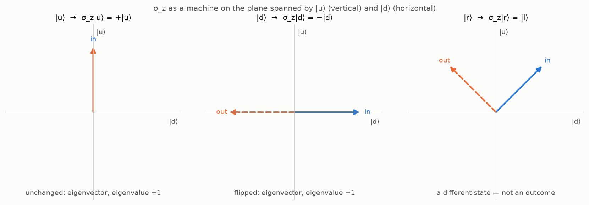

The last two posts — [Heisenberg's Table](/quantum/heisenbergs-table/)
and [Observables Are Hermitian Operators](/quantum/observables-are-hermitian-operators/)
— built the object that stands for a measurable quantity: a
Hermitian operator $\hat A$, whose
average in a state $|\psi\rangle$ is $\langle \psi | \hat A | \psi \rangle$.
Written in the orthonormal eigenbasis $\{|a_i\rangle\}$ of the
operator, $\hat A |a_i\rangle = \lambda_i |a_i\rangle$, with
$|\psi\rangle = \sum_i c_i |a_i\rangle$, that average became

$$
\langle A \rangle = \sum_i \lambda_i\, |c_i|^2, \qquad \sum_i |c_i|^2 = 1,
$$

and the eigenvalues $\lambda_i$ turned out to be the possible outcomes
and the squared coordinates $|c_i|^2$ their probabilities — the
[Born rule](/quantum/states-are-vectors/#what-the-geometry-means-physically),
which the second post had taken on credit and the
[delta post](/quantum/from-kronecker-to-dirac/) borrowed again in
passing.

This post puts the object to work and pays the last open item of
the [first post's wishlist](/quantum/the-apparatus-and-the-arrow/#the-wishlist),
*measurement as an operation on states*. On the way: applying an
operator is not the same as measuring, two of the three Pauli
matrices can be read off the spin experiments, and on a line the
Born rule turns the weights into a density. As in the second post,
the spin of the first post is the running example, and its operators
are constructed from the experiments as in lecture 3 of Susskind and
Friedman.

## Where we stand

Three facts from the earlier posts are used throughout.

- A measurement along an axis has two outcomes, $+1$ and $-1$, and
  two **definite states** — the states that the measurement prepares
  and then confirms on every repetition. For the $z$ axis they are
  $|u\rangle$ and $|d\rangle$; for the $x$ axis, $|r\rangle$ and
  $|l\rangle$, which the
  [second post built](/quantum/states-are-vectors/#the-machinery-earns-its-keep-right-and-left)
  from the experiments:

  $$
  |r\rangle = \tfrac{1}{\sqrt 2}\,|u\rangle + \tfrac{1}{\sqrt 2}\,|d\rangle, \qquad |l\rangle = \tfrac{1}{\sqrt 2}\,|u\rangle - \tfrac{1}{\sqrt 2}\,|d\rangle.
  $$

- The outer product $|a_i\rangle\langle a_i|$ is a
  [projector](/quantum/states-are-vectors/#coordinates-and-a-formula-for-the-identity-operator)
  onto the direction of $|a_i\rangle$, and the projectors of an
  orthonormal basis add up to the identity.
- An observable is a Hermitian operator; in its orthonormal
  eigenbasis its average is $\langle A \rangle = \sum_i \lambda_i |c_i|^2$,
  the eigenvectors are its definite states, and the probability of
  the outcome $\lambda_i$ is the average of the projector
  $|a_i\rangle\langle a_i|$, which is $|c_i|^2$
  (the last two posts).

## The Born rule on a line

For a particle on a line the definite states of position are the kets
$|x\rangle$ of the [delta post](/quantum/from-kronecker-to-dirac/), the expansion is
$|\psi\rangle = \int \psi(x)\,|x\rangle\,dx$, and the "coordinates"
$\psi(x) = \langle x | \psi \rangle$ are a function. The Born rule
carries over with one change of wording, which the delta post's grid
makes exact. Cut the line into cells of width $\Delta x$; the cell
states $|\hat x_i\rangle$ are an orthonormal basis of $L^2$, and the
coordinate of $|\psi\rangle$ along the cell containing $x_i$ is
$c_i = \psi(\xi_i)\sqrt{\Delta x}$ for a point $\xi_i$ of the cell. By
the Born rule the probability of finding the particle in that cell is

$$
|c_i|^2 = |\psi(\xi_i)|^2\, \Delta x ,
$$

a density times a width. So $|\psi(x)|^2$ is a **probability
density** — probability per unit length — and the probability of
finding the particle in an interval is its integral over the
interval,

$$
P(a \leq x \leq b) = \int_a^b |\psi(x)|^2\, dx,
$$

with total probability $\int |\psi|^2\,dx = 1$, the normalization of
the state.

## Operators at work

### Applying the operator is not measuring

The notation invites a confusion, so it is addressed before anything
else is built. Applying $\sigma_z$ to a state is a *mathematical*
operation that returns a state; a measurement is a *physical*
operation that returns a number and changes the state. They are not
the same thing.

Apply $\sigma_z$ to the $x$-definite state $|r\rangle$, using
$\sigma_z|u\rangle = |u\rangle$, $\sigma_z|d\rangle = -|d\rangle$ and
linearity:

$$
\sigma_z\, |r\rangle = \tfrac{1}{\sqrt 2}\, \sigma_z |u\rangle + \tfrac{1}{\sqrt 2}\, \sigma_z |d\rangle = \tfrac{1}{\sqrt 2}\, |u\rangle - \tfrac{1}{\sqrt 2}\, |d\rangle = |l\rangle .
$$

The operator turned *right* into *left*. No $z$ measurement of an
electron prepared along $x$ ever produces an electron pointing left
along $x$: it produces $|u\rangle$ or $|d\rangle$, at random. So
$\sigma_z|r\rangle$ is not the state after a measurement. It is a
*code*: written in the eigenbasis of $\sigma_z$, the input
$|r\rangle = \frac{1}{\sqrt 2}|u\rangle + \frac{1}{\sqrt 2}|d\rangle$
lists the possible answers as its basis directions, and the operator
has tagged each direction with the answer's value; the coefficients
encode the probabilities, by the Born rule. (Susskind and Friedman
devote their §3.5, "A common misconception", to this point.)

Check the formalism against the one number the first post measured.
Prepare $|r\rangle$ — spin $+1$ along $x$ — and measure along $z$, at
$90°$ to the preparation. The cosine predicts an average of
$\cos 90° = 0$. Compute:

$$
\langle r | \sigma_z | r \rangle = \langle r | l \rangle = 0 .
$$

The formalism returns the right average for this angle. The full
$\cos\theta$, for an arbitrary angle between the axes, needs the spin
operators for arbitrary directions, which the next post constructs.

### Two of the three Pauli matrices

For the spin everything above is two-by-two matrices. Work in the $z$
basis $\{|u\rangle, |d\rangle\}$, with $|u\rangle = (1, 0)^T$ and
$|d\rangle = (0, 1)^T$ as in the second post. The spectral
decomposition of $\sigma_z$ is immediate — outcomes $\pm 1$ on the
projectors onto its definite states:

$$
\sigma_z = (+1)\,|u\rangle\langle u| + (-1)\,|d\rangle\langle d| = \begin{pmatrix} 1 & 0 \\ 0 & -1 \end{pmatrix}.
$$

Now the $x$ question. Its definite states are $|r\rangle$ and
$|l\rangle$, with outcomes $+1$ and $-1$, so the same recipe gives
$\sigma_x = |r\rangle\langle r| - |l\rangle\langle l|$. In the $z$
basis, $|r\rangle = \frac{1}{\sqrt 2}(1, 1)^T$ and
$|l\rangle = \frac{1}{\sqrt 2}(1, -1)^T$, and the outer products are
rank-one matrices:

$$
|r\rangle\langle r| = \tfrac12 \begin{pmatrix} 1 & 1 \\ 1 & 1 \end{pmatrix}, \qquad |l\rangle\langle l| = \tfrac12 \begin{pmatrix} 1 & -1 \\ -1 & 1 \end{pmatrix}.
$$

Subtract:

$$
\sigma_x = \begin{pmatrix} 0 & 1 \\ 1 & 0 \end{pmatrix}.
$$

Both matrices are Hermitian, as they must be — real and symmetric.
Both have eigenvalues $+1$ and $-1$: for $\sigma_x$, check directly
that $\sigma_x (1, 1)^T = (1, 1)^T$ and $\sigma_x (1, -1)^T = -(1, -1)^T$.
These are two of the three
[**Pauli matrices**](https://en.wikipedia.org/wiki/Pauli_matrices),
and they were obtained from the experiments, through the definite
states the second post extracted from them, not taken from a table.
The third, $\sigma_y$, waits for the $y$-axis states
$|i\rangle, |o\rangle$, which the second post showed cannot be built
with real amplitudes; the next post builds them, and $\sigma_y$ with
them.

## Measurement, completed

Wishlist item 4 asked how measurement changes the state. Everything
needed is now available.

> **Measurement.** Measuring the observable $\hat A$ in the state
> $|\psi\rangle = \sum_i c_i|a_i\rangle$ returns one of the
> eigenvalues $\lambda_i$, with probability $|c_i|^2$; immediately
> after a measurement that returned $\lambda_i$, the state is the
> definite state $|a_i\rangle$.

In the language of projectors: the outcome $\lambda_i$ projects the
state onto the $i$-th definite direction and renormalizes it,

$$
|\psi\rangle \;\longmapsto\; \frac{|a_i\rangle\langle a_i | \psi \rangle}{\lVert\, |a_i\rangle\langle a_i | \psi \rangle \,\rVert} = \frac{c_i}{|c_i|}\, |a_i\rangle ,
$$

a unit factor times $|a_i\rangle$ — the same physical state. The
probability of the outcome is the average of the projector,
$\langle \psi | \hat P_i | \psi \rangle = |c_i|^2$, as in the last
post's derivation of the Born rule.

Read the first post's three experiments in this language.

- *Repetition confirms.* After a $z$ measurement the state is
  $|u\rangle$ or $|d\rangle$, an eigenvector of $\sigma_z$; measuring
  $\sigma_z$ again finds coefficient $1$ on that eigenvector and
  returns the same value with probability one.
- *Flipping negates.* The apparatus turned upside down measures
  $-\sigma_z$, whose definite states are the same two vectors with
  the outcomes exchanged.
- *A new axis erases the old answer.* Measure $\sigma_x$ on
  $|u\rangle = \frac{1}{\sqrt 2}|r\rangle + \frac{1}{\sqrt 2}|l\rangle$:
  the outcome is $\pm 1$ with probability $\frac12$ each, and the
  state becomes $|r\rangle$ or $|l\rangle$. Measure $\sigma_z$ once
  more: $|r\rangle$ and $|l\rangle$ are each half $|u\rangle$, half
  $|d\rangle$, so the old certainty is gone — probability $\frac12$
  for either answer. The erasure of the first post is the statement
  that $\sigma_z$ and $\sigma_x$ have no eigenvector in common.

## What we built

The wishlist, with two more items paid:

1. **A state object** — a unit vector in a Hilbert space. ✓ (second post)
2. **A way to blend outcomes** — superposition; probabilities are
   squared amplitudes. ✓ (Heisenberg's Table)
3. **Measurable quantities as actors** — Hermitian operators, whose
   eigenvalues are the outcomes and whose eigenvectors are the
   definite states; the average of a quantity is
   $\langle \psi | \hat A | \psi \rangle$. ✓ (the last two posts)
4. **Measurement as an operation on states** — projection onto a
   definite state, with the Born probability. ✓
5. **Geometry must enter** — still open: the dictionary between
   directions in the laboratory and operators on the two-dimensional
   state space, with the cosine of the first post as its first entry.

Two of the three Pauli matrices came out of the experiments; the
third, and with it the whole dictionary of item 5, is the next post.

## Onward

Next stop: the qubit and the Bloch sphere. The $y$-axis states are
built, complex amplitudes become unavoidable, $\sigma_y$ joins the
other two, and the spin operator along an arbitrary direction $\hat n$
turns out to be $\hat n \cdot \vec\sigma$ — from which the first
post's $\langle \sigma \rangle = \cos\theta$ follows in one line, and
a two-dimensional complex state space acquires the geometry of an
ordinary sphere.

## References

- Л. Д. Ландау, Е. М. Лифшиц. *Квантовая механика (нерелятивистская
  теория)*, Теоретическая физика, т. III — chapter I, §3
  "Операторы" (pp. 22–28 of the 6th Russian edition; §3 "Operators"
  in the English *Quantum Mechanics: Non-Relativistic Theory*): the
  road of Heisenberg's Table: $|a_n|^2$ as the only admissible bilinear
  probability, the mean value (3.7), the
  operator *defined* by the mean value (3.8), eigenfunctions (3.12),
  Hermiticity from the reality of the mean (3.15–3.17).
- P. A. M. Dirac. *The Principles of Quantum Mechanics*, 4th ed.
  Oxford University Press, 1958 (Russian translation: П. А. М. Дирак,
  *Принципы квантовой механики*, 2-е изд., Наука, 1979, под ред.
  В. А. Фока) — chapter II, "Dynamical variables and observables":
  §10 (observables; Russian ed. p. 52), §11 (functions of
  observables; p. 60), §12 (the general physical interpretation;
  pp. 67–71): the basic assumption that the average of the results of
  measuring $\xi$ in the state $|x\rangle$ is $\langle x | \xi | x \rangle$
  (p. 68), and the probability of the value $a$ as the average of the
  function $\delta_{\xi a}$ of the observable, $P_a = \langle x | \delta_{\xi a} | x \rangle$,
  eq. (45) (p. 69) — the projector route of Heisenberg's Table.
- Leonard Susskind, Art Friedman. *Quantum Mechanics: The Theoretical
  Minimum*. Basic Books, 2014 — lecture 3, "Principles of Quantum
  Mechanics": §3.1 (linear operators, Hermitian conjugation), §3.2
  (the four principles, which this post reaches as conclusions),
  §3.3–3.4 (the spin operators constructed from the experiments), §3.5
  ("A common misconception": applying an operator is not measuring).
- [Quantum Sense](https://www.youtube.com/@quantumsensechannel), *Maths
  of Quantum Mechanics* — video 1 ([why we need quantum
  mechanics](https://youtu.be/3nvbBEzfmE8): the classical collapse of
  the atom), and videos 7 ([observables as linear
  operators](https://youtu.be/ANLRQ7X6h5A)), 8 ([why the probability
  is the squared amplitude](https://youtu.be/PZUZgOUOOIU)) and 9
  ([Hermitian operators](https://youtu.be/da1rH0Hq62Q)).
- Т. Е. Панов. [*Лекции по линейной алгебре*](http://higeom.math.msu.su/people/taras/teaching/panov-linalg.pdf)
  (in Russian) — §4.1 (adjoint operators; the matrix of the adjoint
  is the conjugate transpose, p. 65) and §4.2 (self-adjoint
  operators: Theorem 4.2.3 on the orthonormal eigenbasis, with Lemmas
  4.2.4 and 4.2.5, pp. 66–67).
- G. W. Mackey. *Mathematical Foundations of Quantum Mechanics*.
  Benjamin, 1963 — the compact axiomatic account, with the
  probability structure and Gleason's theorem at its center.
